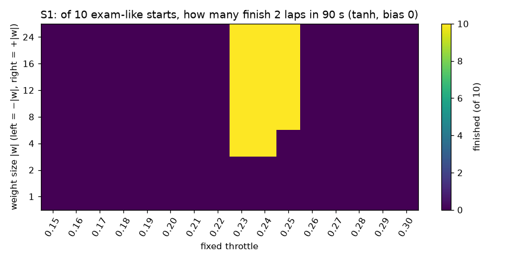
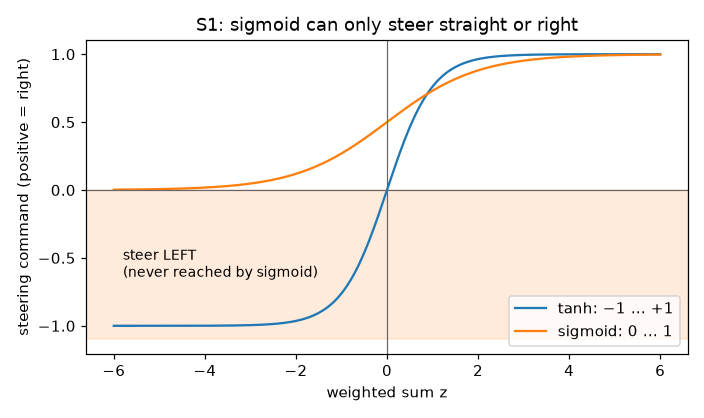
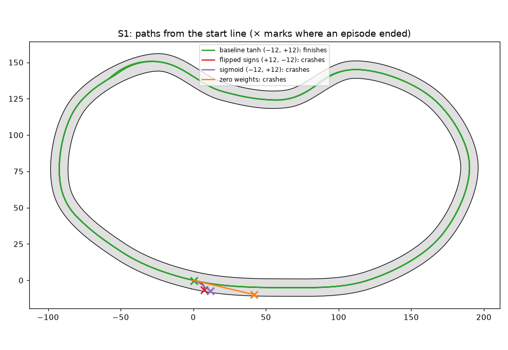

# Study S1 — How far can a hand-wired single neuron go, and why does sigmoid fail as a steering output?

Task 1.10 (Milestone 1). Everything below can be regenerated with
`uv run --with matplotlib python scripts/study_s1.py --figures` (about 16 minutes; every run is
deterministic, so the numbers come out the same). Raw numbers: `docs/studies/S1_results.json`.
Code state: the commit that adds this file.

## Question and hypothesis

**Question.** One neuron reads two numbers (the far-left and far-right ray readings), and its output
steers the car at a fixed throttle. How far can hand-chosen weights take it, and why is a sigmoid
neuron a bad steering controller?

**Hypotheses** (written before the grid below was run; two small exploratory sweeps over weight
size and throttle came first, only to choose the ranges):

- **H1.** Weights of opposite sign steer the car away from the nearer wall and complete laps; the
  same weights with the signs swapped steer it into the wall and crash within a few seconds.
- **H2.** A sigmoid neuron cannot drive this track, whatever its weights and bias: its output is
  never below 0, so it can never steer left, and the track mostly bends left (counter-clockwise).
- **H3.** With a fixed throttle the neuron cannot brake, so its speed is set by the throttle alone.
  Too slow and it misses the 90 s limit; too fast and it cannot get round the bends. I expect a
  narrow window of throttles that finish two laps.

## What changed versus what was held fixed

- **Changed (one thing at a time):** the weight size |w| (left weight −|w|, right weight +|w|), the
  fixed throttle, the sign pattern of the weights, the activation (tanh or sigmoid), and the bias.
- **Held fixed:** track `train_loop_01` (731 m, 12 m wide), physics v1, observation v1, the rays
  read (far left and far right), no randomness in the world, the Driving Exam v1 limits (90 s,
  2 laps, the stall rule).
- **Not used:** no held-out track exists yet (they arrive in Phase 5), so every result is on the
  training track only.

## Setup

- Controller: `NeuronPolicy` (steer = f(w_left·d_left + w_right·d_right + bias), fixed throttle).
- **Exam-like starts:** the ten starts of Driving Exam v1: 0, 20, 40, 60 and 80 % of the track,
  centred, and the same five shifted 1.5 m to the left. All ten cars run together in one world.
  The real `nd exam` arrives in task 5.4; the starts and limits are the same.
- **Seeds:** the world is deterministic, so repeating a run changes nothing. Spread comes only from
  the starting place. For the headline controller I also used **10 seeds (0 to 9)** of random
  starts (random place on the loop, up to 1.5 m sideways, up to 0.1 rad of heading).
- Runs: 112 exam-like grid runs (16 throttles × 7 weight sizes), 17 for the fine throttle sweep,
  controls, bias, 108 sigmoid runs, 10 seeds. Run IDs are the table rows in the JSON file.
- Baseline saved as `configs/baselines/hand_neuron.yaml`: weights −12 and +12, bias 0, tanh,
  throttle 0.24.

## Results

### Weights of opposite sign complete the exam; the throttle decides everything else

Finished episodes out of ten exam-like starts (second number: crashed). Bias 0, tanh. The full
16 × 7 grid is in the JSON file; `figures/s1_grid.png` shows all of it.

| throttle | \|w\|=1 | 2 | 4 | 8 | 12 | 16 | 24 |
|---|---|---|---|---|---|---|---|
| 0.20 | 0 / 10 | 0 / 0 | 0 / 0 | 0 / 0 | 0 / 0 | 0 / 0 | 0 / 0 |
| 0.22 | 0 / 10 | 0 / 0 | 0 / 0 | 0 / 0 | 0 / 0 | 0 / 0 | 0 / 0 |
| 0.23 | 0 / 10 | 0 / 8 | **10 / 0** | **10 / 0** | **10 / 0** | **10 / 0** | **10 / 0** |
| 0.24 | 0 / 10 | 0 / 10 | **10 / 0** | **10 / 0** | **10 / 0** | **10 / 0** | **10 / 0** |
| 0.25 | 0 / 10 | 0 / 10 | 0 / 10 | **10 / 0** | **10 / 0** | **10 / 0** | **10 / 0** |
| 0.26 | 0 / 10 | 0 / 10 | 0 / 10 | 0 / 10 | 0 / 10 | 0 / 10 | 0 / 10 |
| 0.28 | 0 / 10 | 0 / 10 | 0 / 10 | 0 / 10 | 0 / 10 | 0 / 10 | 0 / 10 |

A finer sweep with \|w\| = 12 (`figures/s1_throttle_window.png`):

| throttle | outcome (10 starts) | median progress (fraction of 2 laps) | median finish time |
|---|---|---|---|
| 0.200 to 0.225 | all 10 time out | 0.876 to 0.985 | none |
| 0.230 | 10 finish | 1.000 | 89.5 s |
| 0.240 | 10 finish | 1.000 | 86.2 s |
| 0.250 | 10 finish | 1.000 | 83.4 s |
| 0.255 | 10 crash | 0.780 | none |
| 0.260 to 0.280 | 10 crash | 0.677 down to 0.475 | none |

- With the throttle at 0.23 to 0.25 the steady speed (80 × throttle in this physics) is 18.4 to
  20 m/s. Slower, and 2 laps do not fit in 90 s; faster, and the car crashes in a bend. The
  window is only about 0.02 of throttle wide.
- Once the weights are big enough (|w| of 4 at throttle ≤ 0.24, 8 at 0.25) their size makes no
  difference to completion; 4, 8, 12, 16 and 24 all finish.
- Small weights (|w| of 1 or 2) cannot steer hard enough to follow the bends, so they crash at
  throttles where the larger ones do not.
- Throttles of 0.15 to 0.22 show 0 finished and 0 crashed for \|w\| of 2 or more: those cars drive
  safely and slowly, but all ten run out of time before the second lap is done.

### The baseline

Weights −12 and +12, bias 0, tanh, throttle 0.24 (`configs/baselines/hand_neuron.yaml`):

| test | result |
|---|---|
| 10 exam-like starts | 10 finish, median progress 1.000 |
| from the start line | finishes 2 laps in 86.3 s (2588 steps), recorded and replayed identically |
| 10 seeded random starts (0 to 9) | 10 finish; progress median 1.000, IQR 1.000 to 1.000; median finish time 86.2 s |
| bias −0.4 to +0.4 | all 10 exam starts finish for every bias tried |

With 10 of 10 finishing, the interquartile range is zero, which means there was no variation
to report on this track, not that the controller is perfect. The study has one controller and one
track.

### Controls: break one thing at a time (throttle 0.24)

| controller | 10 exam-like starts | from the start line |
|---|---|---|
| baseline, tanh, −12 / +12 | 10 finish | finishes (86.3 s) |
| zero weights | 10 crash, median progress 0.022 | crashes at 7.5 s, 42 m |
| flipped signs, +12 / −12 | 10 crash, 0.004 | crashes at 3.6 s, 9 m |
| only the left weight | 10 crash, 0.004 | crashes at 3.1 s |
| only the right weight | 10 crash, 0.004 | crashes at 3.0 s |
| sigmoid, −12 / +12, bias 0 | 10 crash, 0.009 | crashes at 4.0 s, 13 m |
| sigmoid, −12 / +12, bias −6 | 10 crash, 0.021 | crashes at 7.4 s, 41 m |

### Sigmoid: no setting works

108 sigmoid runs from the start line: weights 1 to 30, bias −8 to +2, throttles 0.15, 0.20 and 0.24.

- **None finished.** The best reached 42 m, which is under 3 % of the 2 laps.
- **The most negative steering command ever issued in any of them was 0.0** (rounded to four
  decimals; the smallest values are sigmoid outputs of about 0.0001). Not one was below zero: a
  sigmoid neuron never once steered left.

## Failure analysis

Three failures, each reproduced in the linked views: Driver "Neuron" in the Environment page,
then the weights typed into the Network page, then Play (the live session gives the same step
numbers as the study script).

| failure | run | step | what the Network view shows at the end |
|---|---|---|---|
| flipped signs | `train_loop_01` from the start line, weights +12 / −12, throttle 0.24 | 109 (3.63 s) | inputs 0.046 and 0.030; contributions +0.55 and −0.36; z = +0.19; tanh output +0.185 |
| sigmoid | same, weights −12 / +12, sigmoid | 121 (4.03 s) | inputs 0.467 and 0.020; contributions −5.61 and +0.24; z = −5.37; sigmoid output **+0.005** |
| zero weights | same, all weights 0 | 225 (7.50 s) | inputs 0.298 and 0.020; z = 0; steer 0.000 |

All three leave through the right-hand edge of the first stretch of road, where the road starts to
curve to the left. Two of them steer right (towards the edge they leave by); zero weights goes
straight while the road curves away.

- **Flipped signs.** The car starts centred, and as the road curves left it drifts towards the
  right-hand wall, so the right ray reads shorter than the left. With the signs swapped, that makes
  z positive and the car steers right, towards that wall. The error feeds itself: the steering
  command was never below +0.024 during the whole run and reached +1.0. This is positive feedback.
- **Sigmoid.** The run opens with a steering command of +0.49: on a straight stretch z is near 0
  and sigmoid(0) = 0.5, a half-strength right turn all the time. By the moment of the crash the
  neuron is saying the right thing: the right wall is 1 m away (reading 0.020), the left wall far
  (0.467), so z = −5.4, a strong "steer left". But sigmoid turns −5.4 into +0.005, which the car
  reads as "straight". The information was there; the output could not express it.
- **Zero weights.** Steering is exactly 0, so the car goes straight and leaves the first bend.

## Conclusion

Supported by the evidence (on one training track, with deterministic physics):

- **H1 supported.** Opposite-sign weights finish the Driving Exam's 2 laps in about 86 s from all
  ten exam starts and all ten seeded random starts. Swapping the signs, or using only one weight,
  crashes within 3.6 s in every case.
- **H2 supported for this track.** 108 sigmoid settings and two controls never finished; the most
  negative steering ever commanded was 0.0. The reason is the range of the output (0 to 1, never
  negative), not the choice of weights. (I did not test a mirrored, clockwise track, where a
  right-only steerer might do better. That would be a good follow-up.) Follow-up done in
  [Study S1b](S1b.md): on Monza clockwise the best sigmoid setting got 215 m, against 86 m
  counter-clockwise, and neither got past the first bends.
- **H3 supported, with a sharper result than expected.** Only throttles of about 0.23 to 0.25 finish
  2 laps in 90 s; the window is the gap between the 90 s limit and the grip limit. A neuron with
  no way to brake cannot do better than sit in that window.

Uncertain: nothing here says how the baseline behaves on tracks it has not seen, with other
starting speeds, or in the real exam (task 5.4); and a single run per start is all that is
possible while the world has no randomness.

## What this teaches about AI

A model's weights are its behaviour, but the shape of its output decides what behaviour is even
possible: no choice of weights can make a sigmoid neuron say "left". Getting the representation
right (here, an output that can be negative) matters before any learning algorithm is involved, and
a learning algorithm can only search among the behaviours the design allows. It also shows that
"works" can be a thin window: this controller only drives within a 0.02-wide band of one setting
the designer chose for it, which is one reason later phases ask a network to control the throttle
as well.
