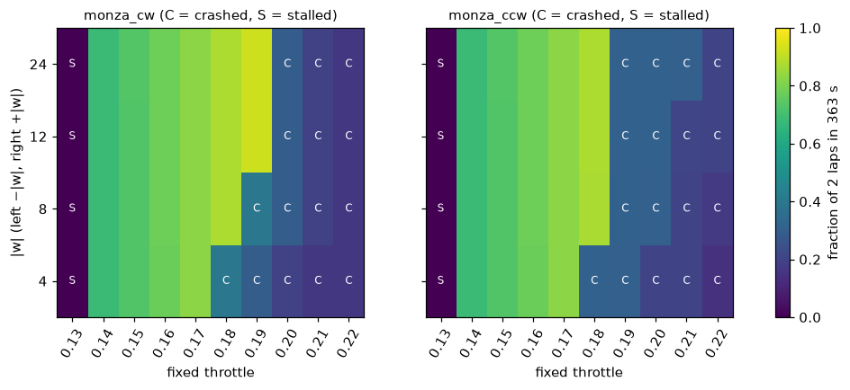
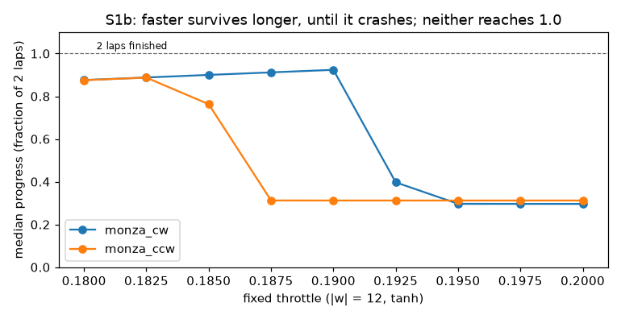
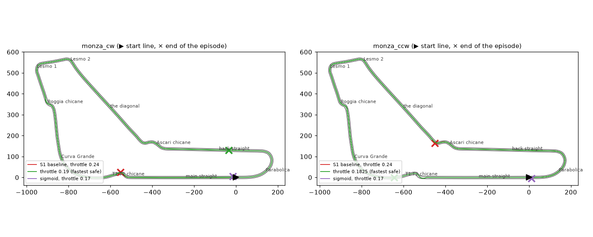

# Study S1b — The hand-wired neuron on Monza, clockwise and counter-clockwise

Task 1.12 (follow-up to [Study S1](S1.md)).

## Question and hypotheses

**Question.** The S1 neuron was tuned on one small loop. What happens on a real circuit it has
never seen (half-size Monza, 2,900 m), driven both ways round? And does a sigmoid neuron, which can
only steer right, do any better on a clockwise track?

**Hypotheses** (written after one exploratory throttle sweep with weights −12 / +12, used only to
choose the ranges, and before the runs below):

- **H1 (transfer fails).** The S1 baseline (throttle 0.24) crashes in both directions, in the
  first chicane it reaches. A chicane bend of radius r ≈ 11 to 12 m can be taken at no more than
  √(9 · r) ≈ 10 m/s before the tyres slide (the grip limit), and throttle 0.24 holds about 19 m/s.
- **H2 (no fixed throttle fits).** No fixed throttle and weight size finishes 2 laps within the
  363 s limit in either direction: the throttles slow enough to survive every bend are too slow
  to finish in time.
- **H3 (the directions differ).** The fastest throttle that survives is not the same clockwise and
  counter-clockwise, because each corner is met from a different straight, at a different angle.
- **H4 (sigmoid and direction).** Sigmoid gets further clockwise (where the bends are mostly
  right-handers) than counter-clockwise, but finishes neither, because every chicane also needs a
  left turn.
- **H5 (the sign logic transfers).** At a throttle slow enough to be safe, flipped signs and zero
  weights still crash in both directions, while −12 / +12 does not.

## What changed versus what was held fixed

- **Changed:** the track (half-size Monza, never used to tune the neuron), the driving direction,
  the fixed throttle, the weight size \|w\| (left weight −\|w\|, right +\|w\|), the activation.
- **Held fixed:** physics v1, observation v1, the two rays the neuron reads, bias 0 (except in the
  sigmoid grid), the exam-like starts of S1, 2 laps, the stall rule.
- **New rule:** the time limit is set per track (ADR-022): 2 laps at an average of 16 m/s, rounded
  up, so 363 s on Monza. S1 used a fixed 90 s on `train_loop_01`.

## Setup

- Tracks: `monza_cw` (racing direction, `train`) and `monza_ccw` (the same road the other way,
  `heldout`); 2,900 m a lap, 12 m wide.
- Starts: the ten exam-like starts of S1 (0, 20, 40, 60 and 80 % of the lap, centred and 1.5 m
  left), all ten cars in one world; single runs from the start line; 10 seeded random starts
  (seeds 0 to 9) for the best setting.
- Runs, per direction: E1 grid of 10 throttles (0.13 to 0.22) × 4 weight sizes (4, 8, 12, 24);
  E2 fine sweep from 0.180 to 0.200 in steps of 0.0025; E3 the fastest safe throttle with a 900 s
  limit; E4 the S1 baseline (throttle 0.24); E5 controls at throttle 0.17; E6 24 sigmoid
  settings; E7 seeds. Once: E8, S1's throttle window re-run on `train_loop_01` under its new
  92 s limit.
- Regenerate everything with `uv run --with matplotlib python scripts/study_s1b.py --figures`
  (26 minutes; deterministic). Raw numbers: `docs/studies/S1b_results.json`. Code state: the
  commit that adds this file.
- **Bend radius and grip speed.** The radius in the tables is the tightest centreline radius in
  the 40 m before the crash, measured over 10 m (the heading change across ±5 m). It comes out
  larger than the 11.3 m the track loader finds over 1 m, because it averages over 10 m. The grip
  speed √(9 · r) is the fastest a car can follow that radius. A car can cut across the 12 m road
  on a wider arc, so the grip speed is a cautious estimate.

## Results

### No setting finishes: a throttle slow enough to survive is too slow for the time limit

Median progress as a fraction of 2 laps (ten exam-like starts, \|w\| = 12, tanh, bias 0):

| throttle | `monza_cw` | `monza_ccw` |
|---|---|---|
| 0.13 | 0.000, all stall | 0.000, 9 stall, 1 time out |
| 0.14 | 0.681, all time out | 0.681, all time out |
| 0.17 | 0.828, all time out | 0.827, all time out |
| 0.18 | 0.876, all time out | 0.875, all time out |
| 0.1825 | 0.888, all time out | **0.887, all time out (fastest safe)** |
| 0.185 | 0.900, all time out | 0.763, 6 crash, 4 time out |
| 0.19 | **0.924, all time out (fastest safe)** | 0.312, all crash |
| 0.1925 | 0.397, all crash | 0.312, all crash |
| 0.20 | 0.296, all crash | 0.312, all crash |

- **None of the 80 grid runs or 18 fine-sweep runs finished.** Every one timed out, crashed or
  stalled.
- **The fastest safe throttle** is 0.19 clockwise and 0.1825 counter-clockwise. With no time
  pressure (a 900 s limit), those settings do finish 2 laps from the start line, in **392.1 s**
  clockwise and **407.9 s** counter-clockwise: 8 % and 12 % more than the 363 s limit.
- **Throttle 0.13 cannot even get going.** Full throttle accelerates at 8 m/s², so 0.13 gives
  1.04 m/s² and just under 2 m in the first 2 s, short of the stall rule's 2 m. Its steady speed,
  80 × 0.13 = 10.4 m/s, would also be too slow: 2 laps would take about 560 s.
- **Weight size matters a little here, unlike on the S1 loop.** At throttle 0.18 |w| = 4 crashes
  in both directions while 8, 12 and 24 survive; at 0.19 clockwise |w| = 8 crashes while 12 and
  24 survive. Bigger weights turn a small difference between the two rays into a firmer steer.
- **Ten seeded random starts** at the fastest safe throttle all time out: median progress 0.924
  clockwise (IQR 0.924 to 0.924) and 0.887 counter-clockwise (IQR 0.887 to 0.888).

### The S1 baseline crashes in the first tight bend, too fast for its grip

Throttle 0.24 holds about 19 m/s. All ten exam-like cars crashed in both directions (median
40.8 s clockwise, 53.4 s counter-clockwise). Each crash happened in a bend whose grip speed is
12.4 to 15.7 m/s, while the car was doing 18.0 to 19.2 m/s.

| direction | from the start line | where the ten exam-like cars crashed |
|---|---|---|
| clockwise | 38.9 s, 557 m: T1-T2 chicane at 18.8 m/s (bend 17.5 m, grip speed 12.5 m/s) | T1-T2 (4), Roggia (2), Ascari (4) |
| counter-clockwise | 55.1 s, 865 m: Ascari chicane at 19.1 m/s (bend 24.1 m, grip speed 14.7 m/s) | Ascari (4), Lesmo 2 (2), Lesmo 1 (2), T1-T2 (2) |

The ten exam-like starts are five places, each used twice (centred and 1.5 m left). Both cars from
the same place always crashed in the same corner, within 0.1 s of each other.

### Controls at a safe throttle (0.17)

| controller | `monza_cw`: exam-like / from the start line | `monza_ccw`: exam-like / from the start line |
|---|---|---|
| tanh −12 / +12 | 10 time out (0.828) / times out at 4,800 m | 10 time out (0.827) / times out at 4,799 m |
| zero weights | 10 crash (0.053) / 48.5 s, T1-T2 chicane | 10 crash (0.016) / 14.4 s, Parabolica |
| flipped signs +12 / −12 | 10 crash (0.001) / 5.5 s, 15 m | 10 crash (0.001) / 5.2 s, 13 m |
| sigmoid −12 / +12, bias 0 | 10 crash (0.002) / 5.0 s, 13 m | 10 crash (0.002) / 5.0 s, 13 m |
| sigmoid −12 / +12, bias −6 | 10 crash (0.025) / 21.8 s, 176 m | 10 crash (0.015) / 13.7 s, 85 m |

### Sigmoid, both directions

24 settings per direction (bias −6, −4, −2 and 0; \|w\| 4, 12 and 24; throttle 0.14 and 0.17),
from the start line:

| | `monza_cw` | `monza_ccw` |
|---|---|---|
| finished | none | none |
| median progress | 46.0 m | 44.3 m |
| best | 214.6 m (bias −6, \|w\| 24, throttle 0.14) | 85.5 m (the same setting) |
| most negative steering ever | 0.0 | 0.0 |

### S1 under the new time limit (`train_loop_01`, 92 s)

The S1 baseline still finishes in 86.2 s from all ten exam-like starts. The 2 extra seconds widen
S1's window by one step: throttle 0.225 now finishes, in 91.25 s (at 90 s it fell 1.5 % short),
so the window is 0.225 to 0.25.

## Failure analysis

To reproduce in the linked views:
1. Choose track `monza_cw` or `monza_ccw` and driver "Neuron".
2. On the Network page, set the weights to −12 and +12 and the throttle as given.
3. Press Play. Speed 8 helps for the long runs.

- **The baseline at the T1-T2 chicane (clockwise, 38.9 s).** After 550 m of straight, the car
  reaches the first chicane at 18.8 m/s. Its tightest bend measures 17.5 m, which tyres can follow
  only below about 12.5 m/s. The neuron does steer hard: in these runs its steering reaches −1.0,
  full lock.
  But at that speed the grip limit caps how tight the car can actually turn. It slides wide and
  leaves the road. The neuron cannot slow down, because braking is not one of its outputs.
- **The first crash above the safe throttle (clockwise, 0.1925).** The car survives the whole first
  lap, then crashes on the second, at 235.3 s, in the same T1-T2 chicane. On both laps it enters
  the chicane on the same centred line; the only difference is speed. On lap 1 it is still
  accelerating and arrives at 15.2 m/s; on lap 2 it has reached its steady 15.4 m/s. Those
  0.2 m/s are the whole margin between surviving and crashing.
- **Counter-clockwise at 0.185, the edge case.** Six of the ten exam-like cars crash and four,
  including the one from the start line, time out. At this throttle, whether a car survives
  depends on where it started.
- **Sigmoid.** With bias 0, the run opens with a steady half-strength right turn
  (sigmoid(0) = 0.5) and leaves the main straight within 13 m in both directions, exactly as on
  the S1 loop. With bias −6 the car goes straight for longer and gets furthest clockwise (176 m at
  0.17, 215 m at 0.14), but it never steers left, not once in 48 runs.

## Conclusion

- **H1 supported, with one correction.** The S1 baseline crashes in both directions, every time in
  a bend whose grip speed (12.4 to 15.7 m/s) is far below its 19 m/s. From the start line that is
  the first chicane in each direction: T1-T2 clockwise, Ascari counter-clockwise. Some exam-like
  cars crashed first in the Lesmo bends, which are not chicanes, so "the first tight bend" is the
  accurate wording.
- **H2 supported.** No fixed throttle and no weight size finished 2 laps in 363 s in either
  direction. The fastest safe throttle needs 392 s clockwise and 408 s counter-clockwise.
- **H3 supported, by a small margin.** The fastest safe throttle is 0.19 clockwise and 0.1825
  counter-clockwise. The corners that end the runs differ too.
- **H4 supported only weakly.** The best sigmoid run went 215 m clockwise against 86 m
  counter-clockwise, but the medians are almost the same (46 m and 44 m), and no run got past
  the first bends. A right-only steerer gains almost nothing from a clockwise track, because the
  chicanes and the straights still need left corrections.
- **H5 supported.** At a safe throttle the −12 / +12 neuron never crashed, while flipped signs
  (after about 5 s), zero weights and sigmoid crashed every time, in both directions.

Uncertain: whether a bias or a third input (the centre ray, or the speed) could open a window. A
single neuron with a fixed throttle was the only design tested.

## What this teaches about AI

A controller tuned in one setting carries that setting's assumptions with it. The S1 neuron's
critical setting was not its weights but its throttle, chosen for a loop whose tightest bend allows
19 m/s. On a circuit with 12 m/s chicanes, the same weights still steer correctly: the sign logic
transfers, which is why the right signs survive at a lower throttle and the wrong ones still
crash. But a fixed throttle cannot be fast on the straights and slow in the chicanes at the same
time. So the failure lies in what the controller can express, not in how it was tuned. A neuron
with no "brake" output can never learn to brake, however good the learning algorithm. That is why
the Phase 2 networks also choose the throttle.
