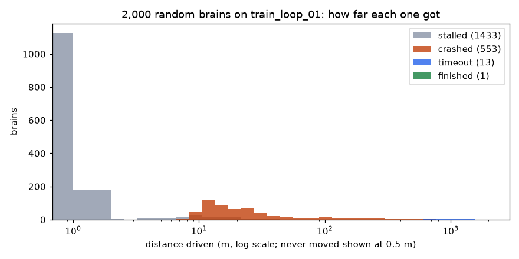
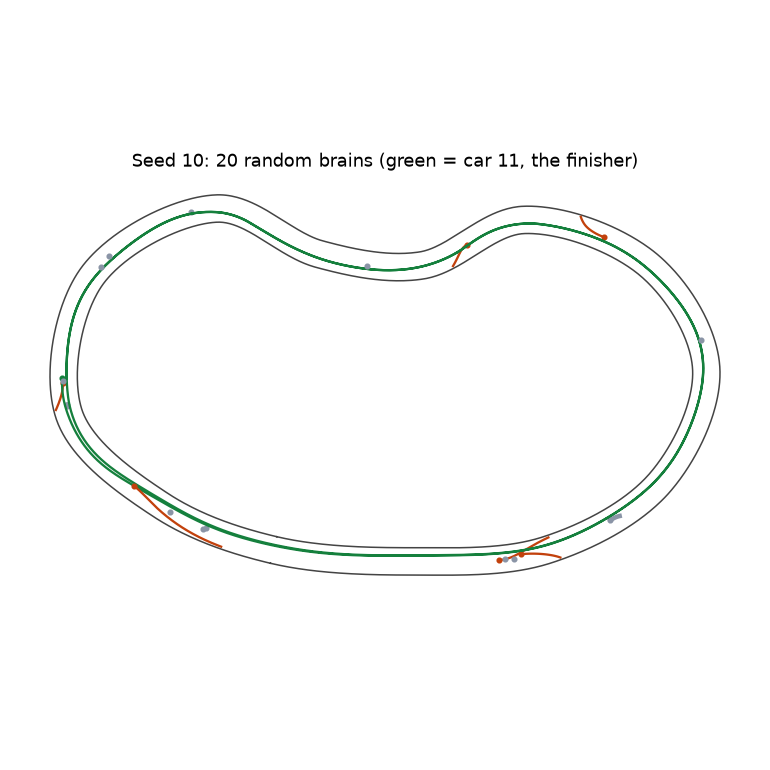
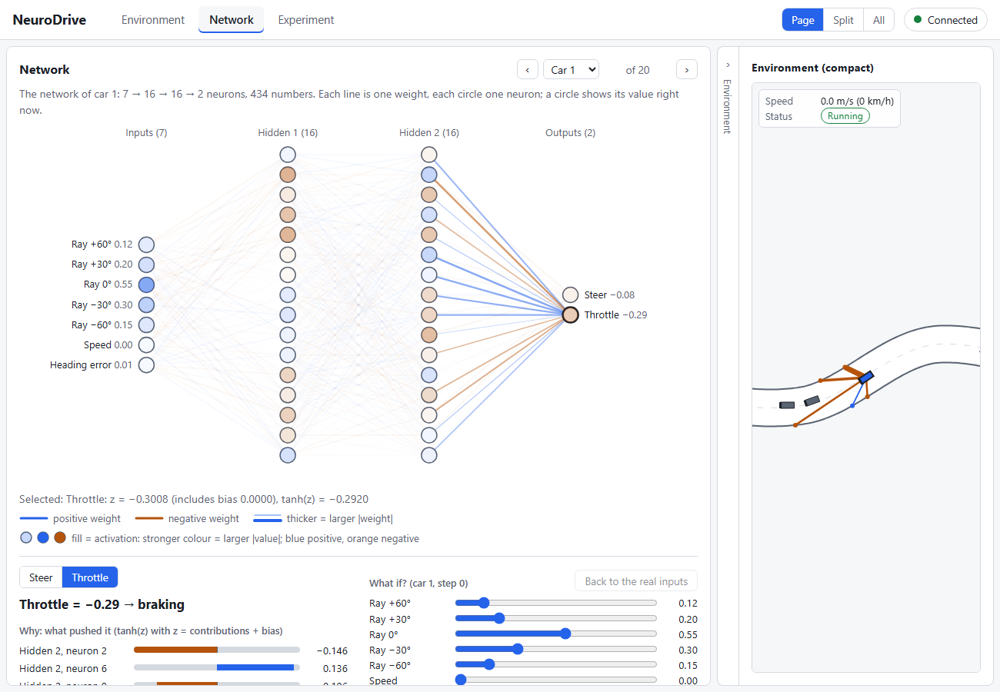
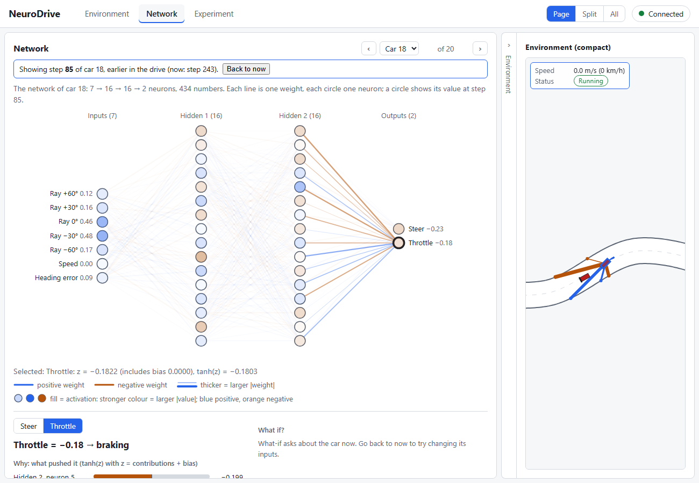
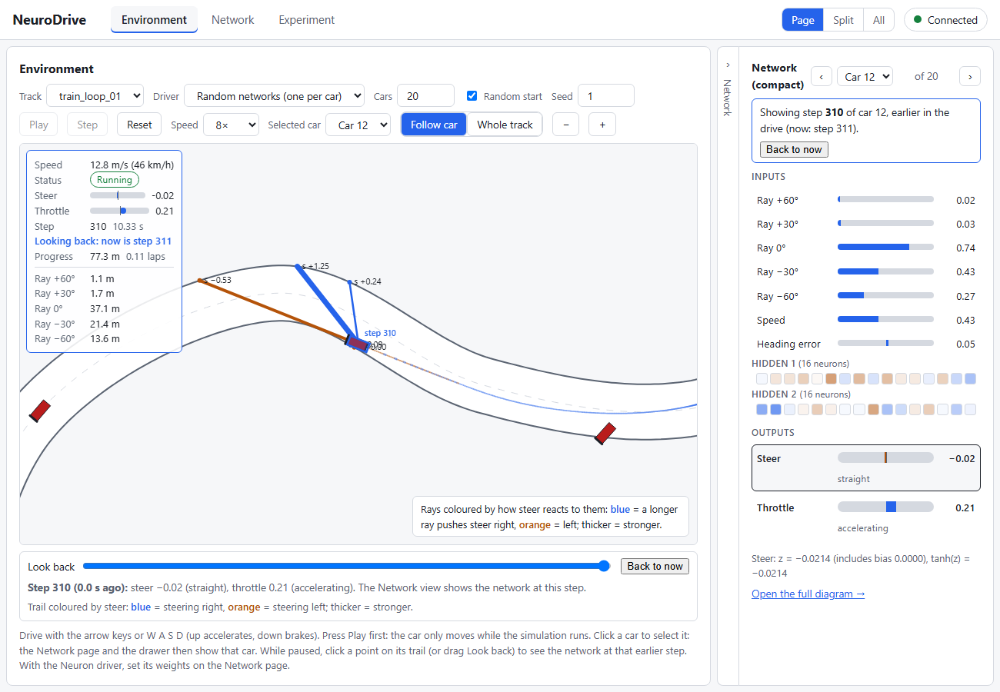
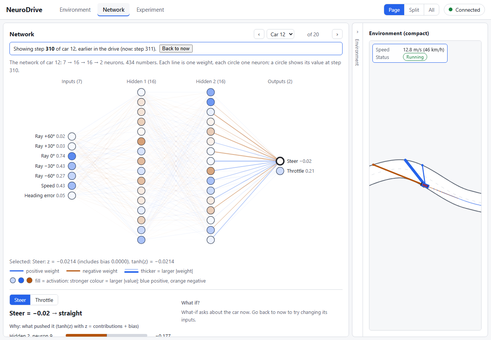
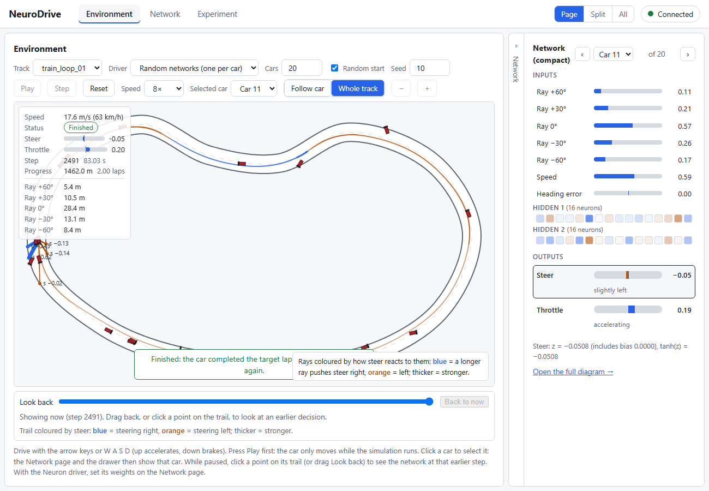
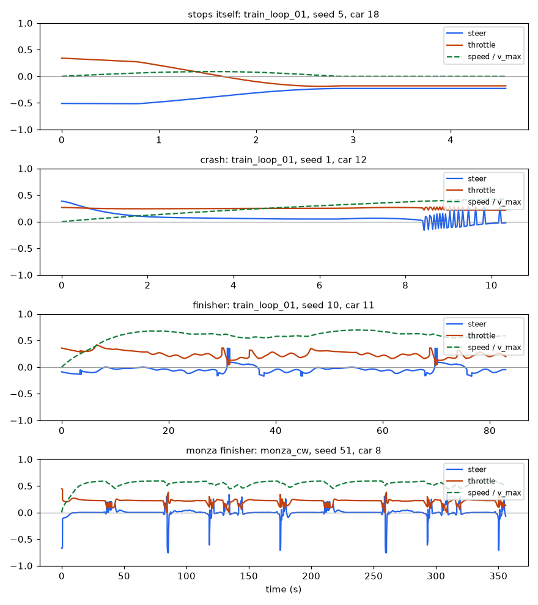
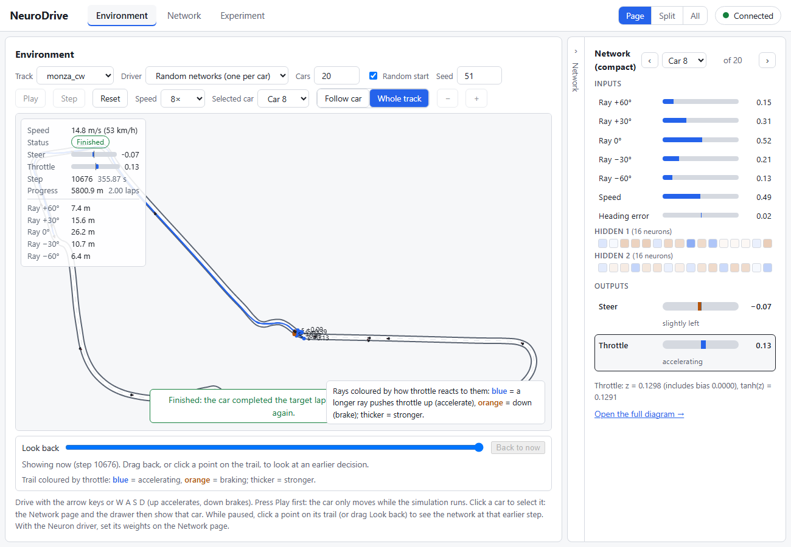
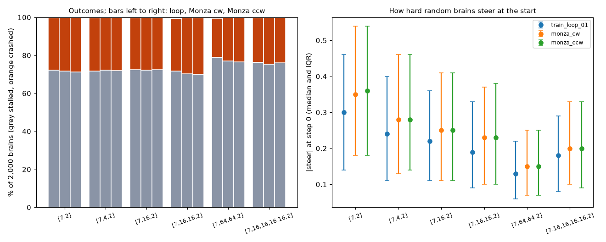

# Study S2a — What do random networks do, and can the views explain why?

Task 2.12. Follows [Study S1](S1.md) and [S1b](S1b.md), which used one hand-wired neuron.
Extended at the user's request with half-size Monza (both directions) and five more network
shapes: 36,000 random brains in all.

## Question and hypotheses

**Question.** Give every car its own untrained network: a [7, 16, 16, 2] tanh network whose 434
weights are drawn at random (Xavier initialisation, biases zero). What do these "random brains" do
on `train_loop_01`, and can the Environment view, the Network view, the output inspector and the
decision trail explain *why* a particular car does what it does?

**Hypotheses** (written after task 2.6 had shown that seed 0's twenty brains mostly stall or crash,
and before the runs below):

- **H1 (nothing drives).** Almost no random brain finishes 2 laps; most stall or crash within
  seconds.
- **H2 (circling).** Some brains steer hard one way all the time and drive in circles.
- **H3 (stalling is a coin flip).** A car that never moves is one whose throttle happens to be
  negative at the start: at a standstill braking keeps the speed at 0, so the inputs never change
  and the network keeps deciding the same thing.
- **H4 (crashes come from wrong wiring).** A crashing car is blind to, or steers towards, the wall
  it hits. Among crashers, the signs of steer's sensitivity to the side rays look like coin flips.
- **H5 (the views are enough).** For each chosen car, the receipt and the sensitivity table name
  the inputs and hidden neurons behind the decision, and the straight-line prediction from the
  sensitivity accounts for most of how the output changes over time.

Added for the extension (written after a 20-seed trial of the grid, before the full runs):

- **H6 (the track hardly matters).** On half-size Monza the shares of stalls and crashes are about
  the same as on the loop, because a random brain fails in its first few metres, long before it
  meets anything special about the track.
- **H7 (the shape matters through the first layer).** Wider first layers give gentler outputs
  (Xavier gives them smaller weights), so more stalls and fewer crashes; depth alone changes
  little. No shape circles.

## What changed versus what was held fixed

- **Changed:** the networks (100 seeds × 20 brains = 2,000 random networks per configuration),
  the start of each car (seeded random starts), and in the extension the track (3) and the network
  shape (6): 18 configurations, 36,000 brains.
- **Held fixed:** physics v1, observation v1, tanh in every layer, Xavier initialisation with
  biases 0, the exam rules (2 laps, the stall rule, the per-track time limit of ADR-022: 92 s on
  the loop, 363 s on Monza).
- No learning happens anywhere in this study.

## Setup

- Track `train_loop_01` (731 m loop, 12 m wide). Each seed s gives 20 cars, built exactly as the app
  builds "Random networks, Random start, seed s": the networks from the seed's `init` stream, the
  starts (position, up to 1 m sideways, up to 0.1 rad of heading) from the seed itself. **Car c of
  seed s here is car c of seed s in the app**, checked step for step by
  `tests/server/test_study_s2a.py`.
- Seeds 0 to 99. Every episode runs until all 20 cars have stopped.
- Tracks: `train_loop_01`, `monza_cw` and `monza_ccw` (2,900 m a lap, 12 m wide, bends down to
  11.3 m radius).
- Shapes, all tanh: [7, 2] (no hidden layer, 16 parameters), [7, 4, 2] (42), [7, 16, 2] (162),
  **[7, 16, 16, 2]** (the app's shape, 434), [7, 64, 64, 2] (4,802) and [7, 16, 16, 16, 16, 2]
  (978). For seed s, car c gets the c-th network drawn from the seed's `init` stream in every
  configuration, so a [7, 16, 16, 2] brain is the same network on all three tracks; only its start
  differs. Only [7, 16, 16, 2] can be loaded in the app.
- The stall rule: a car whose progress over the last 3 s is under 2 m is stopped, checked from 2 s
  on.
- Regenerate everything with `uv run --with matplotlib python scripts/study_s2a.py --figures`
  (about 50 minutes; deterministic: a second full run reproduced every number). Raw numbers: `docs/studies/S2a_results.json`. The view
  screenshots were taken from the app (light theme) at the steps named below.
- **Wiring signs.** For a car's network at one observation, s_k is the sensitivity of steer to
  input k (central differences, task 2.9): how much steer moves per unit change of that input. A
  wall-avoiding driver has s < 0 for the two left rays (+60°, +30°: when the left wall comes closer,
  the ray gets shorter and steer should rise, meaning turn right) and s > 0 for the two right rays
  (−30°, −60°). "Right signs" counts how many of these four are right (0 to 4).
- **Straight-line breakdown.** To explain why an output changed between two steps, each input k
  gets the share s_k × (its change), with s_k the sensitivity at the later step; the shares add up
  to a predicted change. It treats the network as a flat slope around that moment, so it is
  trusted only when the predicted change comes close to the real one. Example: s = −0.5 for the
  centre ray, which grows by 0.3, gives a share of −0.15; s = −0.01 for the +60° ray, which shrinks
  by 0.05, gives +0.0005. The output is predicted to fall by about 0.15, almost all of it because
  of the centre ray.

## Results

### What 2,000 random brains do

| Outcome | Brains | Share |
|---|---:|---:|
| Stalled | 1,433 | 72 % |
| Crashed | 553 | 28 % |
| Still driving at 92 s (timeout) | 13 | 0.65 % |
| Finished 2 laps | 1 | 0.05 % |

- Of the brains that moved at all, the median distance was 11.6 m (IQR 1.5 to 21.5 m) and the
  median top speed 5.0 m/s (IQR 1.4 to 8.1).
- Crashes come early: median 4.6 s after the start (IQR 3.4 to 6.6 s), at a median 7.5 m/s (IQR
  5.6 to 10.0). The wall was on the right in 318 crashes and on the left in 235.
- **The 13 timeouts** survived all 92 s but were too slow: they covered 515 to 1,387 m, short of the
  1,462 m of 2 laps.
- **The one finisher** (seed 10, car 11) completed 2 laps in 83.0 s, cruising at 16.3 to 21.0 m/s.

### Why so many stall: a coin flip at the start (H3 supported)

The stall rule ended 1,433 cars, for four different reasons:

| Why it stalled | Cars |
|---|---:|
| Never moved | 962 |
| Too slow off the line: still speeding up at 2 s, but under 2 m covered | 339 |
| Moved, then braked itself to a standstill | 118 |
| Crawled: moving, but under 2 m in some 3 s | 14 |

- 956 of the 962 cars that never moved had a **negative throttle at step 0** (the other 6 had a
  throttle so small the car crept under 5 cm/s). Over all 2,000 brains the first throttle was
  positive for 1,044 (52 %): a coin flip, as expected from weights drawn symmetrically around 0
  and biases of 0.
- A car at rest that brakes stays at rest (speed is clamped at 0), so its observation never changes
  and its network gives the same answer at every step until the stall rule ends it at 2 s.
- All 118 self-stoppers were braking (throttle < 0) when they stopped, after reaching a median
  3.5 m/s (IQR 2.8 to 4.7).

### Why no car circles (H2 rejected)

- No brain ever turned more than 76° relative to the road, and no moving brain held
  |steer| > 0.9 for even one step.
- Untrained tanh outputs stay moderate. Steer is tanh of a sum of 16 contributions that are about
  as often negative as positive, so they mostly cancel. In the cases below |steer| never exceeds
  0.52.
- Even at full lock a circle does not fit. The car physics alone, at full lock and 3 m/s, drives a
  circle **9.15 m across**, matching the formula 2 × wheelbase / tan(δ_max) = 2 × 2.5 / tan 0.5 =
  9.15 m. A car in the middle of the 12 m road has 6 m to each edge, less its own 1 m half-width.
  So a car that kept turning one way would hit the wall before closing a circle.

So the roadmap's "circling car" does not occur on this track. The cases below explain the four
behaviours that do.

### Crashes: wired like coin flips, often steering into the wall (H4 supported)

| Side-ray signs right | 0 | 1 | 2 | 3 | 4 |
|---|---:|---:|---:|---:|---:|
| Crashed cars (553) | 45 | 128 | 214 | 138 | 28 |
| Four fair coin flips would give | 34.6 | 138.2 | 207.4 | 138.2 | 34.6 |
| Long drivers (13 timeouts + 1 finisher) | 0 | 0 | 1 | 5 | 8 |

- At the moment of the crash, 341 of the 553 crashers (62 %) were steering *towards* the wall they
  hit.
- The ±30° pair (s < 0 for +30°, s > 0 for −30°) was right in 128 crashers (23 %, chance 25 %) but
  in 13 of the 14 long drivers (93 %).
- So the brains that survive are the lucky ones whose random wiring happens to point the right way.

### Four cars, explained with the views (H5 supported)

**1. Brakes at a standstill: seed 1, car 1** (never moves; stalled at 2.0 s)

- At step 0 the Network view shows throttle = −0.29 (braking). The inspector's receipt gives
  z = −0.301 with bias 0. The largest pushes are hidden-2 neuron 2 (−0.146), neuron 6 (+0.136) and
  neuron 9 (−0.106); the other 13 together add −0.184.
- **No single culprit.** It is the sum of 16 small random pushes that happens to land below 0.
- Throttle's sensitivity to speed is +0.24, so this network would want *more* throttle if it were
  moving. But it never moves, so that input never changes.

**2. Stops itself: seed 5, car 18** (moves, brakes to a stop; stalled at 4.6 s)

- **Start:** at step 0 the centre ray sees open road (50 m), steer is −0.51 (left) and throttle is
  +0.34.
- **Turning changes the inputs:** the car turns left, so by step 85 its centre ray has shortened to
  22.9 m and its −30° ray has lengthened from 9.6 to 24.1 m. Throttle is now −0.18.
- **Look back to step 85:** this network's throttle has sensitivity +0.58 to the centre ray (it
  brakes when the road ahead shortens, which looks sensible) and −0.83 to the −30° ray.
- **The straight-line breakdown of the change,** sensitivity × change of each input, as the
  what-if panel computes it:
  - the centre ray accounts for −0.32 of it;
  - the −30° ray accounts for −0.24.
  - Predicted −0.55; actual −0.52.
- So the car's own turn changes its view, and its accidental wiring answers by braking to a halt.

**3. Crash: seed 1, car 12** (drives 78 m, leaves the road at 10.37 s, 12.8 m/s)

- **Look back to step 310, its last decision.**
  - The +60° ray reads 1.1 m and the +30° ray 1.7 m: the left wall is right there.
  - Steer is −0.02, slightly *towards* it.
- **The sensitivity row explains it.**
  - Steer's slope to the +60° ray is −0.004: the right sign but nearly zero, so the car is
    practically blind on that side.
  - Its slope to the +30° ray is +0.094, the wrong sign.
  - What it listens to is the −30° ray (+1.25) and the centre ray (−0.53).
- **Over the last second** (step 280 to 310), steer fell from +0.23 to −0.02. The straight-line
  breakdown predicts −0.24 against an actual −0.25:
  - −0.17 from the centre ray;
  - −0.07 from the −30° ray;
  - 0.0002 from the +60° ray, even though that ray fell from 3.5 m to 1.1 m.
- **Chattering:** from 8.4 s on, steer jumps between about −0.15 and +0.3 at almost every step
  (the middle panel of the figure below). The centre ray is grazing the tip of the inner wall: a
  heading change of 0.005 rad (0.3°) moves its reading between 47 m and 16.5 m. Times the
  sensitivity of −0.53, that is a steer jump of about 0.32 (observed 0.33), which swings the heading
  back. The full wall search gives the same readings, so this is the geometry of a grazing ray, not
  a sensor fault.

**4. The finisher: seed 10, car 11** (2 laps in 83.0 s)

- **All four side-ray signs are right.** Steer's slopes to the +60°, +30°, −30° and −60° rays are
  −0.13, −0.14, +0.62 and +0.43 at the finish, and they barely change over the drive.
- **Its throttle limits its own speed.** Throttle's slope to the speed input is −0.30, so it eases
  off as it speeds up. It settles at 16 to 21 m/s with throttle 0.04 to 0.42.
- It is a lucky draw (the 1-in-16 wiring plus a self-limiting throttle), not a skill. It also
  chatters at one bend on each lap, at about 31 s and 70 s, when its −30° ray grazes a wall tip.

### Other tracks: half-size Monza, both directions (H6 supported)

| Track, shape [7, 16, 16, 2] | Stalled | Crashed | Timeout | Finished | Median distance of movers |
|---|---:|---:|---:|---:|---:|
| `train_loop_01` | 1,433 | 553 | 13 | 1 | 11.6 m |
| `monza_cw` | 1,408 | 586 | 4 | 2 | 12.5 m |
| `monza_ccw` | 1,401 | 594 | 4 | 1 | 12.7 m |

- Stalls and crashes come in the same shares on all three tracks, and the moving brains get the
  same median of about 12 m. A random brain fails in its first seconds; whether chicanes come later
  is irrelevant to it.
- Crashers' wiring signs are coin flips on Monza too. On `monza_cw` 46, 139, 228, 136 and 37
  crashers have 0 to 4 signs right, against 36.6, 146.5, 219.8, 146.5 and 36.6 for coin flips.
- **Yet random brains finish Monza.** Seed 51, car 8 does 2 laps of `monza_cw` in 355.9 s and
  seed 27, car 13 in 362.7 s (limit 363 s); seed 22, car 17 finishes `monza_ccw` in 361.9 s. In
  Study S1b no fixed-throttle neuron could finish Monza in either direction.
- **Surviving belongs to the brain, not the track.** Of the 14 [7, 16, 16, 2] brains that lasted
  92 s on the loop, 6 also lasted the full time or finished on Monza in at least one direction,
  against a base rate of about 0.3 % (5 or 6 brains in 2,000 per direction). Seed 18, car 5 and
  seed 27, car 13 last on all three tracks. The loop finisher (seed 10, car 11) is not among them:
  its luck did not travel.

**5. The Monza finisher: seed 51, car 8 on `monza_cw`** (2 laps in 355.9 s)

- **It slows for what is ahead.** After the first 30 s its speed stays between 14.0 and 17.7 m/s
  (5th to 95th percentile). Its throttle averages 0.14 when the centre ray is under half its range
  (a bend coming) and 0.23 when the road ahead is clear. The loop finisher does the same: 0.16
  against 0.30. A fixed throttle (S1b) cannot do this.
- **Its steering wiring is 3 of 4 right.** Steer's slopes to the +60°, +30°, −30° and −60° rays at
  the finish are +0.82, −1.15, +0.31 and +0.27. The +60° ray is wired the wrong way, but the +30°
  ray, which sees the left wall sooner in a bend, is wired strongly the right way and wins.
- Its steering also chatters at the same places on every lap (the bottom panel of the time-series
  figure): grazing rays again, at Monza's chicanes.

### Other network shapes (H7 supported)

Stalled, crashed, starting steer and crash time are for `train_loop_01`; the Monza rows look the
same (see `S2a_results.json`, key `grid`).

| Shape | Stalled | Crashed | Finished (loop / cw / ccw) | Median \|steer\| at step 0 | Median crash time |
|---|---:|---:|---|---:|---:|
| [7, 2] | 1,446 | 549 | 0 / 0 / 0 | 0.30 | 3.7 s |
| [7, 4, 2] | 1,433 | 563 | 1 / 2 / 1 | 0.24 | 3.9 s |
| [7, 16, 2] | 1,448 | 546 | 3 / 0 / 0 | 0.22 | 4.4 s |
| [7, 16, 16, 2] | 1,433 | 553 | 1 / 2 / 1 | 0.19 | 4.6 s |
| [7, 64, 64, 2] | 1,578 | 413 | 3 / 1 / 1 | 0.13 | 5.4 s |
| [7, 16, 16, 16, 16, 2] | 1,526 | 466 | 1 / 0 / 0 | 0.18 | 4.8 s |

- **Still no circling.** The largest turn relative to the road in any configuration is 91.5°.
  Near-full lock is rare (on average at most 0.11 % of a moving brain's steps) and appears only in
  the smaller shapes. The clearest would-be circler is seed 28, car 14 with [7, 16, 2]: it starts
  at steer 0.93 and holds near full lock, but its throttle is so weak that it covers only 1.1 m in
  2 s, so the stall rule ends it after turning 13°. At its 1.2 m/s, a full circle (29 m round)
  would take about 24 s, and the 9.15 m circle would not fit on the road anyway.
- **Wider first layers steer more gently,** because of how Xavier sets the weight sizes. Xavier
  draws each weight with variance 2 / (n_in + n_out), where n_in is the number of inputs of the
  layer and n_out its number of neurons. A first-layer neuron's sum of the 7 inputs then has
  variance about 7 × 2 / (7 + n_out) × (average squared input). With an average squared input of
  0.25:
  - [7, 2] (the output itself): 7 × 2/9 × 0.25 = 0.39, a typical size of about 0.62;
  - a first layer of 16: 7 × 2/23 × 0.25 = 0.15, about 0.39;
  - a first layer of 64: 7 × 2/71 × 0.25 = 0.05, about 0.22.

  The later layers roughly keep that size (for 16 → 2: 16 × 2/18 ≈ 1.8 times the squared hidden
  values), so the first layer sets the scale. The measured starting |steer| falls in the same
  order: 0.30, 0.22, 0.13.
- **Gentle outputs stall more and crash less.** [7, 64, 64, 2] has the most stalls (480 of them
  "too slow at 2 s", against 339 for [7, 16, 16, 2]), the fewest crashes, the latest crashes and
  the most loop finishers (3). [7, 2] steers hardest, crashes soonest and never finishes.
- **Depth alone changes little:** four hidden layers of 16 behave much like two.
- **Long drivers are well wired for every shape.** Among all 79 long drivers (timeouts and
  finishers) in the grid, 34 have all four side-ray signs right, 31 have three and 14 have two;
  none has fewer. Crashers look like coin flips everywhere.

## Failure analysis

- **Run:** seed 1, Random start, Random networks, 20 cars, `train_loop_01`.
- **Car and step:** car 12 at step 310 (10.33 s), its last decision before leaving the road.
- **What the Network view showed:** inputs +60° = 0.02 and +30° = 0.03 (wall 1.1 m and 1.7 m to
  the left), steer −0.02 ("straight").
- **What the inspector showed:** the receipt is led by hidden-2 neurons 9 (−0.177), 2 (−0.133) and
  5 (+0.117); the sensitivity row gives +60° −0.004 and +30° +0.094.
- **Reading:** the network has almost no connection from the left rays to steer, so a wall on the
  left cannot make it turn right.

## Conclusion

- **H1 supported:** 1 brain in 2,000 finished the loop; 72 % stalled and 28 % crashed, most within
  seconds. Across all 36,000 brains 17 finished.
- **H2 rejected:** no brain circles, for any shape or track. Untrained tanh outputs rarely reach
  full lock, the one that held it was too slow to get anywhere, and a full-lock circle (9.15 m)
  does not fit beside a car on a 12 m road.
- **H3 supported:** never moving is a coin flip on the first throttle. 956 of 962 non-movers braked
  at step 0, and the first throttle was positive for 52 % of all brains.
- **H4 supported:**
  - crashers' wiring signs match four fair coin flips closely (28 with all four right, against 34.6
    expected);
  - 62 % of crashers were steering towards the wall when they crashed;
  - long drivers are the lucky exceptions (8 of 14 with all four right, 13 of 14 with the ±30° pair
    right).
- **H5 supported, for these four cars:** the receipts and sensitivity rows named the inputs behind
  each decision. The straight-line breakdown predicted the change in an output over a stretch of
  driving within 0.06 of the actual change.
- **H6 supported:** Monza gives the same shares of stalls and crashes as the loop. Random brains
  can even finish it (3 of 6,000 with the app's shape), and the brains that last on one track tend
  to last on the others.
- **H7 supported:** wider first layers give gentler outputs (median starting |steer| 0.30 for
  [7, 2] down to 0.13 for [7, 64, 64, 2], in the order the Xavier variances predict), which means
  more stalls and fewer, later crashes; depth alone changes little.
- **Uncertain:**
  - The breakdown is linear and was only checked on these cases.
  - The wiring measure looks at one observation (the last decision), not the whole drive.
  - Finishers are so rare (0 to 3 per 2,000) that differences between shapes in finishing are not
    meaningful; the stall and crash shares are.
  - Only tanh and Xavier were tried; other activations and initialisations may behave
    differently.

## What this teaches about AI

A network's behaviour is entirely in its weights. With random weights you get random rules: brake
or go, ignore a wall or not, decided by the luck of the draw. Neither a harder track nor a bigger
or deeper network changes that: size and depth only change how strongly the random rules are
applied, not whether they make sense. Most of those rules fail at once, and
the rare success (the finisher) is luck, not competence. The explanation tools already work on
these untrained networks: they turn "it crashed" into "its steer has almost no connection to the
left rays". That is exactly what learning will have to change, and what later studies can check it
changed. A smooth network fed a jumpy input (a ray grazing a corner) gives a jumpy decision, a
limitation of the sensors that learning will have to cope with.
