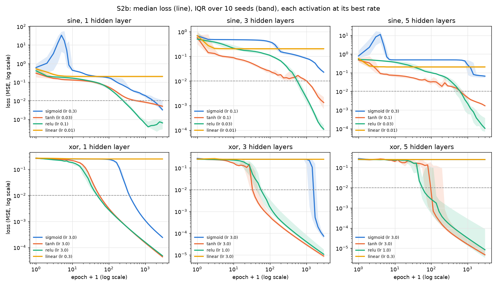
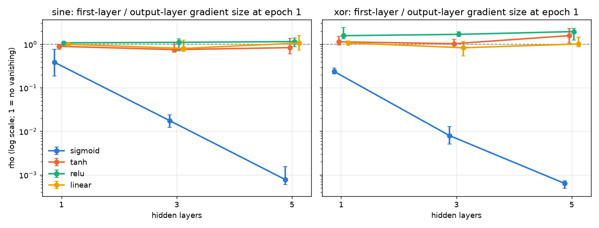
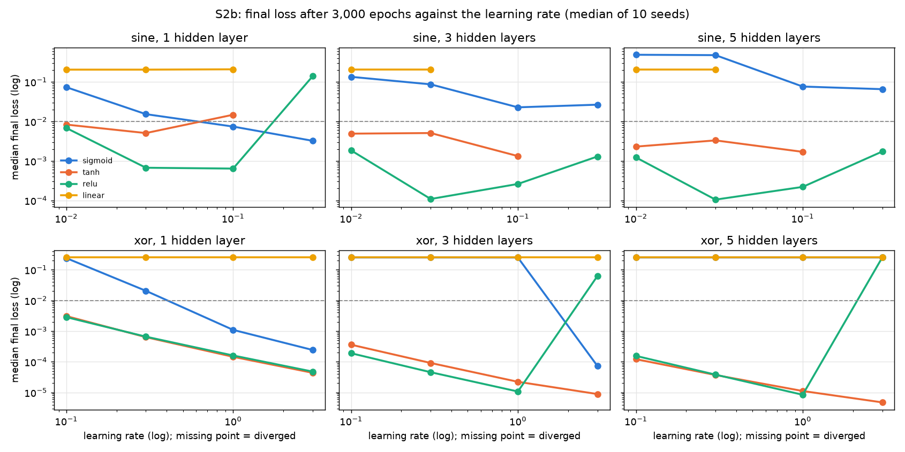
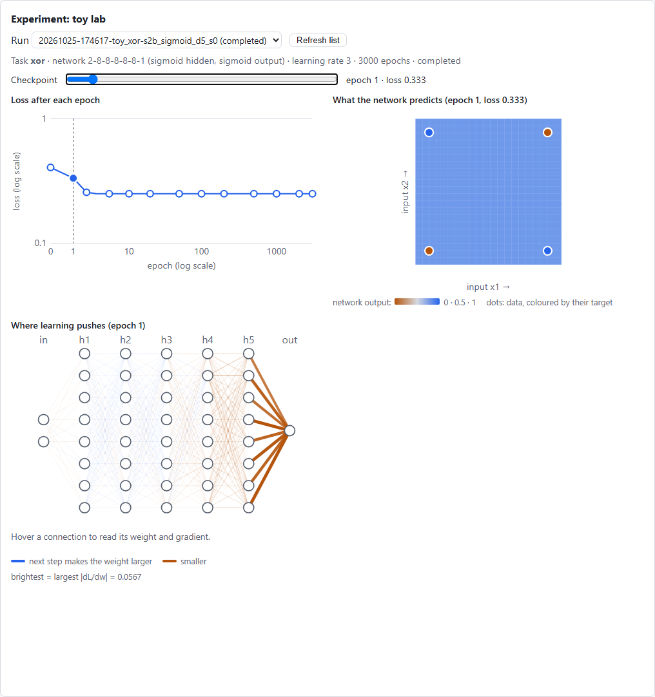
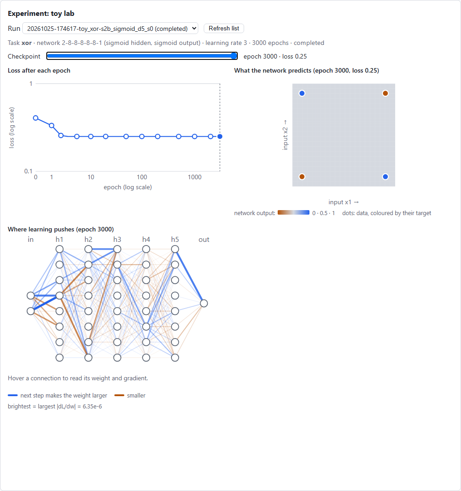
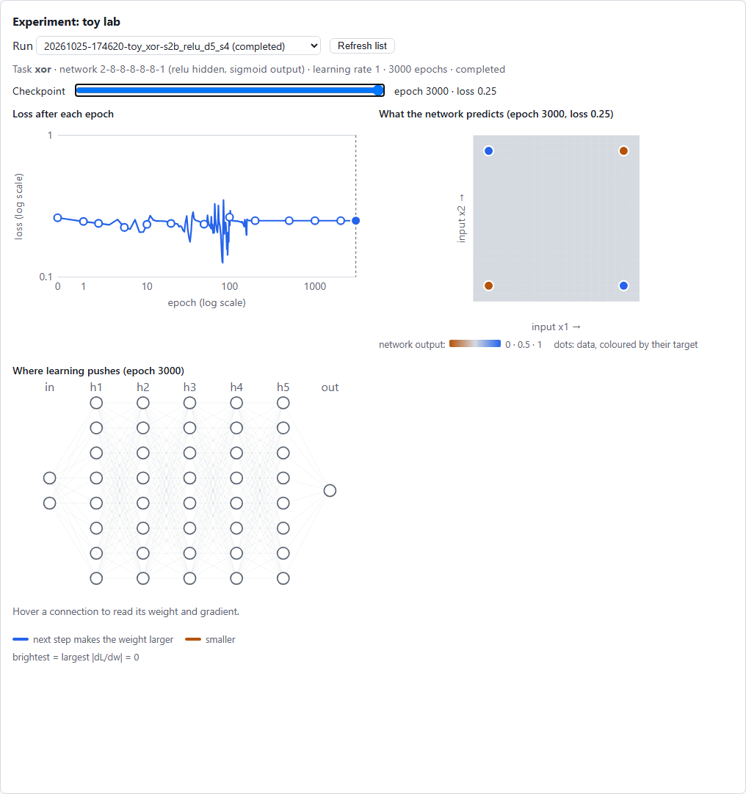
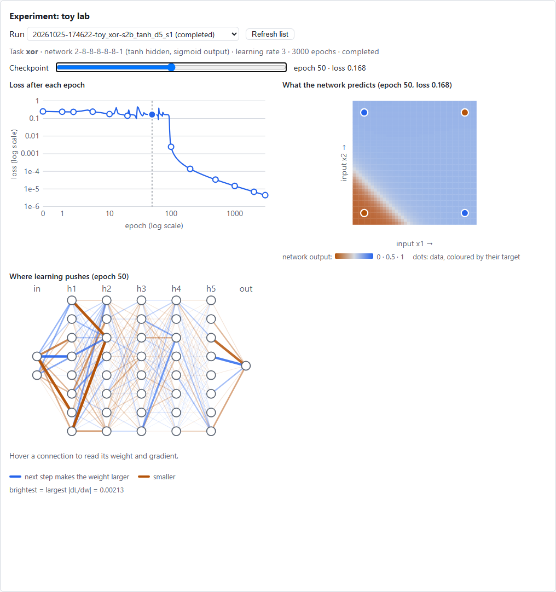

# Study S2b — How does the activation choice affect gradient-based learning (vanishing gradients)?

Task 3.9. Builds on backpropagation (3.4, verified by the gradient check of 3.5), plain gradient
descent on the toy tasks (3.7) and the toy lab (3.8), where the cases below can be opened.

## Question and hypotheses

**Question.** Train the same small networks on the same data with the same full-batch gradient
descent, changing only the activation of the hidden layers (sigmoid, tanh, ReLU; linear as a
control) and the number of hidden layers (1, 3, 5). How much, how fast and how reliably does each
learn, and does the learning signal reach the first layer?

**Hypotheses** (written in the task Brief on 2026-10-25, before any run):

- **H1 (shallow nets all learn; sigmoid is slowest).** With 1 hidden layer, sigmoid, tanh and ReLU
  all reach a loss below 0.01 on XOR and sine for most seeds, but sigmoid needs the most epochs,
  because every step through it is scaled by at most 0.25.
- **H2 (vanishing with depth).** At epoch 1, the vanishing ratio ρ (first-layer over output-layer
  gradient size) falls by about a factor of 4 or more per extra sigmoid layer, to about 10⁻² or less
  at depth 5; tanh stays within about 10× of 1 and ReLU closest to 1. Deep sigmoid networks then
  fail within the budget (plateaus).
- **H3 (ReLU fails differently).** ReLU's failures are all-or-nothing by seed, and the stuck runs
  have a high share of dead neurons, more at depth.
- **H4 (control).** Linear hidden layers solve neither task at any depth: XOR plateaus at the best
  linear answer (MSE 0.25), sine at the best straight line.
- **H5 (the learning rate is not the whole story).** Giving each activation its own best learning
  rate from a small grid does not remove the depth-5 gap between sigmoid and the others.

## What changed versus what was held fixed

- **Changed:** the hidden activation (4) and the depth (1, 3, 5 hidden layers). Each condition ran
  at 4 learning rates (to give every activation a fair chance, H5) and 10 seeds.
- **Held fixed:** the tasks and their data (a seed fixes the data and the starting weights; the
  same seeds are used for every activation, so comparisons are paired), the width (sine 16, XOR 8),
  the output activation (sine linear, XOR sigmoid), Xavier initialisation with zero biases, the
  loss (MSE), full-batch gradient descent with a fixed step (task 3.7), 3,000 epochs.
- No driving and no Driving Exam: this study is about the learning signal itself. Losses are
  compared only within a task, never across tasks.

## Setup

- **Tasks** (task 3.7): sine, 128 points, x uniform in [−π, π], y = sin x; XOR, the 4 corners.
- **Networks:** sine [1, 16 × D, 1] with a linear output; XOR [2, 8 × D, 1] with a sigmoid output
  (8 wide rather than the toy default 4, so deep ReLU networks are not starved), D = 1, 3, 5.
- **Learning rates:** sine {0.01, 0.03, 0.1, 0.3}; XOR {0.1, 0.3, 1, 3}. The main tables use each
  activation's best rate (lowest median final loss); every rate is in the figure below.
- **Seeds** 0–9 per condition: 2 tasks × 3 depths × 4 activations × 4 rates × 10 seeds = **960
  runs**.
- **Measures** (`scripts/study_s2b.py`):
  - final loss L_T after 3,000 epochs (a diverged run counts as +∞); **solved** = L_T < 0.01;
    epochs to reach a loss below 0.01;
  - **ρ = ‖g₁‖ / ‖g_out‖** at epoch 1, the gradient size of the first weight layer over the output
    layer's (‖g‖ = √(Σ ∂L/∂W² + Σ ∂L/∂b²) of the layer). It is measured before the first step, so
    it does not depend on the learning rate;
  - **saturated share** (sigmoid, tanh): hidden (neuron, example) pairs with f′(z) below 10 % of
    the activation's maximum slope; **dead share** (ReLU): hidden neurons with z ≤ 0 on every
    training example; both at the start and the end.
- **Statistics** (EXPERIMENT_PROTOCOL §4): median and IQR over the 10 seeds; for A-vs-B claims, a
  paired bootstrap 95 % interval for the difference in medians of log₁₀ values (10,000
  resamples, seed 2026). A difference of −1 means "10 times lower".
- **Reproduce:** `uv run --with matplotlib python scripts/study_s2b.py --figures` (2 min 13 s on
  10 worker processes). The script was run three times; `S2b_results.json` came out byte for byte
  identical each time. Code: commit `7be182b` plus this task's script. The three cases below were
  written as run folders with `--save-cases xor:5:sigmoid:3.0:0 xor:5:relu:1.0:4 xor:5:tanh:3.0:1`.
- Guard test: `tests/learn/test_study_s2b.py` (the measures on hand cases; a study run equals a
  plain `ToyLearner` run; ρ does not depend on the learning rate; the three cases still behave as
  described).

## Results

### Sine (each activation at its best learning rate; 10 seeds)

| Hidden layers | Activation | Rate | Final loss median [IQR] | Solved | Epochs to 0.01 (median) | ρ at epoch 1, median [IQR] |
|---|---|---|---|---|---|---|
| 1 | sigmoid | 0.3 | 0.0032 [0.0028, 0.011] | 7/10 | 1,650 | 0.39 [0.19, 0.76] |
| 1 | tanh | 0.03 | 0.0051 [0.0045, 0.0054] | 10/10 | 569 | 0.90 [0.77, 1.0] |
| 1 | ReLU | 0.1 | 0.00064 [0.00029, 0.00092] | 10/10 | 248 | 1.08 [0.95, 1.16] |
| 1 | linear | 0.01 | 0.204 [0.177, 0.21] | 0/10 | never | 1.00 |
| 3 | sigmoid | 0.1 | 0.023 [0.021, 0.024] | **0/10** | never | **0.018** [0.012, 0.024] |
| 3 | tanh | 0.1 | 0.0013 [0.00073, 0.0022] | 10/10 | 316 | 0.76 [0.66, 1.1] |
| 3 | ReLU | 0.03 | 0.00011 [0.000088, 0.00016] | 10/10 | 559 | 1.11 [0.70, 1.33] |
| 3 | linear | 0.01 | 0.204 | 0/10 | never | 0.80 |
| 5 | sigmoid | 0.3 | 0.065 [0.055, 0.074] | **0/10** | never | **0.00078** [0.00059, 0.0015] |
| 5 | tanh | 0.1 | 0.0017 [0.0016, 0.0018] | 10/10 | 629 | 0.84 [0.60, 1.37] |
| 5 | ReLU | 0.03 | 0.00010 [0.000071, 0.00038] | 10/10 | 607 | 1.16 [0.88, 1.39] |
| 5 | linear | 0.01 | 0.204 | 0/10 | never | 1.07 |

### XOR (each activation at its best learning rate; 10 seeds)

| Hidden layers | Activation | Rate | Final loss median [IQR] | Solved | Epochs to 0.01 (median) | ρ at epoch 1, median [IQR] |
|---|---|---|---|---|---|---|
| 1 | sigmoid | 3 | 0.00024 [0.00023, 0.00025] | 10/10 | 368 | 0.24 [0.21, 0.28] |
| 1 | tanh | 3 | 0.000044 | 10/10 | 55 | 1.14 [0.97, 1.51] |
| 1 | ReLU | 3 | 0.000048 | 10/10 | 47 | 1.58 [1.33, 2.4] |
| 1 | linear | 0.3 | 0.25 [0.25, 0.25] | 0/10 | never | 1.07 |
| 3 | sigmoid | 3 | 0.000073 [0.000057, 0.000092] | 10/10 | **1,440** | **0.0080** [0.0051, 0.013] |
| 3 | tanh | 3 | 0.0000089 | 10/10 | 33 | 1.03 [0.84, 1.29] |
| 3 | ReLU | 1 | 0.000011 [0.0000084, 0.000018] | 10/10 | 55 | 1.69 [1.51, 1.95] |
| 3 | linear | 3 | 0.25 | 0/10 | never | 0.83 |
| 5 | sigmoid | 3 | **0.25** [0.25, 0.25] | **0/10** | never | **0.00063** [0.00049, 0.00072] |
| 5 | tanh | 3 | 0.0000048 [0.0000041, 0.0000086] | 8/10 | 92 | 1.58 [1.08, 2.33] |
| 5 | ReLU | 1 | 0.0000084 [0.0000034, 0.000091] | 8/10 | 57 | 1.96 [1.25, 2.31] |
| 5 | linear | 0.3 | 0.25 | 0/10 | never | 1.02 |

### Paired bootstrap (difference in medians of log₁₀, A − B, best rate each; 95 % interval)

| Comparison | Final loss | ρ at epoch 1 |
|---|---|---|
| sine, 1 layer: tanh − sigmoid | +0.20 [−0.44, +0.36]: **no clear difference** | +0.37 [+0.06, +0.77] |
| sine, 3 layers: tanh − sigmoid | −1.24 [−1.54, −0.92] | +1.63 [+1.44, +1.94] |
| sine, 5 layers: tanh − sigmoid | −1.59 [−1.66, −1.51] | +3.03 [+2.72, +3.35] |
| sine, 1/3/5 layers: ReLU − tanh | −0.90 / −1.08 / −1.21 (all intervals below 0) | no clear difference at any depth |
| XOR, 1 layer: tanh − sigmoid | −0.74 [−0.79, −0.71] | +0.68 [+0.52, +0.84] |
| XOR, 5 layers: tanh − sigmoid | −4.72 [−4.79, −2.43] | +3.40 [+3.26, +3.60] |
| XOR, 1 layer: ReLU − tanh | +0.04 [+0.01, +0.09] (tanh very slightly lower) | +0.15 [−0.03, +0.33] |
| XOR, 3 and 5 layers: ReLU − tanh | +0.08 [−0.09, +0.62], +0.22 [−1.55, +2.75]: **no clear difference** | +0.22 [+0.04, +0.36], +0.09 [−0.20, +0.30] |

### The hypotheses

- **H1: supported, with nuance.** At depth 1 every nonlinear activation learns. Sigmoid is the
  slowest on both tasks (sine: 1,650 epochs to reach 0.01 against 569 for tanh and 248 for ReLU;
  XOR: 368 against 55 and 47) and on sine solves 7 of 10 seeds. Its *final* sine loss is not
  clearly worse than tanh's (no clear difference), because it was given its best and largest
  rate, 0.3. That rate is on the edge: the median sine loss spikes to about 34 around epochs 3–8
  before recovering (left panel of the curves). ReLU fits sine best at every depth, 8 to 16 times
  lower loss than tanh.
- **H2: supported.** At epoch 1, sigmoid's ρ falls from 0.39 to 0.018 to 0.00078 (sine) and from
  0.24 to 0.0080 to 0.00063 (XOR) as the depth goes from 1 to 3 to 5: a factor of **4.7 (sine)
  and 4.4 (XOR) per extra layer**, close to the 1 / 0.25 = 4 of the slope ceiling. tanh, ReLU and
  linear stay between 0.75 and 2 at every depth. The consequences: deep sigmoid networks solve no
  sine seed at depth 3 or 5 and no XOR seed at depth 5 at any learning rate; at depth 3 XOR is
  solved by every seed only at the largest rate (2 of 10 at rate 1), after a plateau of about
  1,400 epochs (curves, middle row).
  *Unexpected:* saturation is **not** the cause at the start: 0 % of hidden (neuron, example)
  pairs are saturated at epoch 0 for sigmoid and tanh at every depth. The slope ceiling alone does
  it. Saturation grows only during training (sigmoid up to 16 %, tanh up to 19 % at the end).
- **H3: partly supported.** ReLU's failures are indeed all-or-nothing: at XOR depth 5 (rate 1),
  8 seeds solve within 27–130 epochs and 2 are stuck (loss 0.167 and 0.25). The two stuck runs end
  with the most dead neurons (47.5 % and 57.5 %, against at most 40 % for the solvers), but the
  dead share at the *start* does not predict failure (seed 4 started with only 17.5 % dead), and
  one solver ends at 40 %. What matters is *where* neurons die (see the failure analysis). Too
  large a step kills ReLUs: at rate 3, XOR depth 5 solves 0/10 with the dead share rising from
  37.5 % to 66 %; depth 3 solves 5/10. On sine the dead share *fell* during training (depth 5: 29 %
  to 19 %): a dead neuron in a deeper layer can come back when the layers below it change its
  inputs; a dead neuron in the first hidden layer cannot, because its inputs are the fixed data
  and its weights get no gradient.
- **H4: supported.** Linear hidden layers end at 0.25 [0.25, 0.25] on XOR (the network predicts
  0.5 for every corner) and 0.204 [0.177, 0.21] on sine (the best straight line through the
  points) at every depth and rate, and never solve a seed. Deeper linear stacks diverge at smaller
  rates (sine: 8–10 of 10 diverge at rate 0.1 with 3 or 5 layers).
- **H5: supported.** At each activation's best rate the depth-5 gap stays: sine 0.065 (sigmoid)
  against 0.0017 (tanh) and 0.00010 (ReLU); XOR 0.25 against 0.0000048 and 0.0000084. Caveat:
  sigmoid's best rate was the largest one on the grid in 5 of 6 cases, so it might do somewhat
  better with even larger steps; at XOR depth 5, though, it fails at all four rates (0.1 to 3).

## Failure analysis

Three runs written as run folders and opened in the toy lab (Experiment view):

**1. A deep sigmoid network that never learns XOR** (XOR, 5 sigmoid layers, rate 3, seed 0;
`runs/…-toy_xor-s2b_sigmoid_d5_s0`).

At epoch 1 the gradient sizes per layer, from the first to the output, are 0.00016, 0.00086,
0.0033, 0.013, 0.044 and 0.14: each layer down receives 3 to 5 times less. In the toy lab the
glow is bright next to the output and fades layer by layer towards the inputs. So only the last
layers learn at first, and the easiest thing they can learn is to predict the average, 0.5, for
every corner. The loss is 0.2502 at epoch 3 and 0.2500 from epoch 5 on; it ends at 0.2499967 after
3,000 epochs. Once there, every layer's gradient is about 10⁻⁵ (the largest single |∂L/∂w| at
epoch 3000 is 6 × 10⁻⁶): a **plateau**, flat in every direction the network can feel. The colour
map is one uniform colour from epoch 1 to the end.

**2. A ReLU network cut in two by a dead layer** (XOR, 5 ReLU layers, rate 1, seed 4;
`runs/…-toy_xor-s2b_relu_d5_s4`).

It started with few dead neurons (1, 3, 1, 1 and 1 of the 8 in each hidden layer). The loss
flickers around 0.25 for about 150 epochs while neurons switch off and on; by the end the dead
counts are 1, 2, 6, 6 and **8**: the whole last hidden layer is off for all four corners. Its
outputs are all 0, so the network outputs the same 0.5 everywhere, and every gradient in the
network is exactly 0 (the toy lab shows "largest |dL/dw| = 0" and no glowing edge). No amount of
further training can change it: one dead layer disconnects everything below it.

**3. Contrast: a deep tanh network that solves it** (XOR, 5 tanh layers, rate 3, seed 1).

At epoch 50 the brightest connections are in the *first* layers (inputs to hidden 1 and 2), the
opposite of the sigmoid picture: the learning signal reaches the bottom of the network. The map
has already started to bend into the XOR pattern; the loss drops from 0.17 to below 0.01 at
epoch 96.

## Conclusion

- With one hidden layer the activation mostly changes the **speed** of learning: sigmoid needs
  3–8 times more epochs than tanh or ReLU, and only very large steps make up for it.
- With depth, sigmoid's learning signal **vanishes**: about 4.5 times weaker per layer at the
  start, 1,000 times weaker at the first of 5 layers. Deep sigmoid networks fall onto the
  "predict the average" plateau and stay there within 3,000 epochs (sine at depth 5 did escape
  partly, after about 1,000 epochs, to 0.065).
- tanh and ReLU keep the signal at full strength through 5 layers at the start (ρ about 1–2).
  ReLU fits sine best; on XOR tanh and ReLU are indistinguishable.
- ReLU has its own failure: neurons that switch off for every input, and when a whole layer does,
  the network is permanently stuck. Large steps make it more likely.
- Uncertain: 10 seeds per condition; one width per task; Xavier initialisation for all (He
  initialisation, scaled for ReLU, and initialisations designed for sigmoid were not tried); full
  batch only; sigmoid's best rate sat at the top of the grid in 5 of 6 cases; plateaus might end
  with more epochs.

## What this teaches about AI

A correct gradient is not enough: the gradient has to *arrive*. Each layer of backprop multiplies
the learning signal by the activation's slope, so a squashing function with a small slope makes
deep networks deaf at the bottom, and they settle for the most average answer. Rectified units
pass the signal at full strength but can switch themselves off for good. The choice of activation
(and of initialisation and step size) decides which parts of a network can learn at all, which is
why the driving networks of the later phases use tanh, whose slope is 1 at the centre.
