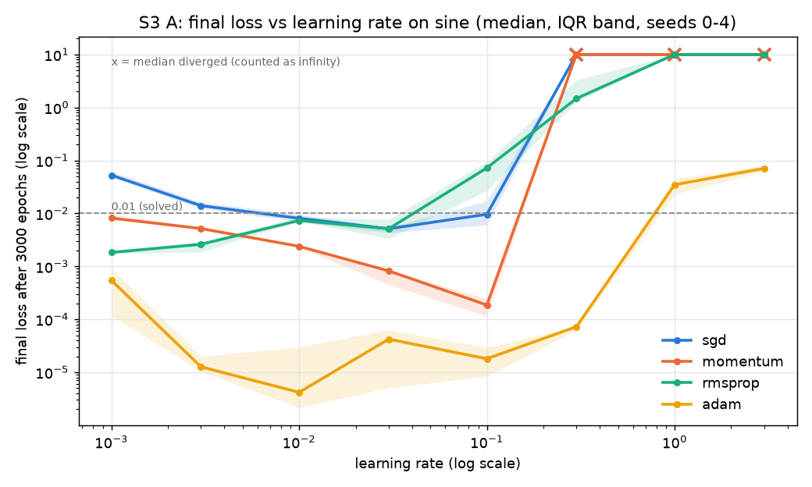
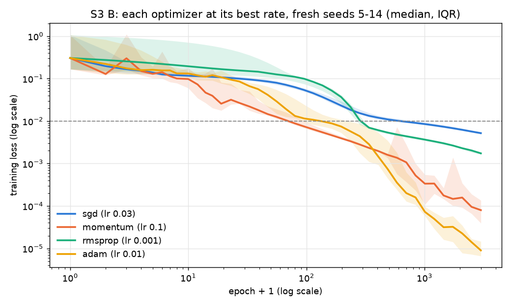
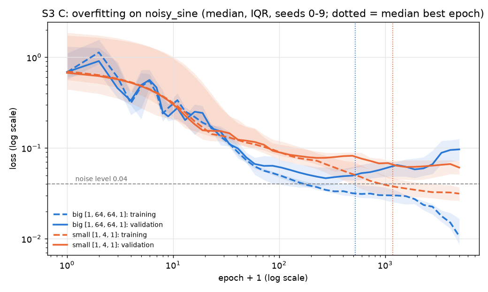
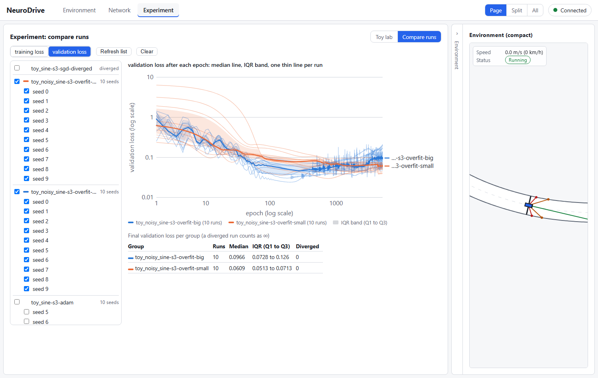
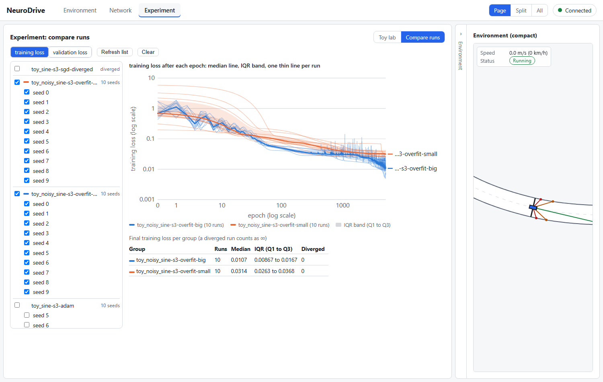
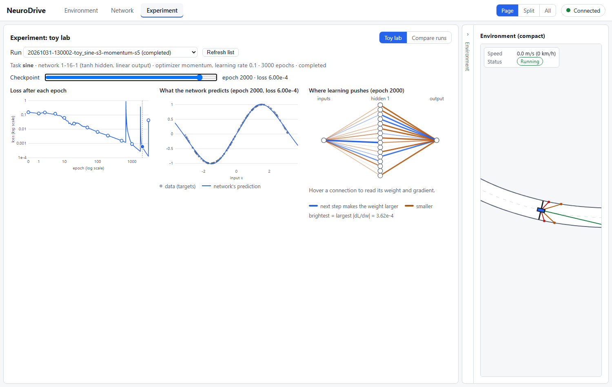
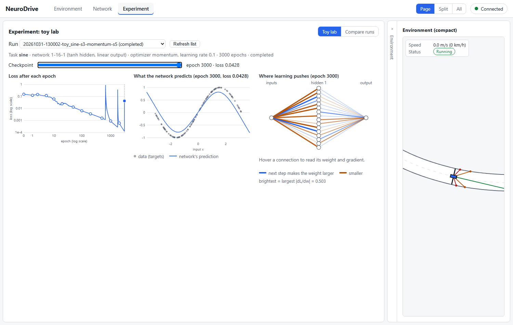
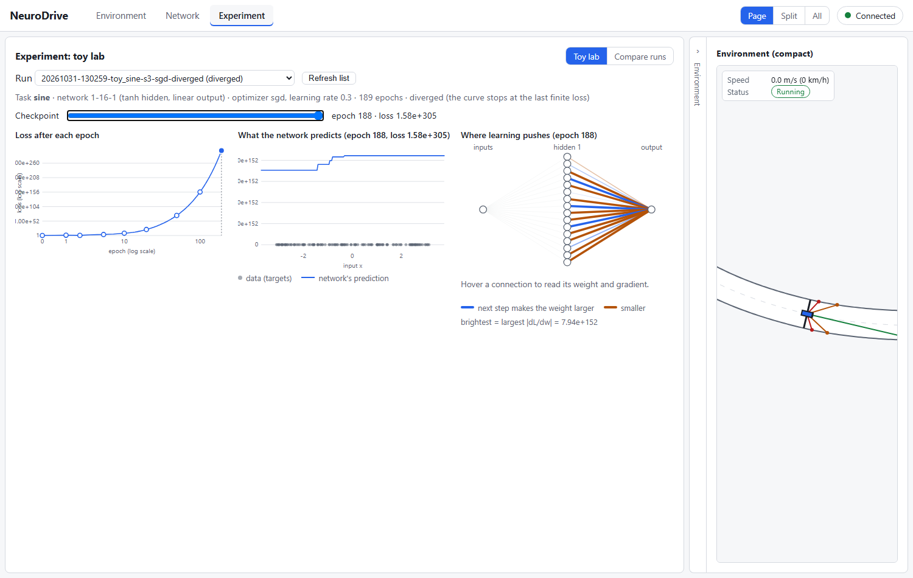

# Study S3 — How do learning rate and optimizer choice affect convergence and stability?

Task 4.8. Builds on the four optimizers (4.2–4.5), the toy learner on minibatches and validation
sets (4.6a), configs and `nd train` / `nd sweep` (4.6b, 4.7a), the statistics module (4.7a) and the
Compare-runs view (4.7b), where every case below can be opened.

## Question and hypotheses

**Question.** Train the same small network on the same data with SGD, Momentum, RMSProp and Adam.
How does the learning rate decide whether each one converges, how fast, and when it breaks down?
Given each optimizer its own best learning rate, which reaches the lowest loss, and is the gap
larger than the spread between seeds? And when a big network meets few, noisy examples, what does
overfitting look like on a validation curve?

**Hypotheses** (written in the task Brief on 2026-10-31, before the study ran):

- **H1 (edge of stability).** For SGD the final loss improves as η rises up to an edge; above it
  every seed diverges (no gradual decline). The edge lies between η = 0.3 and 3. For Momentum
  (β = 0.9) the edge is about 10 times lower, because a steady gradient builds a velocity of up to
  1/(1 − β) = 10 times the gradient.
- **H2 (adaptive optimizers do not blow up).** RMSProp and Adam produce no diverged runs anywhere
  on the grid, since their steps are about η whatever the gradient's size; at too-high η their
  final loss stops improving and stays high (they hover about one step from the minimum, task 4.4).
- **H3 (fair comparison).** Each optimizer at its best η (chosen on seeds 0–4), on fresh seeds
  5–14 after 3000 epochs: Adam has the lowest median final loss, SGD the highest, Momentum also beats
  SGD, and the paired bootstrap interval for Adam − SGD excludes 0.
- **H4 (overfitting).** With 48 noisy training points, the big network [1, 64, 64, 1] reaches its
  lowest validation loss before epoch 1000 for most seeds, its validation loss ends at least 1.5
  times its minimum, and its training loss ends below the noise level 0.04; the small network
  [1, 4, 1] ends with a validation loss within 1.2 times its minimum.
- *Transparency:* H4 was written after one timing probe of the overfitting set-up on seed 0 (big
  network: lowest validation loss 0.028 at epoch 360, ending 2.3 times higher), so it is partly
  informed by that run. H1–H3 rest only on earlier tasks.

## What changed versus what was held fixed

- **Changed:** part A: the optimizer (4) and the learning rate (8, from 0.001 to 3); part B: the
  optimizer, each at its own tuned rate; part C: the network size (big or small).
- **Held fixed:** the task and data (a seed fixes the data, the starting weights and nothing else;
  the same seeds are used for every optimizer, so comparisons are paired), the network in A and B
  ([1, 16, 1], tanh hidden, linear output, Xavier initialisation, zero biases), the loss (MSE), full
  batch, the optimizers' own settings at their defaults (Momentum β 0.9; RMSProp ρ 0.9, ε 1e-8; Adam
  β₁ 0.9, β₂ 0.999, ε 1e-8), the budget (3000 epochs in A and B, 5000 in C).
- No driving and no Driving Exam: this study is about the optimizers themselves. Losses are compared
  only within a part.

## Setup

- **Part A (learning-rate sweep):** sine (128 points, x uniform in [−π, π], y = sin x); each of
  the 4 optimizers at η ∈ {0.001, 0.003, 0.01, 0.03, 0.1, 0.3, 1, 3}; **tuning seeds 0–4**;
  160 runs.
- **Part B (fair comparison):** each optimizer at its best η from part A (lowest median final loss;
  ties to the smaller rate) on **fresh test seeds 5–14**; 40 runs. Tuning and testing on different
  seeds avoids *selection bias*: a rate picked on some seeds looks slightly better on those same
  seeds than it really is.
- **Part C (overfitting):** the new toy task `noisy_sine`: 64 points, x uniform in [−π, π],
  y = sin x + Gaussian noise of standard deviation 0.2, a quarter held back for validation (48
  training, 16 validation points). Big [1, 64, 64, 1] (4,353 parameters) against small [1, 4, 1]
  (13 parameters), Adam η 0.01, full batch, 5000 epochs, seeds 0–9; 20 runs.
- **Measures** (`scripts/study_s3.py`): final loss L_T (a diverged run counts as +∞); the epoch the
  numbers overflowed (`diverged_at`); the first epoch with a loss below 0.01; "solved" = L_T < 0.01;
  the *usable range* of an optimizer = the grid rates whose median L_T is below 0.01; in part C the
  best validation epoch e* (lowest validation loss), and the overfitting ratio = final validation
  loss ÷ lowest validation loss (1 = no overfitting).
- **Statistics** (`experiment/stats.py`, EXPERIMENT_PROTOCOL §4): median and IQR over seeds; paired
  bootstrap 95 % interval for the difference in medians of log₁₀ L_T, optimizer minus SGD
  (10,000 resamples, seed 2026). A difference of −1 means "10 times lower".
- **Reproduce:** `uv run --with matplotlib python scripts/study_s3.py --figures` (44 s on 10 worker
  processes). Run three times; `S3_results.json` came out byte for byte identical each time.
  That holds on one machine. The numbers here were measured on Windows; on Linux (checked in a
  container, 2026-11-01) NumPy rounds the last digit of some sums differently, and runs near the
  edge of stability drift apart after several hundred epochs: their spikes move by a few epochs and
  their best losses agree to about two digits (Case 1 below is the visible example).
  `--save-cases` writes the runs below as run folders in `runs/`: the four optimizer sweeps at their
  best rates on seeds 5–14 (tags `s3-sgd`, `s3-momentum`, `s3-rmsprop`, `s3-adam`), the two
  overfitting sweeps (`s3-overfit-big`, `s3-overfit-small`) and one diverged SGD run
  (`s3-sgd-diverged`: η 0.3, seed 0); their numbers equal the study's (checked: 0 mismatches).
- Guard test: `tests/learn/test_study_s3.py` (a study run equals a plain `ToyLearner` run; a diverged
  run counts as +∞; the best-rate and edge rules on hand-made tables; the overfitting measures; the
  failure case below still learns and still jumps afterwards; it does not check when the jumps happen,
  because that differs between machines).

## Results

### A. Final loss against learning rate (sine, seeds 0–4; median [IQR], diverged of 5)

| η | SGD | Momentum | RMSProp | Adam |
|---|---|---|---|---|
| 0.001 | 0.0525 [0.0486, 0.062] | 0.00814 [0.00774, 0.0096] | **0.00183** [0.00173, 0.00191] | 0.000544 [0.000119, 0.000913] |
| 0.003 | 0.014 [0.0122, 0.0163] | 0.00518 [0.00483, 0.0054] | 0.00261 [0.00188, 0.00294] | 1.27e-05 [1.03e-05, 2e-05] |
| 0.01 | 0.00808 [0.00705, 0.00956] | 0.00239 [0.00231, 0.00245] | 0.00733 [0.00715, 0.00852] | **4.18e-06** [2.16e-06, 2.97e-05] |
| 0.03 | **0.00513** [0.00433, 0.00537] | 0.000821 [0.00045, 0.000871] | 0.00513 [0.00338, 0.0077] | 4.22e-05 [5.1e-06, 6.3e-05] |
| 0.1 | 0.00962 [0.00603, 0.0173] | **0.000186** [0.000115, 0.000243] | 0.0722 [0.027, 0.0942] | 1.8e-05 [8.42e-06, 2.91e-05] |
| 0.3 | ∞, 4/5 diverged | ∞, 4/5 diverged | 1.48 [1.27, 3.29] | 7.24e-05 [6.23e-05, 7.36e-05] |
| 1 | ∞, 5/5 diverged | ∞, 5/5 diverged | 25.1 [24.4, 32.3] | 0.0347 [0.0233, 0.045] |
| 3 | ∞, 5/5 diverged | ∞, 5/5 diverged | 392 [385, 415] | 0.0708 [0.0616, 0.08] |

Bold = each optimizer's best rate. Usable range (median below 0.01): SGD 0.01–0.1 (3 rates),
Momentum 0.001–0.1 (5), RMSProp 0.001–0.03 (4), Adam 0.001–0.3 (6). RMSProp and Adam never diverged.

### B. Each optimizer at its best rate on fresh seeds 5–14

| Optimizer | η | Final loss, median [IQR] | Solved | First epoch below 0.01, median |
|---|---|---|---|---|
| SGD | 0.03 | 0.0052 [0.00486, 0.00544] | 10/10 | 622 |
| Momentum | 0.1 | 7.98e-05 [3.94e-05, 0.000136] | 9/10 | 69.5 |
| RMSProp | 0.001 | 0.00174 [0.00164, 0.00185] | 10/10 | 286 |
| Adam | 0.01 | 8.99e-06 [6.62e-06, 1.46e-05] | 10/10 | 132 |

Paired bootstrap, difference in medians of log₁₀ L_T against SGD (95 % interval):
Momentum −1.85 [−2.23, −1.39]; RMSProp −0.48 [−0.61, −0.42]; **Adam −2.76 [−2.99, −2.23]**.
All three exclude 0. Adam ends about 10^2.76 ≈ 580 times lower than SGD.

### C. Overfitting on noisy_sine (48 training, 16 validation points; seeds 0–9)

| Network | Best validation epoch, median [IQR] | Lowest validation loss | Final validation loss | Final training loss | Ratio, median [IQR] | Ratio ≥ 1.5 | Ratio ≤ 1.2 | Best before epoch 1000 |
|---|---|---|---|---|---|---|---|---|
| big [1, 64, 64, 1] | 520 [206, 968] | 0.0392 | 0.0966 | 0.0107 | 2.49 [1.99, 2.99] | 8/10 | 0/10 | 7/10 |
| small [1, 4, 1] | 1180 [518, 2590] | 0.0439 | 0.0609 | 0.0314 | 1.12 [1.05, 1.34] | 2/10 | 6/10 | 4/10 |

(losses are medians over the 10 seeds)

### The hypotheses

- **H1: partly supported.** SGD has a sharp edge, as predicted: median 0.0096 at η = 0.1, then 4 of
  5 seeds diverge at 0.3 and all 5 at 1 (inside the predicted 0.3–3). There is no gradual decline:
  the loss either settles or explodes. But **Momentum's edge is not 10 times lower**: it diverges at
  exactly the same grid rates as SGD (4/5 at 0.3, 5/5 at 1) and is at its best at 0.1, where SGD is
  already getting worse. The 1/(1 − β) argument holds only for a gradient that keeps the same sign;
  what blows up is the steepest direction, where the gradient flips sign every step and Momentum's
  memory partly cancels instead of adding up. For SGD with momentum the known stability condition in
  a direction of curvature λ (the second derivative along it) is η·λ < 2(1 + β), against η·λ < 2 for
  SGD: with β = 0.9 Momentum tolerates up to 1.9 times SGD's rate there. Checked on the bowl
  (w − 3)² of task 4.2 (λ = 2): SGD diverges for η > 1 (at η = 1.05 its distance from 3 grows to
  10¹⁷ in 400 steps), Momentum still converges at η = 1.85 (distance 8e-10) and diverges at 1.95,
  matching the predicted edge 1.9. On sine both edges fall between 0.1 and 0.3 on this grid.
- **H2: partly supported.** No RMSProp or Adam run diverged anywhere on the grid. Adam degrades
  gently (0.035 at η = 1, 0.071 at 3). RMSProp does not "hover near the minimum": at η = 1 and 3 its
  final loss is 25 and 392, far worse than an untrained network (0.15 to 1.9 on these seeds). Its steps are
  bounded, so the numbers never overflow, but at η = 3 every weight jumps by a few units per step
  (and by about 3.2·η on a step whose gradient is new to it, task 4.4), which drives the tanh neurons
  into saturation and the output weights far from any good fit. Adam's averaging of the gradient's
  direction (its first moment) and bias correction keep its steps calmer.
- **H3: supported.** Adam has the lowest median final loss (9.0e-6) and SGD the highest (0.0052);
  Momentum (8.0e-5) and RMSProp (0.0017) both beat SGD; Adam − SGD = −2.76 [−2.99, −2.23] excludes 0.
  Speed tells a different story from the end point: Momentum reaches 0.01 first (median epoch 70),
  Adam second (132), RMSProp third (286), SGD last (622). RMSProp's best rate is the smallest one on
  the grid (0.001), so its true best may lie below it (see Conclusion).
- **H4: partly supported.** For the big network all three predictions hold: lowest validation loss
  before epoch 1000 for 7 of 10 seeds (median epoch 520), ratio at least 1.5 for 8 of 10 (median
  2.49), training loss below the noise level 0.04 for 10 of 10 (median 0.0107). For the small network
  the ratio is within 1.2 for only 6 of 10 seeds (median 1.12, IQR up to 1.34): it overfits a little
  too. And the noise-level test is cruder than the Brief assumed: even a model that does *not* fit
  noise reaches a training loss below 0.04, because each parameter can absorb a share of the noise.
  For a model with p parameters on n points the expected training loss of the best smooth fit is about
  σ²(1 − p/n): for the small network 0.04 × (1 − 13/48) ≈ 0.029, close to its observed 0.031; for the
  big network p ≫ n, so it can drive the training loss towards 0, and its 0.0107 is well below 0.029.

## Failure analysis

**Case 1: Momentum at its best rate, test seed 5 (run `…-toy_sine-s3-momentum-s5`, epochs 2000
and 3000, opened in the toy lab).** This is the one unsolved run in part B (final loss 0.0428).
Its loss fell steadily to 0.000126 at epoch 2980; then, in the last 18 epochs, it grew by about 1.8
times every two epochs (0.000128 at 2984, 0.00127 at 2994, 0.0428 at 3000). The same run had three
earlier jumps of more than 10 times in one epoch (epochs 670, 674 and 1765) and recovered from each;
the loss curve in the toy lab shows them as spikes. At epoch 2000 the prediction plot lies on the data
(loss 0.0006); at epoch 3000 it has swung off at both ends, and the glow shows large gradients on most
weights (largest |dL/dw| 0.503, against 0.00036 at epoch 2000): the network has been thrown out of
the minimum. η = 0.1 is just below Momentum's edge on this task (0.3 diverges): as training settles
into a sharper part of the loss surface, the same step size crosses the edge, the error grows
step by step, and Momentum's velocity sometimes carries it back. That this seed's last spike fell in
the final 20 epochs is chance; its "final loss" is a snapshot of a moment, not a measure of what it
learned. Keeping the best checkpoint (or lowering the rate late in training) would have kept 0.000126.
Proof that it is chance: on Linux the same run, from the same seed and code, differs only in the last
digit of some sums, yet it has its first jump at epoch 670 like here, no later jump, and ends at
0.000124 with no spike at the end.

**Case 2: SGD at η = 0.3, seed 0 (run `…-toy_sine-s3-sgd-diverged`).** The toy lab's loss curve
rises from the first epoch and stops at epoch 188 (status "diverged"). The study's trace: loss 1.89
at the start, 2.9·10⁸ by epoch 10, 1.3·10⁷² by epoch 50, 1.6·10³⁰⁵ by epoch 188, overflow at 189.
It never learned anything first: from the first step every update overshoots along the steepest
direction by more than it corrects, so the error is multiplied by roughly the same factor every
epoch (geometric growth), exactly as on the bowl with η > 1 in task 4.2. `diverged_at` therefore
marks when the computer's numbers run out, not when the instability began. In the toy lab at epoch
188 the glow shows where the explosion sits: the input-to-hidden connections are almost dark, while
every hidden-to-output connection is bright (largest |dL/dw| = 7.9·10¹⁵²). The prediction is a flat
staircase near 10¹⁵²: the tanh neurons are saturated at ±1, so the output is a sum of enormous
output weights. (The toy lab's tick labels are clipped at the left edge for numbers this large, a
display limitation noted for later.) One of the five tuning
seeds at η = 0.3 (seed 2) survived with a final loss of 0.0209: near the edge, the starting weights
decide which side a run falls on.

**Case 3: overfitting (sweeps `s3-overfit-big` and `s3-overfit-small` in Compare runs).** With the
training loss selected, the big network's band ends lowest (0.0107); switch to validation loss and the
order flips: the big network's median curve turns upward after a few hundred epochs and ends at 0.0966,
above the small network's 0.0609. Its thin per-seed lines show jagged spikes late in training: once the
noise is fitted, small weight changes swing the curve between the training points, and the 16
held-back points see every swing.

## Conclusion

- The learning rate decides stability before the optimizer decides speed. SGD and Momentum on this
  task have a cliff between η = 0.1 and 0.3: below it they converge, above it almost every seed blows
  up within a few hundred epochs, and right at the edge the starting weights decide. Momentum's edge is
  not lower than SGD's; its velocity makes it faster (it reaches 0.01 first) but not more fragile.
- RMSProp and Adam cannot overflow, but "never NaN" is not "always fine": RMSProp at η ≥ 0.3 ends far
  worse than an untrained network. Adam had the widest usable range (0.001–0.3), the lowest final loss
  at its best rate (about 580 times below SGD, a clear difference on 10 fresh seeds) and degraded most
  gently when the rate was too high.
- Uncertain: RMSProp's best rate lies at the edge of the grid (0.001), so its comparison may be
  unfair to it; a grid reaching down to 0.0001 would settle it. Results are for one small network on
  one smooth task, 5 tuning and 10 test seeds; the fixed number of epochs also rewards fast starters.
  A final loss is a snapshot (Case 1), so a single late spike changes it.
- A big network on few noisy points overfits clearly: its validation loss is lowest after about 500
  epochs and ends 2.5 times higher. Its lowest validation loss (0.0392) is better than the small
  network's best (0.0439): with early stopping the big network generalises best; without it, worst.

## What this teaches about AI

Gradient descent is only as good as its step size: the same gradients that lead downhill at one
learning rate make every step overshoot further at three times that rate, and optimizers differ mostly
in how they choose the step for each weight. A fair comparison needs each method tuned, tested on
seeds it was not tuned on, and summarised over seeds, because a single run can be lucky (Momentum at
the edge reached 3·10⁻⁷ on one seed) or unlucky (a spike in the last 20 epochs). And a lower training
loss is not better learning: the network that fitted the training points best predicted the held-back
points worst, which is why every later method in this project is judged on data it never trained on,
and the Driving Exam uses tracks the learners never saw.
