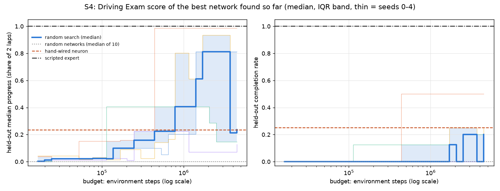
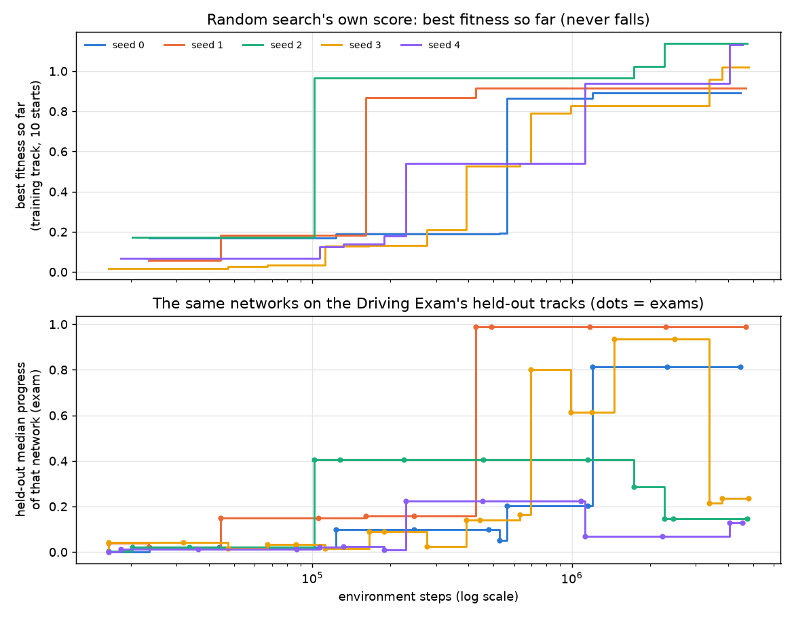
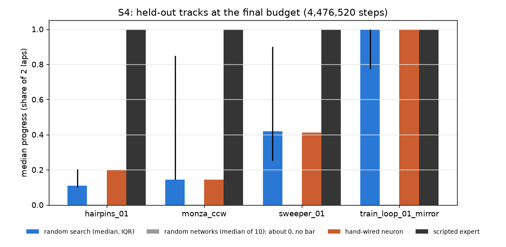
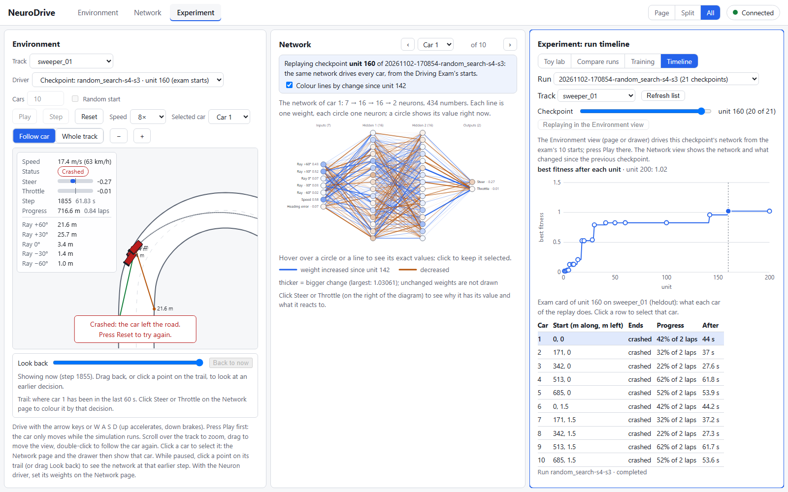
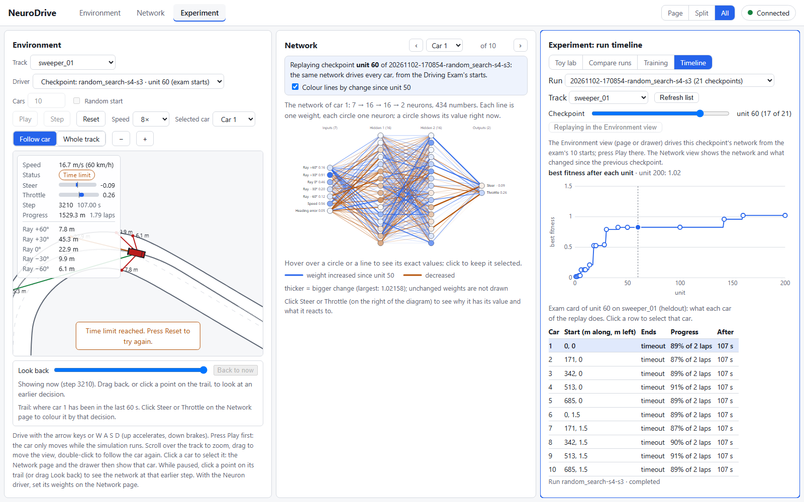

# Study S4 — Does random search beat the baselines, and at what budget?

Task 5.10. Builds on the Driving Exam (5.4), the runner with exams at every checkpoint and every
new best (5.5, 5.9), the baselines (5.6), random search (5.7) and the run timeline (5.9), where
every network below can be replayed. The runs carry `"study": "S4"` in their meta.json (ADR-043).

## Question and hypotheses

**Question.** Random search draws fresh random networks, 20 per unit, scores each on the 10 exam
starts of the training loop and keeps the best so far. After spending a budget of B environment
steps, is the network it holds better on the Driving Exam than each baseline: random networks,
the hand-wired neuron of Study S1, and the scripted expert? From which budget on? And does
spending more keep helping on tracks it never saw?

**Hypotheses** (written in the task Brief on 2026-11-02, before any S4 run):

- **H1 (beats the floor fast):** from the first budget at which every seed has finished unit 10
  (200 networks) on, the median held-out progress of random search is above the random networks'
  median; at the final budget the paired bootstrap interval of the difference excludes 0.
- **H2 (progress yes, completion no, against the neuron):** at the final budget the median
  held-out progress is above the neuron's 0.234, but the median held-out completion rate is below
  the neuron's 0.25.
- **H3 (selection overfitting):** for at least 2 of 5 seeds the held-out median progress at the
  final budget is at least 0.1 below that seed's best earlier exam, while its training fitness
  only rose.
- **H4 (the ceiling stands):** no seed reaches the expert's held-out completion rate of 1.0, and
  the median held-out completion rate at the final budget is below 0.5.
- *Transparency:* H2 and H3 were partly informed by two random-search runs made in task 5.7–5.8:
  the 100-unit run of seed 0 and a 50-unit run whose held-out progress fell from 0.725 (unit 20)
  to 0.176 (unit 50). The Brief called the second one "seed 0"; it was seed 6 (launched from the
  app in task 5.8). H1 and H4 rest on Study S2a and the baselines' cards.

## What changed versus what was held fixed

- **Changed:** the driver (random search against each baseline) and the budget (the x-axis).
- **Held fixed** (protocol rule 2): observation v1, action v1, physics v1, the network
  ([7, 16, 16, 2], tanh hidden and output, Xavier initialisation, the same as the random-network
  baseline), the Driving Exam v1 (training loop reported separately; 4 held-out tracks, 10 starts
  each, 2 laps, time limit ceil(2L / 16 m/s)), the fitness of ADR-040 (progress up to 1 plus a
  finisher's share of time left, mean over the training loop's 10 exam starts).
- Fitness is random search's own score: it appears only in its own panel (rule 3). Methods are
  compared on exam metrics only.
- The held-out tracks were never used for training or for choosing networks (rule 7): random
  search keeps the best *fitness*, and the study reads the exam of exactly that network.

## Setup

- **Random search:** `configs/random_search.yaml` (20 candidates per unit) with tag `s4`,
  **seeds 0–4, 200 units each** (4,000 networks per seed), exams on; one sweep
  (`20261102-170854-random_search-s4`). Seed k's unit-0 network is the random-network baseline
  of seed k (ADR-040), so seeds are paired with random networks 0–4.
- **Baselines, made again for S4** (ADR-043, D2A): random network seeds 0–9 (one sweep), the
  hand-wired neuron (`configs/baselines/hand_neuron.yaml`), the scripted expert. Their 12 exam
  cards equal the task 5.6 cards exactly (everything but the run name; checked by the script).
- **Measure:** S_k(B), the exam card of the best network seed k holds after B environment steps:
  with u the last unit whose `env_steps_total` is at most B, the card of the unit that found the
  network held at u (`best_unit`). Every new best is examined (task 5.9), so no network is
  examined after the fact. Main measures: held-out median progress (share of 2 laps), held-out
  completion rate and crash rate (40 held-out episodes pooled), the training loop's median
  progress and completion rate, and each held-out track's median progress.
- **Budget grid:** 0 and 30 budgets evenly spaced on a log scale from 16,356 steps (the smallest
  first unit) to **4,476,520 steps, the common final budget** (the smallest final total of the
  five seeds; the others had used 4.54–4.81 M steps by unit 200). B\* = the first budget above 0
  at which the median over seeds is above the baseline's value.
- **Statistics** (`experiment/stats.py`, EXPERIMENT_PROTOCOL §4): median and IQR over 5 seeds;
  paired bootstrap 95 % interval of the difference in medians against random networks 0–4;
  one-sample bootstrap interval of random search's median against the deterministic neuron and
  expert (lower end above the value: clearly higher; upper end below: clearly lower; otherwise no
  clear difference); 10,000 resamples, seed 2026.
- **Budget in other currencies:** each seed trained for 941–973 s of wall clock (5 seeds at once
  on a 12-core machine), plus 144–314 s of exams (kept out of the training clock). Demonstration
  frames and teacher queries: 0. The whole study took 21 minutes (17:08:54–17:29:55 UTC).
- **Reproduce:** `uv run --with matplotlib python scripts/study_s4.py --train --figures` makes the
  17 runs in `runs/` and analyses them; without `--train` it only analyses the S4 runs it finds
  there. The analysis was run three times; `S4_results.json` came out byte for byte identical.
  The runs were made from commit `bae1a4b` plus the uncommitted task 5.10 changes (meta.json
  records `git_dirty: true`); those changes touch only the run's meta (`study`) and the database,
  and `tests/learn/test_study_s4.py` checks that a study run equals a plain random-search run
  file for file. Seed 0 also reproduces task 5.7's 100-unit run (new bests at units 23 and 51,
  fitness 0.865 and 0.893).
- **Run IDs:** `20261102-170854-random_search-s4-s0` … `-s3`, `20261102-170855-random_search-s4-s4`;
  `20261102-1708…1709-random_network-baseline-s0` … `-s9`, `20261102-170913-hand_neuron-baseline`,
  `20261102-170934-scripted_expert-baseline` (all 17 in `S4_results.json`, `run_ids`). In the
  database: `SELECT run_id FROM runs WHERE study = 'S4'` lists the same 17, and the `studies` row
  says 17 runs, 4 methods, 2 sweeps.
- **Guard test:** `tests/learn/test_study_s4.py` (the budget rule on the Brief's worked example,
  B\*, every hypothesis rule on a hand-made set of run folders, a study run equals a plain run).

## Results

### Exam score by budget (median [IQR] over seeds 0–4)

| Budget (environment steps) | ≈ networks tried | Held-out progress | Held-out completion | Held-out crash rate | Training-loop progress | Training-loop completion |
|---|---|---|---|---|---|---|
| 0 (unit 0) | 0 | 0.001 [0.000, 0.003] | 0 [0, 0] | 0.375 | 0.001 | 0 |
| 25,000 | 20 | 0.022 [0.020, 0.023] | 0 [0, 0] | 0.95 | 0.060 | 0 |
| 100,000 | 100 | 0.023 [0.020, 0.032] | 0 [0, 0] | 0.825 | 0.060 | 0 |
| 250,000 | 220 | 0.158 [0.099, 0.224] | 0 [0, 0] | 0.85 | 0.538 | 0 |
| 500,000 | 450 | 0.224 [0.142, 0.405] | 0 [0, 0.125] | 0.75 | 0.538 | 0 |
| 1,000,000 | 900 | 0.405 [0.224, 0.612] | 0 [0, 0.125] | 0.5 | 0.916 | 0 |
| 2,000,000 | 1,800 | **0.813** [0.286, 0.935] | 0 [0, 0.25] | 0.25 | 0.916 | 0 |
| 4,000,000 | 3,600 | 0.236 [0.147, 0.813] | 0.2 [0, 0.25] | 0.75 | 0.951 | 0 |
| **4,476,520 (final)** | 4,000 | **0.236** [0.147, 0.813] | **0.2** [0, 0.25] | 0.75 | 1.000 | 1.0 |
| *random networks 0–9* | – | 0.0001 [0, 0.002] | 0 | – | 0.0001 | 0 |
| *hand-wired neuron* | – | 0.234 | 0.25 | 0.75 | 1.000 | 1.0 |
| *scripted expert* | – | 1.000 | 1.0 | 0 | 1.000 | 1.0 |

("Networks tried" is approximate: a unit costs 16,000–25,000 steps, more once its networks drive.)
Per seed at the final budget, held-out progress: 0.813, 0.988, 0.147, 0.236, 0.128; held-out
completion: 0, 0.5, 0.2, 0.25, 0.

### When does random search pass each baseline (B\*, median over seeds)?

| Baseline | Held-out progress | Held-out completion | Training-loop progress | Training-loop completion |
|---|---|---|---|---|
| Random networks | 16,356 (its first unit) | 1.70 M | 16,356 | 4.48 M (the final budget) |
| Hand-wired neuron | 0.78 M, **but only until 3.0 M**: from 3.69 M the median (0.214, then 0.236) is back at the neuron's 0.234 | never | never above (equal at 1.0 at the end) | never above (equal) |
| Scripted expert | never | never | never above (equal at the end) | never above (equal) |

### At the final budget (bootstrap 95 % intervals)

| Measure | Random search median [95 % CI] | minus random networks (paired) | vs neuron | vs expert |
|---|---|---|---|---|
| Held-out progress | 0.236 [0.128, 0.988] | +0.235 [+0.128, +0.950]: **clearly higher** | 0.234: no clear difference | 1.0: clearly lower |
| Held-out completion | 0.2 [0, 0.5] | +0.2 [0, +0.5]: no clear difference | 0.25: no clear difference | 1.0: clearly lower |
| Held-out crash rate | 0.75 [0.25, 1.0] | +0.375 [−0.75, +1.0]: no clear difference | 0.75: no clear difference | 0: clearly higher |
| Training-loop progress | 1.0 [0.891, 1.0] | +0.999 [+0.858, +1.0]: clearly higher | 1.0: no clear difference | 1.0: no clear difference |
| Training-loop completion | 1.0 [0, 1.0] | +1.0 [0, +1.0]: no clear difference | 1.0: no clear difference | 1.0: no clear difference |

The training loop is not independent evidence: random search chose its networks on those same
10 starts (ADR-040). The held-out columns are the test.

### Random search's own score next to the exam

Best fitness never fell in any seed (top panel). New bests per seed: 5, 4, 4, 13 and 7 (units
[1, 5, 22, 23, 51], [1, 2, 6, 17], [1, 4, 74, 93], [1, 3, 4, 6, 9, 14, 18, 28, 30, 41, 60, 142,
160], [1, 6, 7, 10, 11, 51, 179]); the harmonic number predicts H_200 = 5.88 on average, and the
mean here is 6.6. Final best fitness: 0.893, 0.916, 1.139, 1.021, 1.131. Below it, the held-out
progress of the same networks does not follow: it jumps up and down with every new best.

### Two kinds of winner

The final networks fall into two groups, and fitness does not separate them the way the exam does:

| Seed | Final network (unit) | Fitness | Training loop | Held-out progress | Held-out completion | Per held-out track (hairpins, Monza, sweeper, mirror) |
|---|---|---|---|---|---|---|
| 0 | 51 | 0.893 | times out at 89 %, no crash | 0.813 | 0 | 0.20, 0.85, 0.90, 0.77 |
| 1 | 17 | 0.916 | times out at 92 %, no crash | **0.988** | **0.5** | 0.20, **1.0**, 0.96, **1.0** |
| 2 | 93 | 1.139 | finishes 10/10 | 0.147 | 0.2 | 0.10, 0.14, 0.21, 1.0 |
| 3 | 160 | 1.021 | finishes 10/10 | 0.236 | 0.25 | 0.11, 0.14, 0.42, 1.0 |
| 4 | 179 | 1.131 | finishes 10/10 | 0.128 | 0 | 0.10, 0.07, 0.25, 0.36 |
| neuron | – | 1.063 | finishes 10/10 | 0.234 | 0.25 | 0.20, 0.14, 0.41, 1.0 |

- **Slow and safe** (fitness below 1, seeds 0 and 1): they never finish two laps of the training
  loop in time, but they crash almost nowhere, so they score high on progress everywhere.
  Seed 1's network finishes Monza (2 × 2,900 m) and the mirrored loop on all 10 starts each:
  held-out completion 0.5, twice the neuron's.
- **Fast and fitted** (fitness above 1, seeds 2, 3, 4): they finish all 10 training starts, so they
  collect the time bonus, and that lifts their fitness above every slow network. On the held-out
  tracks they look like the hand-wired neuron: seed 3's per-track profile (0.11, 0.14, 0.42, 1.0)
  is almost the neuron's (0.20, 0.14, 0.41, 1.0). Both master the training loop (and its mirror),
  and both crash on the other three tracks.
- Every network, the neuron's included, stops at about 0.2 on `hairpins_01`: the first 13 m
  hairpin, after a 300 m straight, ends every drive except the expert's.

A network that finishes all 10 training starts always outranks one that finishes none (its
fitness is above 1; a non-finisher's is at most 1), however the two drive elsewhere. So every
seed that runs long enough to draw a finisher swaps its network for one, and in seeds 2 and 3
that swapped a better-generalising network for a worse one. The median curve shows the effect:
0.813 from 1.70 M to 3.04 M steps, then 0.214 and 0.236 once seed 3's last bests (units 142 and
160, at 3.39 M and 3.80 M steps) replace its unit-60 network (0.935). Unit 142 does not finish
yet (fitness 0.959, training-loop progress 0.959), but its held-out progress is already 0.214.

### The hypotheses

- **H1: supported.** From 246,244 steps (every seed past unit 10) on, the median held-out progress
  is above the random networks' median (0.0001) at every budget; at the final budget the paired
  difference is +0.235 [+0.128, +0.950]. But the floor is very low: one unit of 20 networks
  already beats it (B\* = 16,356 steps). On completion random search does not clearly beat even
  random networks (interval [0, 0.5]).
- **H2: supported by its rule, not in substance.** At the final budget the median held-out progress
  is 0.236 against the neuron's 0.234 (above, by 0.002), and the median completion 0.2 is below
  0.25, as predicted. But both bootstrap intervals contain the neuron's values (no clear
  difference on either). The prediction rested on the 5.7 seed-0 run, a "slow and safe" network;
  three of five seeds ended on "fast and fitted" networks instead.
- **H3: supported.** Seeds 2 and 3 end at least 0.1 below their best earlier exam (2: 0.405 at
  unit 4 → 0.147 at unit 93; 3: 0.935 at unit 60 → 0.236 at unit 160) while their fitness only
  rose (0.967 → 1.139 and 0.828 → 1.021). Seed 4 misses the threshold narrowly (0.224 at unit 11
  → 0.128, a drop of 0.095). Seeds 0 and 1 improved on held-out tracks at every new best.
- **H4: supported.** The best seed completes half the held-out episodes (seed 1); none reaches the
  expert's 1.0. The median completion is 0.2, against the expert's 1.0 (clearly lower).

## Failure analysis

**Seed 3, unit 160, on `sweeper_01` (run `20261102-170854-random_search-s4-s3`; Experiment →
Timeline, track `sweeper_01`, checkpoint unit 160, replayed at 8×).** This is the network seed 3
ends with: fitness 1.021, it finishes all 10 training starts in 89.4–91.0 s with 41.8 s laps. On
the sweeper all 10 cars crash, every one at the same place: 716–720 m along the lap (some on
their second lap), three quarters of the way round the 120° left bend of 30 m radius that
follows an 80 m straight. Car 1 (start 0) crashes at step 1321 (44.0 s), 0.42 of two laps.

What the views show at the crash: the HUD says 17.4 m/s, steer −0.27 (left), throttle −0.01,
rays 21.6, 25.7, 3.4, 1.4 and 1.0 m (far-left to far-right). The car is on the *outside* of a
left bend, with the right edge 1 m away. The Network view shows the steering output at −0.27 and
the throttle output at about 0: the network does turn left, and has lifted off the throttle.
The replay in Python gives the 75 steps before it: the car enters the bend at 19.6 m/s with
throttle 0.21, eases off to 0 over 2.5 s, and is still at 17.4 m/s when it leaves the road.

Why it cannot make the bend: the grip limit allows a curvature of at most a_lat / v², so at
17.4 m/s the tightest possible circle has a radius of v² / a_lat = 17.4² / 9 = 33.6 m, more than
the bend's 30 m. The steering asked for a curvature of tan(0.27 × 0.5) / 2.5 = 0.054 /m (an 18 m
circle), which the grip clipped to 0.030 /m. The car slides wide whatever the steering says. To
take the bend at all it needed to be below √(9 × 30) = 16.4 m/s.

The fault is the speed, and the network has no brake. Over its whole drive its throttle never
goes below −0.006 (also on the training loop, minimum +0.156). It is a cruise controller: with
throttle u the speed settles where u · a_acc = k · v, that is v = 80u, and lifting off only
slows it by drag, k · v ≈ 2 m/s² at 19.6 m/s, far too little to lose 3 m/s before the bend. The
training loop has a bend just as tight (radius about 26 m, grip speed about 15 m/s), and there
the same network gets round every time; what its rays see on the approach to the sweeper's bend
(it reaches 20.3 m/s on the straight before it) leaves its speed too high. The views show *that*
the speed rule fails here; this study does not show which input pattern sets the speed.

The network it replaced, unit 60 (fitness 0.828), enters the same bend at 16.6 m/s on its first
lap (just above the 16.4 m/s grip speed), slides a little wide, slows to 13.5 m/s inside it and
gets round; it never crashes on the sweeper and runs out of time at 87–91 % of two laps on every
start. It is the same kind of driver, a cruise controller without a brake, set about 3 m/s
slower (mean speed on the training loop 13.3 m/s against unit 160's 16.3 m/s). Selection
preferred unit 160 because those 3 m/s turned ten timeouts on the training loop into ten
finishes with a time bonus (fitness 0.828 → 1.021). On the held-out tracks the same 3 m/s cost
0.7 of median progress (0.935 → 0.236).

## Conclusion

- **Against random networks: yes, immediately, on progress.** The best of the first 20 random
  networks already drives further than a typical random network (B\* = 16,356 steps), and at the
  final budget the paired difference is clear (+0.235). On completion, the evidence is too thin
  with five seeds: the interval [0, 0.5] includes 0.
- **Against the hand-wired neuron: only for a while, and not clearly.** The median held-out
  progress passed the neuron at 0.78 M steps and stayed above it until 3.0 M (up to 0.813), then
  fell back to the neuron's level (0.236 against 0.234) as three seeds found finishers that drive
  like the neuron. At the final budget there is no clear difference on any held-out measure. The
  answer to "at what budget" is not a single number: with this fitness, more budget can make the
  held-out result *worse*.
- **Against the expert: no**, at any budget (held-out completion 0.2 against 1.0).
- Uncertainty: 5 seeds give wide intervals (held-out progress [0.128, 0.988]); the "two kinds of
  winner" split (2 slow, 3 fast) could come out differently with 10 seeds. The budget at which a
  seed finds its first finisher varies from 1.7 M to 4.1 M steps (seeds 2–4), and seeds 0 and 1
  found none within 4.5 M, so a longer run would probably pull them down too. That is a
  prediction, not a result.

## What this teaches about AI

Random search optimises exactly what it is told to: the fitness on 10 starts of one track. Once
the search is good enough to find drivers that finish there, the time bonus decides, and it
rewards speed that only the training loop can absorb; the networks that generalised best (slow
and safe) are thrown away for networks that fit the test. This is selection overfitting: the
score on the training track kept rising while the score on unseen tracks fell, and only a
held-out test could show it. It also shows that a better-designed objective, not more search,
would have kept the better drivers: rewarding safety margins, or measuring fitness on more
varied roads. That question goes to Study S6 (fitness design in the GA), which must also beat this
curve at equal environment steps.
