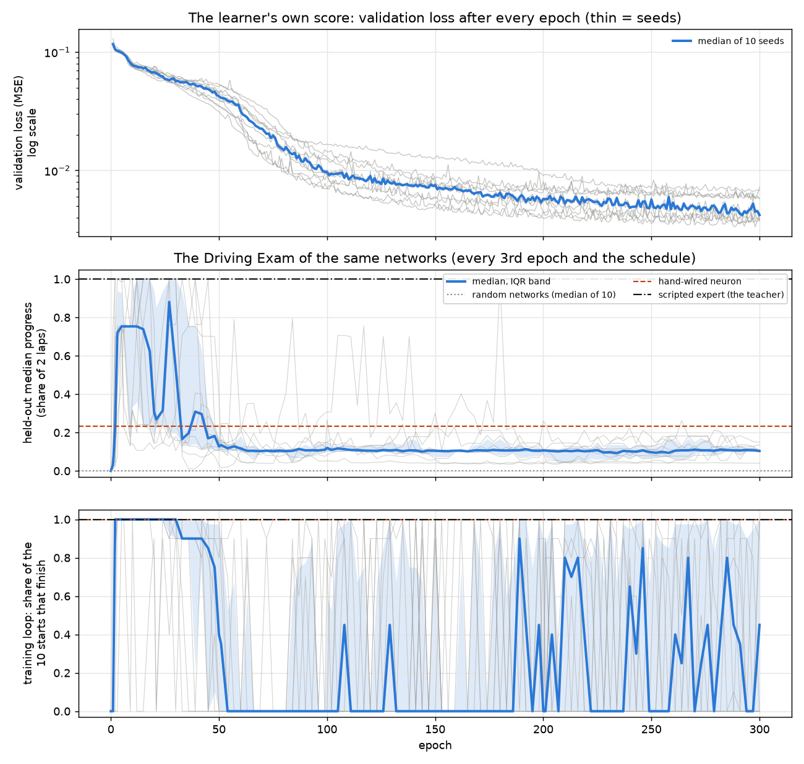
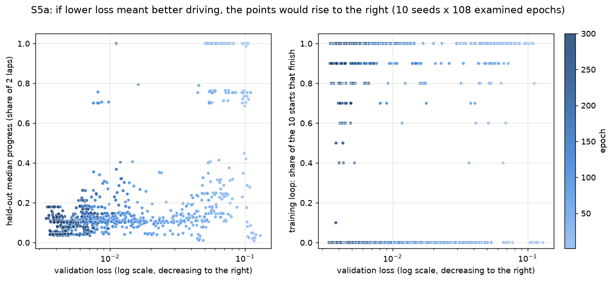
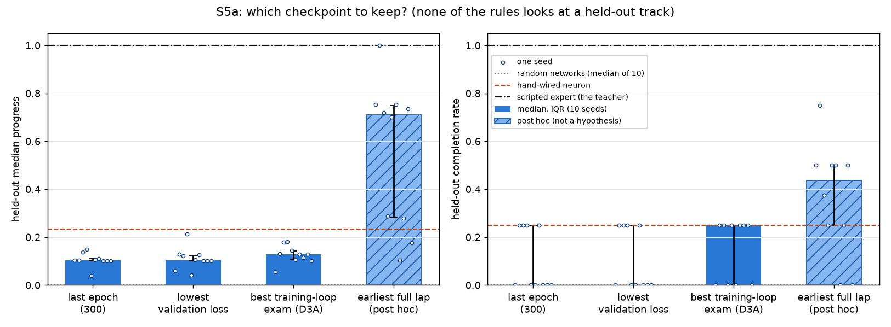
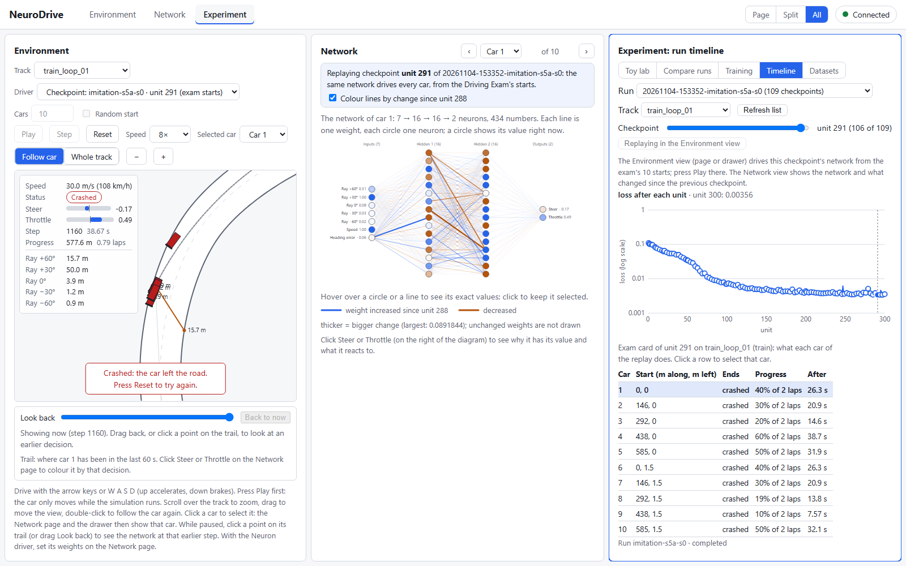
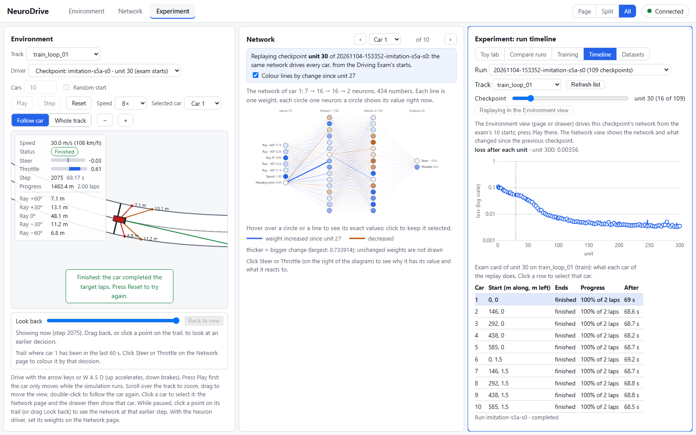

# Study S5a — Does a lower imitation loss mean better driving?

Task 6.4. It builds on:
- the demonstration dataset (6.1a);
- the dataset inspector (6.2);
- the imitation learner, with a checkpoint and Driving Exam every k epochs (6.3, ADR-047);
- the Driving Exam (5.4), the baselines (5.6) and the run timeline (5.9), where every network below can be replayed.

The runs carry `"study": "S5a"` in their meta.json (ADR-043).

## Question and hypotheses

**Question.** Behavioural cloning lowers one number, the mean squared error between the network's (steer, throttle) and the expert's on the expert's own frames. Does a network with a lower validation loss also drive better on the Driving Exam? Where, during training, do the two part? And which checkpoint should be kept, when the held-out tracks may not be used to choose (protocol rules 7 and 8)?

**Hypotheses** (written in the task Brief on 2026-11-04, before any S5a run; H1 restated for 300 epochs when the user chose D2B, still before any run):

- **H1 (the loss keeps falling):** in every seed, the validation loss at epoch 300 is below that at epoch 30, and the lowest validation loss among the examined epochs is at epoch 240 or later.
- **H2 (the loss does not rank drivers):** the median over seeds of the pairwise agreement A(V, P), between the validation loss and the held-out median progress over the examined epochs, is below 0.5. Keeping the lower-loss of two checkpoints picks the better held-out driver less often than a coin flip.
- **H3 (the clone laps its training track):** in every seed, some examined epoch among 1–10 finishes all 10 training-loop starts. This is the phase goal.
- **H4 (choose by the training exam, not by the loss):** the training-exam rule gives a higher held-out median progress than the min-loss rule. The median paired difference is above 0, and its bootstrap 95 % interval excludes 0.
- *Transparency:* H1, H2 and H4 were informed by one run: task 6.3's seed 0, 100 epochs, every epoch examined.
  - Its validation loss fell to 0.0070 at epoch 99–100.
  - Its training-loop laps fell from 36 of the first 45 epochs to 12 of the last 55.
  - Its epoch-100 network crashed from all 10 training starts.
  - H3 rests on the same run (10/10 at epoch 1) and on the scratch trial of the 6.3 Brief.

## What changed versus what was held fixed

- **Changed:** only the seed. The seed sets the starting weights, the shuffle that picks the 4 held-back episodes, and the minibatch order: three separate generators, `child_rng` "init", "split" and "batches".
- **Held fixed:**
  - the dataset `20261104-084617-expert-default`: 20 expert drives on `train_loop_01`, 39,338 frames, pinned by id and SHA-256;
  - the network: [7, 16, 16, 2], tanh hidden and output layers, Xavier initialisation, the same as every other method's;
  - the training: MSE, Adam with learning rate 0.003, batches of 256, 20 % of the episodes held back;
  - observation v1, action v1, physics v1, and the Driving Exam v1.
- The validation loss is the learner's own score: it appears only in its own panel (protocol rule 3). The study's question is about the relation within one method, so the two are compared rank by rank, never on a shared axis.
- No held-out track was used for training or for choosing a checkpoint (rule 7). The held-out tracks only *score* the checkpoints that the rules chose.

## Setup

- **Imitation:** `configs/imitation.yaml` with tag `s5a`, the dataset pinned by its id, **300 epochs, checkpointed and examined every 3rd epoch** (`checkpoint_every: 3`, decision D2B) and on the usual schedule (1, 2, 5, 10, 20, 50, 100, 200). That makes 108 examined epochs plus the untrained network at epoch 0. **Seeds 0–9** (decision D1A), one sweep, 6 runs at once in separate processes.
- **Baselines, made again for S5a** (ADR-043): random network seeds 0–9, the hand-wired neuron, and the scripted expert, which is the teacher itself. Their cards must equal task 5.6's.
- **Measures**, for seed k at examined epoch e:
  - V_k(e), the validation loss;
  - P_k(e), the held-out median progress (share of 2 laps, over the 40 held-out episodes);
  - C_k(e), the held-out completion rate;
  - T_k(e), the training loop's completion rate (share of its 10 starts that finish);
  - also the training loop's median mean speed, and each held-out track's median progress and completion.
- **Pairwise agreement** A_k (`experiment/stats.py: pairwise_agreement`). It looks at every pair of examined epochs whose losses differ:
  - the pair agrees when the lower-loss epoch has the strictly higher score;
  - it disagrees when it has the strictly lower score;
  - equal scores are left out.

  A_k = agree / (agree + disagree): 1 means the loss ranks the checkpoints as the exam does, 0.5 a coin flip, 0 the reverse. Spearman's rank correlation is reported beside it, for comparison.
- **Checkpoint rules** (none looks at a held-out track), each among the examined epochs:
  - *last*: epoch 300;
  - *min-loss*: the lowest validation loss;
  - *training-exam*: the highest training-loop completion, and among those the lowest validation loss (decision D3A).
- **Statistics** (`experiment/stats.py`, EXPERIMENT_PROTOCOL §4): median and IQR over the 10 seeds; bootstrap 95 % intervals (10,000 resamples, seed 2026) of the median agreement and of the paired difference between rules.
- **Reproduce:** `uv run --with matplotlib python scripts/study_s5a.py --train --figures` makes the 22 runs in `runs/` and analyses them. Without `--train` it only analyses the S5a runs it finds there.
- **Guard test:** `tests/learn/test_study_s5a.py`:
  - the checkpoint rules on the Brief's worked example;
  - every hypothesis rule on a hand-made set of run folders, including rules that must fail;
  - a study run equals a plain imitation run of the same seed.
- **Budget in other currencies:** every run read the same 39,338 demonstration frames, charged once. It used 0 environment steps for training (exams are never counted) and 0 teacher queries. Training took 30–58 s of wall clock per seed; the 109 exams per seed took 375–946 s, with 6 runs side by side on an 8-core machine. The whole study took 23.5 minutes (15:33:52–15:57:24 UTC).
- **Provenance:** the runs were made from commit `d97d7f5` plus the uncommitted task 6.4 changes (meta.json records `git_dirty: true`). Those changes are the study script and one new function in `experiment/stats.py`; neither touches the learner, the runner or the exam.
- **Checks that passed:**
  - **Seed 0 against the 6.3 run** (`20261104-150909-imitation-default`): its first 100 metrics lines and all 41 exam cards both runs hold are equal (apart from wall-clock times and the run name). The learner does not depend on the run's length.
  - **The baselines:** their 12 cards equal task 5.6's.
  - **The database:** `SELECT run_id FROM runs WHERE study = 'S5a'` lists the same 22 runs; its `studies` row says 22 runs, 4 methods, 2 sweeps.
  - **The analysis is reproducible:** run twice, it wrote `S5a_results.json` byte for byte identical.
- **Run IDs:**
  - imitation: `20261104-153352-imitation-s5a-s0` … `-s4`, `20261104-153443-imitation-s5a-s5`, `20261104-154423-imitation-s5a-s6`, `20261104-154711-imitation-s5a-s7`, `20261104-154759-imitation-s5a-s8`, `20261104-154933-imitation-s5a-s9`;
  - baselines: `20261104-153352-random_network-baseline-s0` … `20261104-153405-random_network-baseline-s9`, `20261104-153405-hand_neuron-baseline`, `20261104-153420-scripted_expert-baseline`.

  All 22 are in `S5a_results.json`, under `run_ids`.

## Results

### The loss and the exam, epoch by epoch (median over seeds 0–9)

| epoch | validation loss | held-out progress [IQR] | held-out completion | training loop finished |
|---|---|---|---|---|
| 0 (untrained) | – | 0.000 | 0.000 | 0.0 |
| 1 | 0.117 | 0.031 [0.022, 0.046] | 0.000 | 0.0 |
| 2 | 0.105 | 0.227 [0.063, 0.715] | 0.125 | 1.0 |
| 3 | 0.103 | 0.720 [0.486, 0.938] | 0.500 | 1.0 |
| 5 | 0.099 | 0.754 [0.740, 0.930] | 0.500 | 1.0 |
| 10 | 0.077 | 0.754 [0.332, 0.939] | 0.500 | 1.0 |
| 15 | 0.073 | 0.739 [0.242, 1.000] | 0.500 | 1.0 |
| 20 | 0.068 | 0.308 [0.177, 0.941] | 0.250 | 1.0 |
| 30 | 0.057 | 0.534 [0.196, 1.000] | 0.375 | 1.0 |
| 50 | 0.042 | 0.128 [0.110, 0.154] | 0.250 | 0.4 |
| 100 | 0.0097 | 0.120 [0.105, 0.149] | 0.000 | 0.0 |
| 200 | 0.0057 | 0.107 [0.099, 0.113] | 0.113 | 0.0 |
| 300 | 0.0042 | 0.104 [0.102, 0.110] | 0.000 | 0.45 |

- **The loss falls almost all the way, 28-fold:** from 0.117 to 0.0042. It falls fastest between epochs 30 and 100.
- **The driving does the opposite.** The held-out progress jumps to about 0.75 by epoch 3 and stays there to about epoch 15. It is unstable until about epoch 40, then collapses to about 0.10 and never comes back:
  - median of the epoch medians: 0.753 over epochs 3–15, 0.106 over epochs 51–300;
  - the highest late median: 0.135.
  - Nine of the ten seeds have at least one epoch, between 2 and 27, at which the median held-out start finishes both laps (progress 1.0).
- **The training loop follows the same pattern, less cleanly.** Every seed laps it from all 10 starts by epoch 5. The median falls to 0 from about epoch 55, then flickers between 0 and 1 epoch to epoch (bottom panel).
- **What the loss is made of.** Steering is learned almost at once: the steering part of the validation loss is 0.001–0.003 after epoch 1 and about 0.0002 from epoch 30 on. Nearly all the loss, and nearly all of its fall, is **throttle**: 0.22–0.26 at epoch 1, about 0.11 at epoch 30, 0.014–0.033 at epoch 100, and 0.007–0.014 at epoch 300. The collapse of the driving coincides with the network learning the expert's throttle.

### Does the loss rank the checkpoints? (pairwise agreement)

| seed | A(V, P), held-out progress | A(V, T), training loop | lowest-loss epoch | last epoch lapping all 10 starts |
|---|---|---|---|---|
| 0 | 0.211 | 0.346 | 291 | 300 |
| 1 | 0.414 | 0.484 | 297 | 282 |
| 2 | 0.502 | 0.413 | 288 | 300 |
| 3 | 0.450 | 0.208 | 279 | 141 |
| 4 | 0.190 | 0.101 | 291 | 45 |
| 5 | 0.442 | 0.578 | 300 | 300 |
| 6 | 0.402 | 0.462 | 288 | 297 |
| 7 | 0.289 | 0.342 | 297 | 192 |
| 8 | 0.325 | 0.036 | 300 | 39 |
| 9 | 0.201 | 0.571 | 300 | 300 |
| **median** | **0.364** [IQR 0.231–0.435; 95 % CI 0.211–0.442] | **0.379** [IQR 0.242–0.478; CI 0.208–0.517] | | |

- **The loss ranks checkpoints the wrong way round.** Of two checkpoints, the one with the lower validation loss is the better held-out driver in only 36 % of the pairs that differ (median over seeds). Only one seed (2) reaches a coin flip. Spearman's rank correlation between the loss and the held-out progress agrees: median +0.36, where a useful loss would give a clearly *negative* value.
- **On the training loop itself, the loss is no better:** 38 % (median). Six of the ten seeds still lap it from all 10 starts at some epoch after 280, so the late networks are not simply worse everywhere. They lap the training loop on some epochs and not on others, unpredictably, while the loss changes in the fourth decimal.
- **In the scatter plot** (1,080 points: 10 seeds × 108 examined epochs):
  - Of the 107 points with held-out progress of 0.7 or more, 99 have a loss above 0.04, all early epochs (light blue). The other 8 are seed 3 at epochs 105–138 (6 points), seed 6 at epoch 84 and seed 1 at epoch 180.
  - Of the 656 points with a loss below 0.01, 95.4 % have held-out progress of 0.2 or less.

### Which checkpoint to keep? (none of the rules looks at a held-out track)

| rule | epoch chosen (median) | held-out progress [IQR] | held-out completion [IQR] | training loop finished |
|---|---|---|---|---|
| last epoch (300) | 300 | 0.104 [0.102, 0.110] | 0.000 [0.000, 0.250] | 0.45 |
| lowest validation loss | 294 | 0.105 [0.102, 0.125] | 0.000 [0.000, 0.250] | 0.00 |
| best training-loop exam (D3A) | 256 | 0.129 [0.109, 0.142] | 0.250 [0.000, 0.250] | 1.00 |
| *earliest full lap (post hoc)* | *2* | *0.711 [0.281, 0.749]* | *0.438 [0.250, 0.500]* | *1.00* |
| baselines: random networks / hand-wired neuron / expert | – | 0.000 / 0.234 / 1.000 | 0.000 / 0.250 / 1.000 | 0.0 / 1.0 / 1.0 |

- **Training-exam minus min-loss**, paired by seed:
  - progress: **+0.025**, 95 % interval **[+0.002, +0.048]**;
  - completion: +0.25, interval [−0.125, +0.25], so no clear difference.
- **Training-exam minus last:**
  - progress: +0.025, interval [+0.002, +0.041].
- **Per held-out track** (median progress / completion):
  - **training-exam rule:** `train_loop_01_mirror` 1.00 / 1.00, `sweeper_01` 0.21 / 0, `monza_ccw` 0.07 / 0, `hairpins_01` 0.07 / 0. Its networks lap the training loop, and also its mirror image, but almost nothing else.
  - **min-loss rule:** the mirror is 0.28 / 0.
  - **post-hoc rule:** the mirror and the sweeper 1.00 / 1.00, Monza 0.24 / 0, hairpins 0.18 / 0.
- **Post hoc** (added after seeing the results; it is decision D3's option B, not a hypothesis): keep the *earliest* epoch that laps the training loop best. It picks epochs 1–5 and scores a median held-out progress of 0.711. That is 0.58 above the training-exam rule (paired interval [+0.12, +0.64]), and above the hand-wired neuron's 0.234. It is still far below the expert's 1.0: no rule's networks finish `hairpins_01` or `monza_ccw`.
  - Two seeds show its limits: seed 6's earliest lap (epoch 2) scores 0.103, below its later rules; seed 9's scores 0.175.

### The hypotheses

- **H1 (the loss keeps falling): supported.** In every seed V(300) < V(30); the lowest examined validation loss is at epochs 279–300 (and the lowest over all 300 epochs at 290–300).
- **H2 (the loss does not rank drivers): supported.** The median agreement is 0.364, below 0.5, and so is the upper end of its bootstrap interval, 0.442.
- **H3 (the clone laps its training track): supported.** Every seed's network finishes all 10 training-loop starts by epoch 5 (first full lap at epochs 1, 2, 2, 3, 2, 3, 2, 2, 5, 2). The phase goal "the cloned car laps the training track" is met, by early checkpoints.
- **H4 (choose by the training exam, not by the loss): supported, but the effect is small.** +0.025 held-out progress, interval [+0.002, +0.048]. The pre-registered rule's tie-break (the lowest loss among the best laps) pulls it to late epochs (median 256), which have the same problem as the min-loss rule. The post-hoc earliest-lap rule shows where the large difference lies, but it was not tested as a hypothesis.

## Failure analysis

**Seed 0, epoch 291, on `train_loop_01`** (run `20261104-153352-imitation-s5a-s0`; Experiment → Timeline, track `train_loop_01`, checkpoint unit 291, replayed at 8×). This is seed 0's lowest-loss network (validation loss 0.0038) and the one the min-loss rule keeps. On the track it learned from, all 10 cars crash, every one at the same place: 564–581 m along the lap, on the outside of a left bend. Car 1 (start 0) crashes at step 789 (26.3 s), 0.79 laps in.

- **What the views show at the crash.** The HUD says 30.0 m/s, which is the car's top speed, steer −0.17 (left), throttle 0.49.
  - The rays read 15.7, 50.0, 3.9, 1.2 and 0.9 m (far-left to far-right): the right edge is 1 m away.
  - The Network view shows the speed input at its maximum, 1.00, and the throttle output still positive.
  - The replay in Python gives the second before the crash:
    1. It enters the straight before the bend with the throttle at 0.87–0.97 and reaches 29.5 m/s.
    2. At 25.23 s, 1.07 s before the crash, the left ray jumps to its maximum (1.0: the bend opens a long view to the left).
    3. The network keeps the throttle at 0.94–1.00 and steers only −0.13 to −0.16. The car reaches 30 m/s and slides off.
- **What the teacher did there.** The expert's dataset has 622 frames within 6 m of the point where that view opens:
  - its speed there: median 21.7 m/s, at most 24.1;
  - it is braking: median throttle −0.42;
  - its left ray there never reads 1.0 (median 0.28).

  **In the whole dataset there is not one frame with the left ray at 1.0 and the speed reading above 0.9** (0 of 39,338). The highest speed reading in the data is 0.976, while the network arrived at 0.983 and reached 1.0. So the network was in a state its training data never contained, and what it did there was not learned from anything.
- **The same network earlier in training.** Epochs 5 and 30 of the same seed pass that point at 21.7 and 23.1 m/s with the throttle near 0 (+0.12 and −0.04). Every one of their cars finishes; the epoch-30 network's 10 cars take 68.2–69.2 s.

- **The 6.3 run shows the same mechanism** at its epoch 100, crashing at 271 m from start 0.
  - In the frames where the expert's left ray reads 1.0 (2.9 % of the dataset), the expert brakes (median throttle −0.26), and it is slow there (median speed reading 0.48).
  - The late network arrives at that view fast (0.78) and floors the throttle (0.99).
- **What this shows:** a crash in a state the expert never visited, reached because the network was a few m/s faster than the expert on the approach.
- **What it does not show:** *why* the late networks are faster on that straight while matching the expert's throttle better on its own frames. Study S5b (6.5) is planned to find out, with perturbed starts and the Network view's contributions.

## Conclusion

- **Low imitation loss does not mean good driving, and over most of training it means worse driving.**
  - In all ten seeds the validation loss fell steadily over 300 epochs (H1), while the held-out driving peaked within the first 15 epochs and then collapsed to about 0.10 median progress, below the hand-wired neuron's 0.234.
  - The loss ranks pairs of checkpoints the wrong way round 64 % of the time (H2).
- **The cloned car does lap its training track,** in every seed by epoch 5 (H3, the phase goal). But the networks the loss calls best mostly do not lap it any more.
- **Choosing the checkpoint matters more than training longer.** Neither the lowest loss nor the last epoch is a good choice. The pre-registered training-exam rule is only slightly better (+0.025, H4) because its tie-break also prefers late, low-loss networks. Keeping the *earliest* checkpoint that laps the training loop did much better in this study (0.711), but that rule was chosen after seeing the results. It should be tested on fresh seeds, or in S5c, before it is trusted.
- **Uncertain:**
  - **One dataset, one teacher, one network size,** and 300 epochs. A different dataset (more varied starts, DAgger's data in 6.6) may change when and whether the collapse happens.
  - **The mechanism has one inspected case.** The failure analysis shows it twice (the 6.3 run and seed 0 here), with the same signature, but that is not yet shown to be the cause in every seed.
  - **The validation loss is measured on held-back drives of the same track,** so it was never a test of new situations; that is part of why it misleads.

## What this teaches about AI

- A training loss is a stand-in for what we actually want. When the data covers only the situations the teacher created, the stand-in and the goal can move in opposite directions.
- Here, gradient descent kept improving the copy of the expert's throttle on the expert's own frames, and the result drove worse: a few km/h faster on an approach is enough to reach a state the data never contained.
- Picking "the best model" by its own score would have picked the worst drivers. Judging a learner needs an outside test of the behaviour itself (the Driving Exam), and data that covers the states the learner will create. That is what DAgger (6.6) adds.
