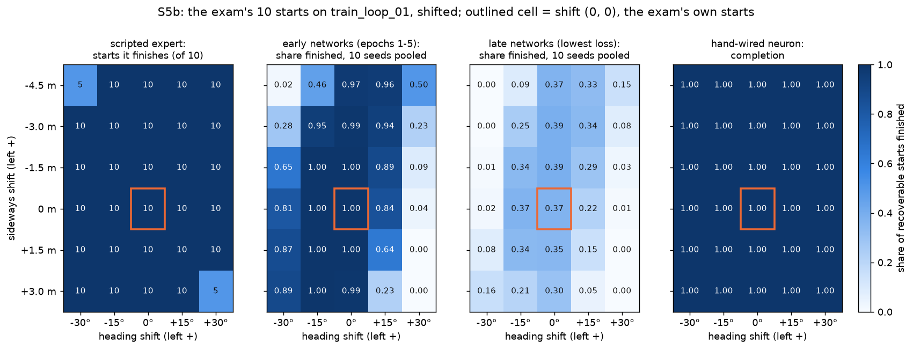
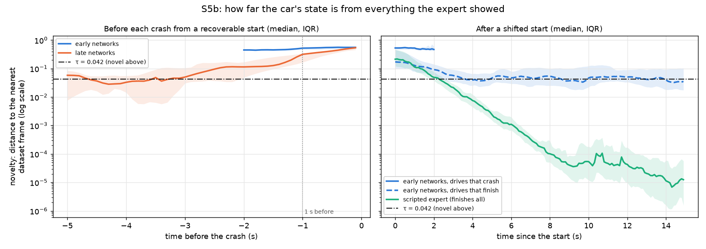
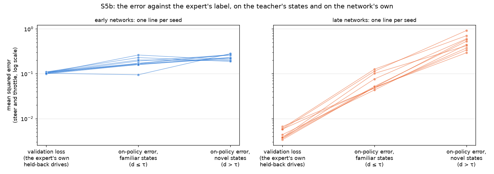
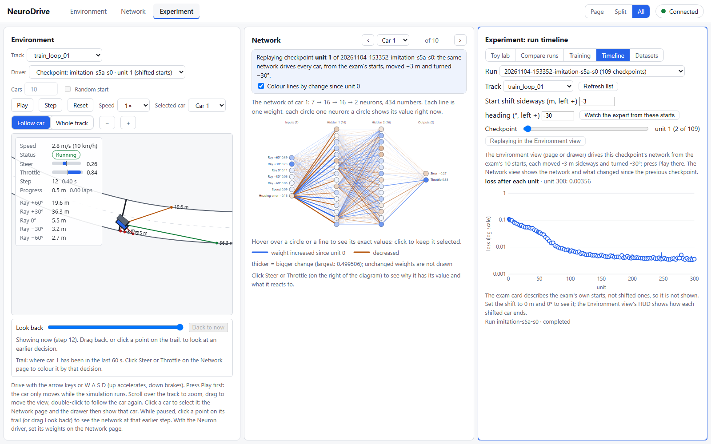
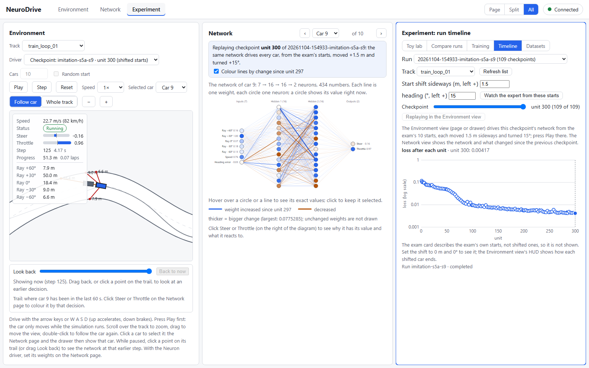
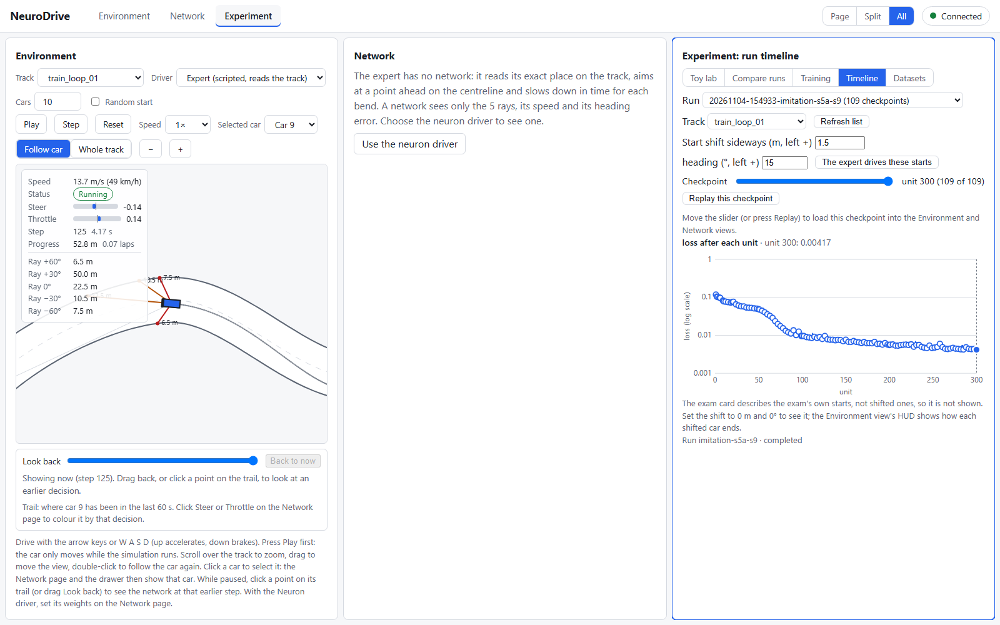

# Study S5b — Where does a cloned driver fail, and are its crashes in states the expert never visited?

Task 6.5. It builds on:
- Study S5a (6.4): its 10 imitation runs (seeds 0–9, 300 epochs) and its baselines; no network is trained for S5b;
- the demonstration dataset (6.1a) and the dataset inspector's coverage numbers (6.2);
- the Driving Exam's starts (5.4), the scripted expert as a teacher that can label any state (5.3), and the run timeline (5.9), which since this task replays a checkpoint from shifted starts (api v1.18, ADR-048).

## Question and hypotheses

**Question.** Behavioural cloning learns only from the states the teacher visited: the expert drives near the centreline, pointing along the road. Start the clone somewhere the teacher never was, shifted sideways and turned, on the very loop it learned. Does it recover as the teacher does? When it crashes, was the car in a state the dataset holds nothing like (distribution shift)? And is the clone's error larger there than on the teacher's own states?

**Measures** (defined in the task Brief, before any drive):
- **Shifted starts:** the exam's 10 starts on `train_loop_01`, each moved by one shift (δ, θ): δ metres added sideways (left positive), θ added to the heading (left positive), from rest (`experiment/exam.py: shifted_starts`). Grid (decision D3A): δ ∈ {−4.5, −3, −1.5, 0, +1.5, +3} m and θ ∈ {−30°, −15°, 0°, +15°, +30°}: 30 shifts × 10 starts = 300 starts per driver. Shift (0, 0) is the exam itself.
- **Recoverable start:** a start from which the scripted expert finishes 2 laps. Only these count.
- **Novelty** d(o) of a state with observation o: the distance, in the network's 7 inputs, to the nearest of the dataset's 39,338 frames (`experiment/dataset_view.py: nearest_distances`). **Threshold τ:** the 99th percentile of every dataset frame's distance to the nearest frame of a *different* episode (`novelty_threshold`). A state is *novel* when d > τ, *familiar* otherwise. Measured every 3rd step (0.1 s).
- **On-policy error:** at every step of the network's own drive, the squared difference between its (steer, throttle) and the expert's label for that same state, averaged as in the validation loss: L_on = (1 / 2T) Σ_t Σ_k (ŷ_t,k − y*_t,k)². Split into familiar and novel steps (on the steps where novelty is measured).
- **Crash from an unvisited state:** the novelty 1 s (30 steps) before the crash is above τ. (At the wall itself every state is novel: the expert never drives within 1 m of an edge.)

**Networks** (decision D2A), from S5a's run folders, per seed:
- **early:** the earliest examined epoch that finishes all 10 training-loop starts (S5a's earliest-lap rule; epochs 1–5);
- **late:** the examined epoch with the lowest validation loss (epochs 279–300).
- References: the scripted expert, the hand-wired neuron, random networks for seeds 0–9 (S5a's baseline runs).

**Hypotheses** (written in the task Brief on 2026-11-04, before any drive from a shifted start; informed only by S5a's published results):

- **H1 (the clones are fragile off the teacher's starts):** for the early networks, the median over seeds of the completion on recoverable *shifted* starts (shift (0, 0) left out) is below their completion from the exam's own starts (1.0 in every seed, by S5a's rule). The paired bootstrap interval of the difference excludes 0.
- **H2 (crashes come from unvisited states):** for the early networks and, separately, for the late networks, the median over seeds of the share of crashes (from recoverable starts) whose state 1 s before the crash is novel is above 0.5. Seeds without a crash have no share and are left out.
- **H3 (the clone's error is larger off the data):** for the early networks, in every seed with at least 100 measured steps of each kind, the on-policy error on novel steps is larger than on familiar steps.
- **H4 (late networks copy better on the data and worse off it; S5a's open question):** paired by seed, the late minus the early network's on-policy error is below 0 on familiar steps and above 0 on novel steps, and both bootstrap intervals exclude 0. Seeds where either network has fewer than 100 measured steps of a kind are left out.

## What changed versus what was held fixed

- **Changed:** only the start: its sideways offset and its heading.
- **Held fixed:** the networks (S5a's checkpoints, unchanged), the training track `train_loop_01`, the 2-lap goal and its 92 s limit, observation v1, action v1, physics v1, and the expert. Each shift's 10 starts are driven as one batch of 10 cars, as the exam does, so shift (0, 0) reproduces each network's exam card exactly.
- No held-out track is used: the study asks about the shift away from the teacher's states on the track the clone learned, without a new road on top.

## Setup

- **Drivers:** 32, from S5a's run folders (their `"study": "S5a"`):
  - the early and late networks of seeds 0–9: early epochs 1, 2, 2, 3, 2, 3, 2, 2, 5, 2 and late epochs 291, 297, 288, 279, 291, 300, 288, 297, 300, 300 (seed 0 first). All 20 equal S5a's published earliest-lap and min-loss choices;
  - the scripted expert, the hand-wired neuron (its 7 → 2 checkpoint) and the random networks of seeds 0–9.
- **Starts:** 300 per driver on `train_loop_01` (92 s, 2 laps), each shift's 10 starts driven as one batch.
  - Starts 5–9 of shift δ are the same poses as starts 0–4 of shift δ + 1.5 m. So the 300 starts hold 175 distinct poses, and the central offsets count twice (noticed after the Brief).
  - Twin starts always end alike, because the drive is deterministic. A post-hoc completion over distinct poses is given next to the main one; it changes no conclusion.
- **Novelty** is measured against the pinned dataset `20261104-084617-expert-default` (39,338 frames, 20 drives).
  - The other-episode distances are tiny: median 0.000007, 90th percentile 0.0007, 99th percentile **τ = 0.0423**, largest 0.241. The expert's 20 drives follow almost the same line, so its frames are nearly copies of one another.
  - So "novel" here means "farther from the data than 99 % of the expert's frames are from its other drives". That is a strict test: a car a little slower than the expert on the same line can already be novel.
- **Statistics:** median and IQR over the 10 seeds; bootstrap 95 % intervals (10,000 resamples, seed 2026, `experiment/stats.py`). A difference between two medians is resampled in pairs by seed, as in S5a.
- **Reproduce:** `uv run --with matplotlib python scripts/study_s5b.py --drive --figures` drives every driver into a cache in `runs/.s5b/` (51 MB, git-ignored) and analyses it. Without `--drive` it only analyses the cache.
- **Guard test:** `tests/learn/test_study_s5b.py`:
  - the Brief's worked examples (L_on 0.395; familiar 0.0925 and novel 1.0);
  - the labelling wrapper leaves a drive unchanged, bit for bit;
  - shift (0, 0) equals the exam;
  - which starts a driver's record counts;
  - every hypothesis rule on hand-made records that must pass and records that must fail.
- **Budget in other currencies:**
  - nothing was trained: 0 training environment steps, 0 demonstration frames, 0 teacher queries for learning;
  - the analysis drove 7,772,761 car-steps and asked the expert for 7,201,420 labels of learner states, for measuring only. Those labels are exactly the queries DAgger (6.6) would make, and there they would count in the budget;
  - about 15 minutes of wall clock with 6 drivers at once (64 CPU-minutes in all).
- **Provenance:** commit `4488986` plus this task's uncommitted changes. The networks are S5a's checkpoints, unchanged.
- **Checks that passed:**
  - **Shift (0, 0) is the exam:** for all 32 drivers, every car's status and progress equal its exam card's training-loop part, to the last digit.
  - **The analysis is reproducible:** run twice, it wrote `S5b_results.json` byte for byte identical.
  - **The views agree with the script:** replayed in the Timeline with the new start shift, the inspected cars show the speed, steer and throttle of the script's record (below).

## Results

### Which shifted starts each driver survives

- **The expert recovers from 290 of the 300 starts.** The 10 it cannot drive put the car 4.5 m off centre (0.5 m from the edge), pointing 30° towards that edge. They are left out everywhere below.
- **Early networks** (the clones that lap the exam's starts):
  - finish a median **0.70** of the recoverable shifted starts [IQR 0.65–0.72] (distinct poses: 0.71), against 1.00 from the exam's own starts;
  - crash on a median 0.075 of them; the rest of the failures stall or time out.
  - They survive most sideways shifts when pointing straight or turned 15° right. They fail when turned 30° towards the near edge.
  - **Turned 30° to the left, they fail from almost every offset** (pooled 0.00–0.23; 0.50 from 4.5 m right). This left/right asymmetry is not explained by this study.
- **Late networks** (lowest validation loss):
  - median **0.00** [IQR 0.00–0.45]. Six of the ten seeds finish nothing, not even the exam's own starts, as S5a found;
  - seeds 1, 5, 6 and 9, which still lap some exam starts, finish 0.43–0.56 of the shifted ones;
  - crash on a median 0.44.
- **Hand-wired neuron: 1.00.** It finishes every recoverable shifted start, 290 of 290. Its single rule (steer by the difference between the left and the right ray) reads the road directly, so a start the expert never used is no different to it.
- **Random networks: 0** in every seed, as on the exam.

### Is the car in a state the expert never visited?

- **Every crash, of every network, comes from a novel state:** the novelty 1 s before the crash is above τ for 259 of 259 early crashes and 1,471 of 1,471 late crashes.
- **For the early networks this is close to true by construction:**
  - 89 % of their crashes happen within 2 s of the start and none after 5 s (median 1.2 s). One second before the crash the car is still in its shifted pose, which is itself far from the data (median novelty 0.52, 12 times τ).
  - On the drives they *finish*, early networks spend a median **54 %** of their steps in novel states. Their median novelty settles near τ (0.047 at 5 s and at 10 s).
  - The expert drops to 0.0024 by 5 s and 0.00005 by 10 s: it returns exactly to its own line. The clone returns only near it.
  - So a novel state does not mean a crash. An early clone usually gets away with being off the data at low speed; its crashes are the starts it cannot get out of at once.
- **The late networks show the compounding pattern:**
  - 61 % of their crashes come after more than 5 s of driving (median 8.6 s), most of them mid-lap (159–578 m along, 10th to 90th percentile) at a median 30 m/s, the top speed;
  - in the 5 s before a crash, the median novelty climbs from about τ (0.05 at 3 s before) to 0.32 at 1 s before and 0.54 at the crash;
  - on the drives they finish, only 13 % of their steps are novel (median of the 4 seeds that finish some).

### The error on the teacher's states and on the network's own

| | validation loss (the expert's held-back drives) | on-policy error, familiar states | on-policy error, novel states |
|---|---|---|---|
| early networks | 0.105 [0.103, 0.108] | 0.170 [0.162, 0.200] | 0.229 [0.208, 0.263] |
| late networks | 0.0041 [0.0036, 0.0058] | 0.051 [0.049, 0.095] | 0.486 [0.386, 0.595] |

Medians [IQR] over the 10 seeds, recoverable starts only. The error is the squared difference from the expert's label, averaged over steer and throttle, as in the validation loss.

- **On their own states the late networks are 12 times worse than the validation loss says, even where those states look familiar.** On novel states they are about 120 times worse.
- **Almost all of the error is throttle**, as in S5a's loss: the on-policy steer error is 0.005 (early) and 0.017 (late), the throttle error 0.40 and 0.51.
- **Early networks are uniformly mediocre.** They have not yet learned the expert's throttle (S5a: epochs 1–5), so their error is large everywhere, and only about a third larger off the data.

### The hypotheses

- **H1 (the clones are fragile off the teacher's starts): supported.** Early networks finish a median 0.698 of the recoverable shifted starts, against 1.0 from the exam's starts. The paired difference is **−0.30**, 95 % interval **[−0.38, −0.27]**.
- **H2 (crashes come from unvisited states): supported, but read it with care.** The median share of crashes from a novel state is 1.0 for the early networks and 1.0 for the late networks, in every seed. For the early networks this mostly restates that the shifted start is itself novel (above); the late networks' crashes are the informative ones.
- **H3 (the clone's error is larger off the data): not supported.** In 7 of the 10 seeds the early network's error on novel steps is larger (ratios 1.37–2.96). In seeds 3, 5 and 7 it is smaller (0.78, 0.82, 0.96), and the rule asked for every seed. The early networks' throttle error is large on familiar states too, so being off the data adds little to it.
- **H4 (late networks copy better on the data and worse off it): supported.** Late minus early, paired by seed:
  - on familiar steps **−0.119**, interval **[−0.152, −0.074]**;
  - on novel steps **+0.257**, interval **[+0.143, +0.419]**.

  This answers S5a's open question. 300 epochs make the network a better copy of the expert's throttle where the expert drove, and a worse guesser everywhere else.

## Failure analysis

Two crashes, each replayed in Experiment → Timeline with the new start shift (task 6.5, ADR-048) and stepped to 1 s before the crash. The numbers come from the script's record (`S5b_results.json`, `inspected`); the views show the same values.

**1. An early clone that cannot leave its start** (run `20261104-153352-imitation-s5a-s0`, unit 1; shift −3 m, −30°; car 1, exam start 0 at s = 0).

- **The start:** 3 m right of the centreline, pointing 30° to the right, at rest. The expert finishes 2 laps from the same start in 66.0 s; the same network finishes from the unshifted start in 65.7 s.
- **1 s before the crash** (step 12, 0.4 s after the start), at 2.8 m/s:
  - inputs: rays 0.39, 0.73, 0.11, 0.06, 0.05 (the far-right edge is 2.7 m away), speed 0.09, heading error **−0.16** (the 30° turn);
  - the network steers **−0.26** (a little left), throttle 0.83. The expert's label for the same state is **−0.72** (hard left), throttle 1.0;
  - the car crashes at step 42 (1.4 s), 5 m along, at 6.2 m/s.
- **Why so little steering?** The nearest dataset frame (novelty 0.60, 14 times τ) is a car at rest on the centreline at the start of an expert drive, heading error −0.02, labelled steer **−0.245**. The network does almost exactly what it would do there: it acts as if it were in the nearest situation it knows.
- **The sensitivities** (the Network view's "what it reacts to"): steer moves by only +0.06 per unit of the heading-error input, against +0.43 per unit of the −30° ray. In the dataset the heading error barely changes (the expert always points along the road), so the network never learned to steer by it. A 30° heading error, which should dominate the decision, hardly registers.

**2. A late clone that recovers, then arrives too fast** (run `20261104-154933-imitation-s5a-s9`, unit 300; shift +1.5 m, +15°; car 9, exam start 8 at s = 438 m, so 3 m left of the centreline and turned 15° left).

- From the unshifted start 8 this network finishes (64.9 s). From the shifted start the expert finishes (65.4 s).
- **It first recovers towards the data.** The novelty falls from 0.46 at the start to 0.02–0.04 at about 3 s; 2 s before the crash it is 0.036, familiar.
- **Then it approaches the next bend faster than the expert ever did.** 1 s before the crash (step 125, 4.2 s):
  - 22.7 m/s; the left ray opens to its maximum (1.0); novelty 0.16 (4 times τ);
  - the network holds the throttle at **+0.97**, where the expert's label is **−1.0** (full braking);
  - the nearest dataset frame has the same open left view at a speed reading of 0.67 (20 m/s), and the expert brakes there (−0.43).
- **The expert from the same start is at 13.7 m/s at that moment** (throttle +0.14), on a slower line through its recovery.

- The clone reaches 28 m/s and leaves the road at step 155 (5.2 s), 514 m along; by then the novelty has risen to 0.56.
- **This is S5a's mechanism, started by a small push.** A recovery line the expert never drove brings the car to the bend faster than any expert frame, and there the late network's throttle, a near-perfect copy on the expert's own frames, is an extrapolation.

## Conclusion

- **The clones are fragile off the teacher's starts (H1).** The networks that lap the exam's own starts finish only about 70 % of the starts the expert recovers from, on the very track they learned. A hand-wired single neuron finishes all of them.
- **Their crashes are in states the dataset holds nothing like (H2), but that alone explains little.**
  - Early clones fail in the first 2 s, still in a pose the expert never showed. They do not use the input that matters there (the heading error), because the data never varied it.
  - Late clones fail after a recovery, through compounding errors: a slightly different line, a faster approach, and a throttle that keeps pressing where the expert braked.
  - Being off the data is common even on finished drives (54 % of the early clones' steps), so novelty is necessary for these crashes, not sufficient.
- **Longer training trades robustness for accuracy on the data (H4).** The late networks' on-policy error on familiar states is a third of the early ones', and on novel states twice as large. The early networks' error is not larger off the data in every seed (H3 not supported), because they are poor at the throttle everywhere.
- **Uncertain:**
  - **One track, one dataset, one teacher, and starts from rest only.** A push at speed (decision D3's option C) could fail differently.
  - **τ is strict,** because the expert's drives are nearly identical. Another threshold would move the novel/familiar split, though not the crash timing or the error ratios between early and late.
  - **The +30° asymmetry is unexplained.**
  - **Only two crashes were inspected,** chosen after the results.

## What this teaches about AI

- A model trained by copying is only as good as the situations it was shown. Here the teacher always pointed along the road, so its student never learned to use the one input that says "you are pointing the wrong way". An input the data never varies is an input the model learns to ignore.
- Training longer made the copy more exact on the teacher's own states and worse everywhere else. The validation loss is measured on the teacher's states, so it could not see the problem.
- The fix is not more of the same data. It is data from the states the learner itself drives into, labelled by the teacher, which is what DAgger (6.6) does. This study's on-policy labels are exactly those queries, and its shifted starts, completion rates and on-policy errors are the measures DAgger has to improve.
