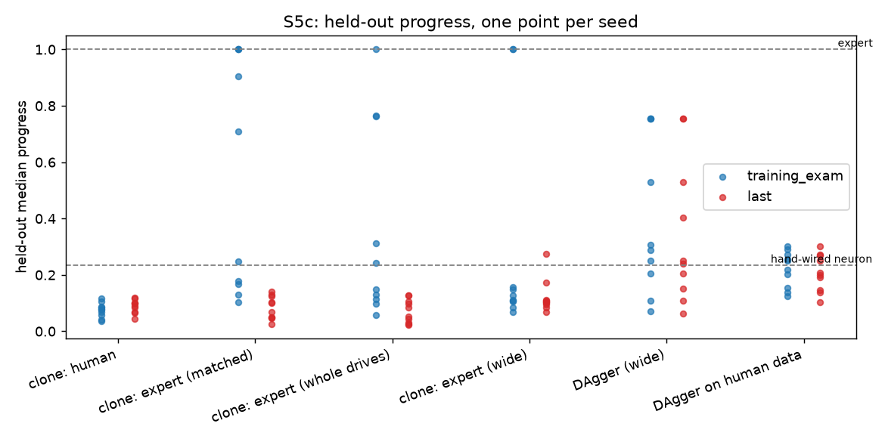
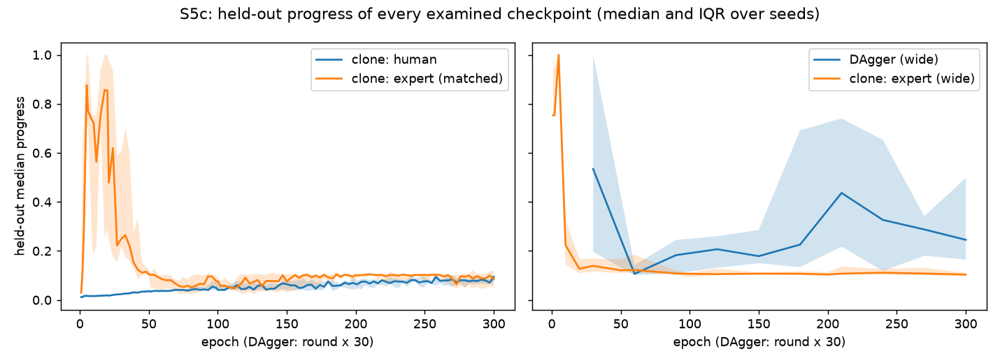

# Study S5c — Does the teacher matter, and does DAgger beat cloning on held-out tracks?

Task 6.7. It builds on:
- the demonstration datasets (6.1a, 6.1b) and the dataset tools made for it (`nd demo-merge`, `nd demo-record --starts-from`, ADR-052);
- the imitation learner (6.3), Studies S5a (6.4) and S5b (6.5), and DAgger with wide collection starts (6.6, ADR-050);
- the Driving Exam (5.4), the baselines (5.6) and the run timeline (5.9).

The runs carry `"study": "S5c"` in their meta.json (ADR-043).

## Question and hypotheses

**Question.** (A) Is a person a worse teacher than the scripted expert, when both start from the same starting poses and give the same number of frames? (B) Does DAgger beat plain cloning on the Driving Exam's held-out tracks, when both have used about the same number of expert labels? (C) Can DAgger repair a person's data?

**Hypotheses** (written in the task Brief on 2026-11-11, before any S5c run and before the keyboard data was merged; informed by S5a, S5b and 6.6, not by any keyboard data). Each reads the checkpoint that S5a's *training-exam rule* picks in each run (the highest training-loop completion; among those the lowest validation loss; it reads no held-out track, protocol rules 7 and 8). P is the held-out median progress.

- **T1 (the human is a worse teacher):** paired by seed, the median of P(expert clone, matched) − P(human clone) is above 0 and its bootstrap 95 % interval excludes 0.
- **T2 (a human's data suffices for the training loop):** in at least 5 of 10 seeds, some examined epoch of the human clone finishes all 10 training-loop starts.
- **T3 (matching matters):** the median P of the clone on whole expert drives is at least that of the clone on the matched expert data.
- **D-1 (DAgger helps on held-out tracks):** the median paired P(DAgger-wide) − P(wide clone) is above 0, interval excluding 0.
- **D-2 (DAgger is steadier):** the IQR over seeds of P is smaller for DAgger-wide than for the wide clone.
- **D-3 (select, don't take the last):** for DAgger-wide, the median paired P(rule) − P(last round) is above 0, interval excluding 0.
- **H-1 (DAgger repairs human data):** the median paired P(DAgger on human data) − P(human clone) is above 0, interval excluding 0.

*Honest priors, written with them:* the 6.6 follow-up found DAgger-wide better than the wide clone in only 3 of 5 seeds on shifted starts, so D-1 was a real question.

## What changed versus what was held fixed

- **Part A changed only the teacher's data:** the 22 keyboard drives (human), the expert's first n_i frames from the same 22 starting poses (matched) and the expert's whole drives from them (whole). Same starts; the human and matched datasets have exactly the same number of frames, 33,812, drive by drive.
- **Part B changed only the learning method:** DAgger-wide (6.6 follow-up) against a clone on the wide expert dataset (196,765 frames), about the same number of expert labels (below).
- **Part C changed only the data of round 1:** DAgger-wide with the human dataset instead of the 6.1a expert dataset.
- **Held fixed in every arm:** the network [7, 16, 16, 2] (tanh, Xavier), MSE, Adam 0.003, batches of 256, 20 % of the episodes held back for validation, 300 epochs (DAgger: 10 rounds of 30), observation v1, action v1, physics v1, Driving Exam v1. Ten seeds (0–9): the seed changes the starting weights, the held-back episodes and the minibatch order, and for DAgger the collection starts. **The human data is fixed: one person, one sitting.**
- No held-out track was used for training or for choosing a checkpoint. The held-out tracks only *score* the chosen checkpoints.

## Setup

- **The human data:** 22 drives on `train_loop_01`, recorded on 2026-11-11 with the keyboard in the live session (task 6.1b): 8 sessions (the fixed start with 3 drives, seeds 1–7 with 2–4 drives), merged with `nd demo-merge` into `20261111-073610-keyboard-s5c`: **33,812 frames**, 16 drives finished 2 laps, 6 crashed.
- **The expert from the same starts:** `nd demo-record --starts-from keyboard-s5c --match-frames` → `20261111-073613-expert-s5c-match` (33,812 frames, every drive cut at the human drive's frame count, status `truncated`); without `--match-frames` → `20261111-073617-expert-s5c-full` (43,306 frames, all 22 drives finished).
- **Arms** (all with seeds 0–9, tags `<tag>-s<k>`):

| arm | method, data | length, examined |
|---|---|---|
| `human` (`s5c-human`) | imitation, human | 300 epochs, every 3rd |
| `e_match` (`s5c-ematch`) | imitation, expert from the human's starts, same frames | 300 epochs, every 3rd |
| `e_full` (`s5c-efull`) | imitation, expert's whole drives from those starts | 300 epochs, every 3rd |
| `clone_wide` (`s5c-cw`) | imitation, wide expert dataset `20261110-111643-expert-wide` | 300 epochs, every 30th |
| `dagger_wide` (`s5c-dw`) | DAgger, `configs/dagger_wide.yaml`, round 1 on `expert-default` | 10 rounds, every round |
| `dagger_human` (`s5c-dh`) | DAgger, `configs/dagger_wide.yaml`, round 1 on the human data | 10 rounds, every round |

- **Baselines, made again for S5c** (ADR-043): random networks seeds 0–9, the hand-wired neuron, the scripted expert.
- **Checkpoint rules** (none looks at a held-out track): *last*; *min_loss*; *training_exam* (S5a's, the pre-registered one). **Post hoc**, added after the results and marked as such wherever it appears: *earliest_lap*, the earliest examined checkpoint with the highest training-loop completion (S5a's post hoc rule).
- **Statistics:** median and IQR over the 10 seeds; paired differences are the median of the 10 per-seed differences with a bootstrap 95 % interval (10,000 resamples of the seeds, seed 2026).
- **Reproduce:** `uv run --with matplotlib python scripts/study_s5c.py --train --figures` (about 1.5 h with `--workers 8`; resumable). Without `--train` it only analyses. The merged dataset and the two expert datasets are made as above.
- **Guard test:** `tests/learn/test_study_s5c.py` (paired difference on the Brief's three-seed example, label ratio, the checkpoint rule reading no held-out number, every hypothesis rule on hand-made runs including rules that must fail, a study run equals a plain run); `tests/learn/supervised/test_demo_tools.py` and `tests/test_cli_demo_tools.py` for the tools.
- **Budgets:** below, in every currency.
- **Provenance:** runs made from commit `3be8d9d` plus the uncommitted task 6.7 changes (meta.json records `git_dirty: true`): the two dataset tools, the study script and its tests. No learner, exam or server code changed.
- **Checks that passed:**
  - **Seeds 0–4 of the DAgger-wide and wide-clone arms equal the 6.6 follow-up's runs** (`checkwide-s<k>`, `checkwide-bc-s<k>`): their metrics lines (all but the wall-clock time) are equal in 5 of 5 runs of each arm, and 55 of 55 and 95 of 95 shared exam cards are equal. Retraining is exactly reproducible.
  - **The database:** `SELECT run_id FROM runs WHERE study = 'S5c'` lists the same 72 runs as the folders (60 study runs, 12 baselines).
  - **The analysis is reproducible:** run twice, `S5c_results.json` is byte for byte identical.
  - **The human clone's worst episode replays as its card says** (status `stalled`).
- **One run was interrupted and resumed:** `20261111-083219-imitation-s5c-efull-s1` failed at epoch 115 with a Windows `PermissionError` while replacing its state file (an operating-system file lock; the training code is unchanged and the other 59 runs were not affected). `nd resume` continued it from epoch 115 and it completed; a resumed run equals an uninterrupted one apart from wall-clock times (task 5.7's test), but its wall-clock figure is not comparable.

## Results

### What a person's labels look like (descriptive)

| | human (22 drives) | expert, same starts and frames | expert, whole drives | 6.1a expert |
|---|---|---|---|---|
| frames | 33,812 | 33,812 | 43,306 | 39,338 |
| drives finished / crashed / cut | 16 / 6 / 0 | 0 / 0 / 22 cut | 22 / 0 / 0 | 20 / 0 / 0 |
| distinct steering values | **3** | 14,132 | 15,748 | 39,338 |
| steering exactly 0 | 24.5 % | 0 % | 0 % | 0 % |
| steering at full lock (±1) | **75.5 %** | 0 % | 0 % | 0 % |
| "nearly straight" (\|steer\| < 0.1) | 24.5 % | 88.9 % | 88.6 % | 88.2 % |
| mean change of steering per step | **0.062** | 0.0010 | 0.0010 | 0.0010 |
| full throttle / braking | 71 % / 8 % | 33 % / 27 % | 32 % / 27 % | 32 % / 27 % |
| mean speed, median finished drive | 24.8 m/s, 58.5 s | 22.0 m/s | 22.2 m/s, 65.6 s | 22.2 m/s, 65.5 s |

The person steered by holding left or right most of the time (three-quarters of the frames at full lock) and switching direction constantly, where the expert's labels are small and smooth; the person drove faster (58 s per two laps against 66 s) and braked far less. The "88 % nearly straight" the earlier studies reported for the expert is the reverse of the person's 24.5 %.

### Held-out progress of the checkpoint each rule picks (median [IQR] over 10 seeds)

| arm | training-exam rule (pre-registered) | completion / crash (held-out) | training loop finished | median chosen epoch | last checkpoint | *post hoc: earliest lap* |
|---|---|---|---|---|---|---|
| clone, human | 0.079 [0.060, 0.086] | 0.00 / 0.90 | 0.15 | 232 | 0.094 | 0.068 [0.018, 0.099] |
| clone, expert (matched) | 0.478 [0.170, 0.976] | 0.34 / 0.46 | 1.00 | 27 | 0.085 | 0.296 [0.202, 0.558] |
| clone, expert (whole drives) | 0.195 [0.117, 0.651] | 0.25 / 0.59 | 1.00 | 158 | 0.068 | 0.315 [0.200, 0.723] |
| clone, expert (wide) | 0.119 [0.106, 0.154] | 0.00 / 0.90 | 1.00 | 235 | 0.104 | **0.753 [0.739, 1.000]** |
| DAgger-wide | 0.297 [0.217, 0.697] | 0.33 / 0.63 | 1.00 | round 9.5 | 0.245 | 0.732 [0.265, 1.000] |
| DAgger on human data | 0.234 [0.167, 0.269] | 0.00 / 0.99 | 1.00 | round 8.5 | 0.203 | 0.249 [0.171, 0.269] |

References (never trained on a held-out track): random networks, median 0.000 (largest 0.038, 10 seeds); the hand-wired neuron 0.234; the scripted expert 1.000.

### The hypotheses, as written

| | result | supported? |
|---|---|---|
| **T1** human worse than matched expert | median paired difference **+0.415**, 95 % interval [+0.061, +0.896] | **supported** — but see below: the spread is enormous (per seed 0.04 to 0.93) |
| **T2** the human clone laps the training loop in ≥ 5 of 10 seeds | **0 of 10** seeds; the best training-loop completion any examined epoch reached was 0.4 | **not supported** |
| **T3** whole drives ≥ matched | median 0.195 against 0.478 | **not supported** |
| **D-1** DAgger-wide better than the wide clone | **+0.114**, [−0.124, +0.445]; higher in 6 seeds, lower in 4 | **not supported** (no clear difference) |
| **D-2** DAgger steadier | IQR 0.48 against 0.05 | **not supported** (the opposite) |
| **D-3** select, don't take the last (DAgger-wide) | 0.000, [−0.040, +0.033] | **not supported** (no clear difference) |
| **H-1** DAgger repairs human data | **+0.164**, [+0.084, +0.197] | **supported** |

- **T1.** The matched expert clone is better than the human clone, and the interval excludes 0, but not because the expert clone is reliably good: in 5 of 10 seeds it scores 0.7 or more (3 seeds score 1.0: it finishes every held-out start), in the other 5 it scores 0.10 to 0.25. **No human clone scores above 0.12 in any seed, and in every one of the 10 seeds the matched expert clone scores higher than the human clone.** Same starts, same frames, same networks: only the labels differ.
- **T2.** The human clones never lap the training loop from all 10 exam starts, at any of the 108 examined epochs of any seed. At the checkpoint the rule picks (late, around epoch 230) they finish 15 % of the training starts. S5a's clones of the expert's data lapped it in every seed by epoch 5 (H3 of S5a).
- **T3.** Contrary to T3, more expert frames did not help under this rule, but this is mostly the rule: in the whole-drive arm many epochs lap the training loop, so "the lowest validation loss among them" picks a late epoch (median 158) where the matched arm picks an early one (median 27). Under the post hoc earliest-lap rule the two arms are level (0.315 against 0.296). T3 is not a safe finding; the rule decides it.
- **D-1 and D-2.** DAgger-wide is not clearly better than the wide clone on the held-out tracks. Its median is higher (0.297 against 0.119) but the interval includes 0 and the wide clone is *higher* under the post hoc rule (below). DAgger's results are spread out: 3 seeds at 0.75, the rest between 0.07 and 0.53.
- **D-3.** DAgger's own last round is about as good as the round the rule picks (9.5 on median, so most often the last or the one before): choosing a checkpoint does not matter *for DAgger* in this design, because its checkpoints are 30 epochs apart.
- **H-1.** DAgger on the human data finishes more of the held-out tracks than the human clone (0.234 against 0.079) in every one of the 10 seeds (interval [+0.084, +0.197], all above 0), and it laps the training loop in 9 of 10 seeds where the human clone laps in none. It still finishes none of the held-out starts (completion 0.00) and crashes in 99 % of them. It is the expert's labels on the states the network drives into that do the work: in rounds 2–10 the network is driven, the expert labels, and the human's frames are only round 1.

### Post hoc: the checkpoint matters more than anything else here

*Not pre-registered. Added after seeing the results above, because T3 and D-1 looked decided by which epoch was read; reported so that nobody reads them as findings.*

Under the earliest-lap rule (the earliest checkpoint with the highest training-loop completion; still blind to the held-out tracks), the wide clone's held-out progress is **0.753 [0.739, 1.000]**, against **0.119** with the pre-registered rule, a six-fold change from the choice of epoch alone, in a clone with 197,000 frames. The same rule gives DAgger-wide 0.732 [0.265, 1.000]:

| post hoc, earliest-lap rule | median paired difference [95 % interval] |
|---|---|
| T1: matched expert − human | +0.233 [+0.098, +0.536] |
| D-1: DAgger-wide − wide clone | **−0.119 [−0.507, +0.247]** (the wide clone higher in 5 seeds, DAgger-wide in 4, one tie) |
| D-3: earliest-lap − last, DAgger-wide | +0.172 [−0.002, +0.749] |
| H-1: DAgger on human data − human | +0.164 [+0.114, +0.210] |

The human-versus-expert difference (T1) and the repair of human data (H-1) survive the change of rule. The DAgger-versus-clone difference does not: with the best early checkpoint, a wide clone is as good as DAgger on the held-out tracks, with a narrower spread (IQR 0.26 against 0.73).

### Budgets, in every currency (median over seeds)

| arm | demonstration frames | teacher queries | environment steps | training wall-clock | exam wall-clock |
|---|---|---|---|---|---|
| human | 33,812 | 0 | 0 | 54 s | 427 s |
| matched expert | 33,812 | 0 | 0 | 78 s | 1,273 s |
| whole-drive expert | 43,306 | 0 | 0 | 95 s | 1,147 s |
| wide clone | 196,765 | 0 | 0 | 336 s | 198 s |
| DAgger-wide | 39,338 | 164,255 | 164,255 | 267 s | 147 s |
| DAgger on human data | 33,812 | 51,852 | 51,852 | 93 s | 68 s |

(The runs share the machine; exam time grows with the number of examined epochs.) **Labels:** a DAgger-wide run uses F + Q = 39,338 + about 164,000 labels; the wide clone's 196,765 frames are **0.97** of that (median; per seed 0.91 to 1.18), so Part B compares about equal expert labels, as designed.

## Failure analysis

**Run `20261111-075842-imitation-s5c-human-s0`, checkpoint 210, held-out track `hairpins_01`, exam start 1** (the 308 m mark, centred, at rest): the car **never moves**. It stalls after 60 steps (2 s), progress 0. It is the worst held-out episode of the human clones' chosen checkpoints, and all ten seeds have many like it.

- **What the network did.** At the starting state (rays 0.17, 0.44, 0.28, 0.18, 0.13, speed 0, heading error 0), the network outputs steer −1.00 and **throttle −0.73** (it brakes at a standstill). The expert, asked about the same state, says steer −0.36, throttle +1.0. Every one of the 60 steps is the same state, so it stays put.
- **Why.** The state is not far from any frame (the nearest human frame is 0.30 away, the nearest of the 6.1a expert 0.24, in a space where a ray is read between 0 and 1), but the networks are asked about a start the data barely contains: only 91 of the human's 33,812 frames (0.27 %) are at rest, and in none of them is the throttle negative (the mean label is +0.73); the expert's data has 60 of 39,338 (0.15 %), all at +1. A network trained on 75 % full-lock steering labels learns a smooth blend of left and right full lock and, at a state it has not been shown, extrapolates: a negative throttle where no label is negative.
- **What the views show.** The drive replays exactly as the card (status `stalled`, the same 60 steps), checked in Python with the same exam drive the Timeline plays. I did **not** take a screenshot of the Network view for this study: open Experiment → Timeline, choose the run, checkpoint 210 and `hairpins_01`, press Replay and select car 2 to see the same outputs; the numbers above are what the Network view would show. This is a limitation of this report, stated rather than hidden.

## Conclusion

Only what the evidence supports:

1. **A person drove a worse teacher than the scripted expert here, and the gap is large.** With the same starting poses and the same number of frames, a clone of the person's keyboard driving never lapped the training loop in any seed and scored 0.08 on the held-out tracks, below the hand-wired neuron (0.234); the matched expert clone scored 0.48 (and 0.30 under the post hoc rule), with 5 of 10 seeds at 0.7 or more. The paired difference's interval excludes 0 under both rules (T1, post hoc T1). The labels differ by a lot: three distinct steering values, 75 % at full lock, a steering change per step 60 times the expert's. This is **one person in one sitting**, so "the human teacher" means this person; a smoother or longer demonstration might do better, and S5c cannot say.
2. **DAgger did not clearly beat plain cloning on the held-out tracks.** With about equal labels, DAgger-wide's median is higher under the pre-registered rule (+0.114) but the interval includes 0, and under an early-checkpoint rule the wide clone is as good (−0.119, also including 0). The "DAgger improvement measured on held-out tracks" that the phase asked for is measured and **is not demonstrated**. Read at the last checkpoint, DAgger-wide scores 0.245 against the wide clone's 0.104 (medians; no interval was computed): DAgger's late networks do not collapse the way the clone's do, but the clone's earliest checkpoints are better than anything either method has later (the right panel above). What DAgger did do, in every seed, was keep the training loop lapped and bring its network's error on its own states to 0.009–0.035 (6.6): it learned to drive the road it practised on, robustly; the held-out tracks need more than that.
3. **DAgger can repair a person's data** (H-1, supported under both rules): relabelling the states the network drives into takes a clone that never laps the training loop to one that laps it in 9 of 10 seeds, and from 0.079 to 0.234 on the held-out tracks, but it does not reach the matched expert's median and finishes none of the held-out starts.
4. **The choice of checkpoint moved results more than the choice of method.** A wide clone scores 0.119 or 0.753 depending on which of its checkpoints is read, using only the training track to choose. A study that compared methods at one fixed epoch, or by "lowest loss", would have found a difference that is only the epoch.

**Uncertain:** T3 and D-1 are decided by the tie-break of the pre-registered rule and should not be quoted as findings; the human result rests on one person; 10 seeds give wide intervals (D-1's runs from −0.12 to +0.45); the matched expert data is the expert's own states from the human's starts, so the datasets agree in starts and size, not in where the cars go.

## What this teaches about AI

How a teacher *labels* matters as much as how much they show: a person's coarse, constantly switching key presses gave a network nothing smooth to copy, where the same starts and the same number of frames from a smooth teacher sometimes gave a network that finished every unfamiliar track. Aggregating the learner's own mistakes (DAgger) repairs a poor dataset better than it improves a good one. And in this whole phase the strongest lesson is about measuring: a learner's score depends on which moment of its training you read, so any claim that one method beats another needs the stopping point chosen by a rule that was fixed in advance and that sees no test data.

## Run IDs

All 72 runs (60 study runs, six arms × ten seeds, and the 12 baseline runs, all tagged `"study": "S5c"`) are listed in `S5c_results.json` under `run_ids` (study runs) and in the database (`SELECT run_id FROM runs WHERE study = 'S5c'`); each run's `meta.json` names its sweep.
