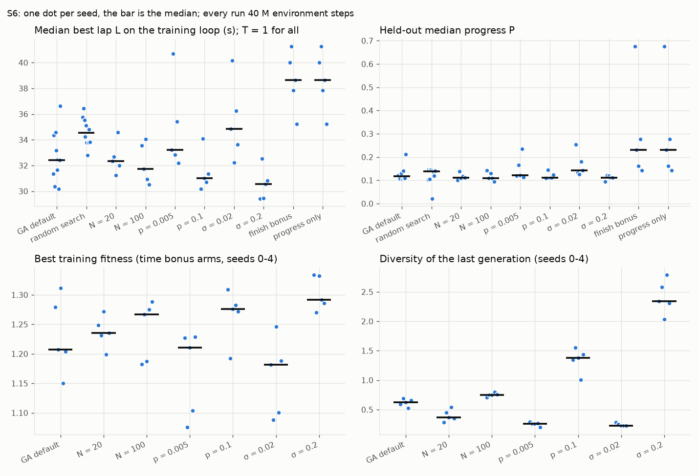
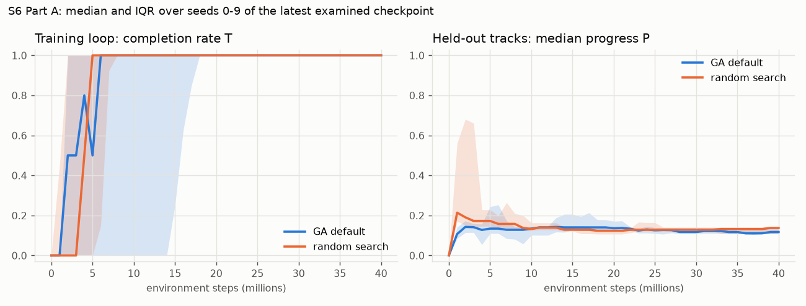
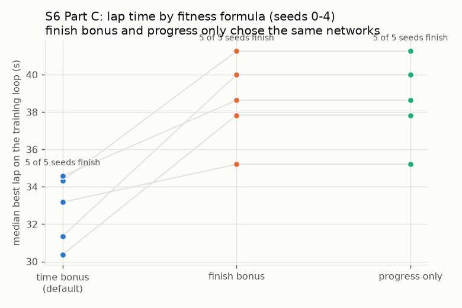
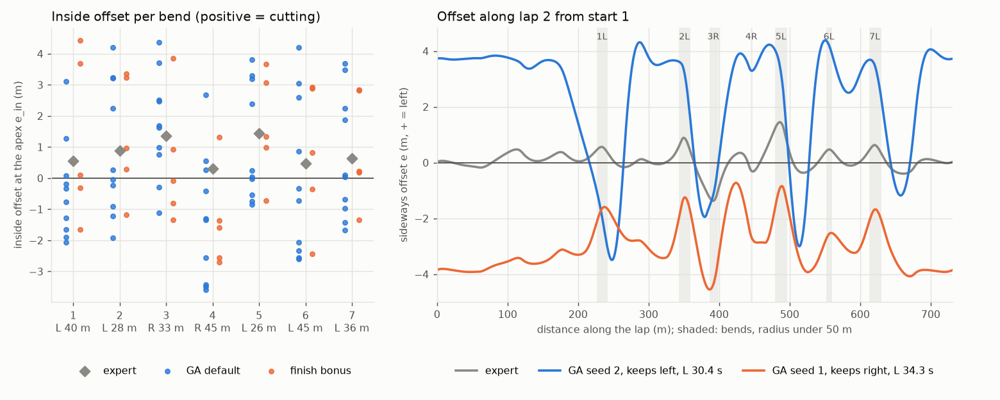

# Study S6 — How do population size, mutation and fitness design shape evolution? Does the GA beat random search? Does evolution find a racing line?

Task 7.9 (Phase 7), ADR-062. Design and hypotheses were written in the task Brief on 2026-11-16,
before any S6 run. The numbers come from `scripts/study_s6.py` and are in
[`S6_results.json`](S6_results.json) (the same bytes on every analysis of the same runs).

## Question and hypotheses

Five questions, all answered on the Driving Exam (exam v1) at an equal budget of 40 M
environment steps per run:

- **Part A:** does the genetic algorithm (GA) beat random search, given the same driving?
- **Part B:** how do the population size N, the mutation rate p and the mutation strength σ change it?
- **Part C:** what happens when the fitness loses its time bonus (f = p + c), or its finishing reward too (f = p)?
- **Part D:** do the answers hold on the four held-out tracks?
- **Part E:** do evolved finishers take a racing line through the training loop's bends, and is it the time bonus that makes them?

Symbols:
- **T**: the share of the training loop's 10 exam starts the chosen network finishes.
- **L**: its median best lap there, over finished drives.
- **P**: its median progress over the 40 held-out episodes.
- **C**: its held-out completion rate.
- **e_in**: the inside offset at a bend's apex (positive = cutting).

Each arm is paired seed by seed: Part A uses seeds 0–9, Parts B and C use the default GA's seeds 0–4. Each paired difference is the median of the per-seed differences, with a bootstrap 95 % interval (10,000 resamples, seed 2026). "Supported" needs the expected sign and an interval that excludes 0. A paired rule with fewer than 3 usable seeds is reported as not testable.

| | Hypothesis, as written before any run | Rule |
|---|---|---|
| G1 | The GA beats random search on the training loop | median paired T(GA) − T(RS) > 0, interval excluding 0; *mastery:* T = 1 in ≥ 5 of 10 GA seeds |
| G2 | … and on held-out tracks | median paired P(GA) − P(RS) > 0, interval excluding 0 |
| N1 | A middle population is best at equal steps | median best fitness of N = 50 ≥ that of N = 20 and of N = 100 |
| M1 | Mutation keeps diversity | median final diversity rises with p (0.005 < 0.02 < 0.1) and with σ (0.02 < 0.05 < 0.2) |
| M2 | Too strong mutation hurts | best fitness of p = 0.1 and of σ = 0.2 each below the default's (paired, interval excluding 0) |
| F1 | The time bonus buys speed | L(finish_bonus) − L(default) > 0, paired, interval excluding 0 |
| F2 | Finishing needs a reward | median T(progress) ≤ median T(finish_bonus) |
| R1 | Evolved finishers cut the apex more than the expert (restated before any run, see below) | per default-GA seed, its median e_in minus the expert's; median > 0, interval excluding 0 |
| R2 | … because of the time bonus | median paired e_in(default) − e_in(finish_bonus) > 0, interval excluding 0 |

**R1 was restated before any S6 run.** It was first written as "the default's median e_in ≥ 0.5 m while the expert's |e_in| < 0.2 m", on the premise that the scripted expert keeps to the centreline. Building the measure showed that premise was wrong (`tests/experiment/test_racing_line.py`):
- pure pursuit aims at the centreline 8 m + 0.5 v ahead, so it drives the chord of every bend;
- it cuts every apex, by 0.30–1.43 m per bend, median **0.63 m**.

The restated R1 asks whether evolution cuts *more* than that.

## What changed versus what was held fixed

Each arm is its shipped config (`configs/ga.yaml`, or `configs/random_search.yaml`) with exactly one change; a test checks this.

| Arm | Change | Seeds |
|---|---|---|
| `ga` | none: N 50, E 2, tournament k 3, crossover c 0.5, p 0.02, σ 0.05, time bonus | 0–9 |
| `random_search` | random search instead of the GA (20 fresh networks per unit, keep the best) | 0–9 |
| `n20`, `n100` | population size N = 20, N = 100 | 0–4 |
| `p005`, `p01` | mutation rate p = 0.005, p = 0.1 (σ fixed) | 0–4 |
| `s002`, `s02` | mutation strength σ = 0.02, σ = 0.2 (p fixed) | 0–4 |
| `finish_bonus` | `fitness.formula: finish_bonus`, f = p + c | 0–4 |
| `progress` | `fitness.formula: progress`, f = p | 0–4 |

Held fixed in every arm:
- the network [7, 16, 16, 2], tanh/tanh, Xavier initialisation;
- the evaluation: the exam's 10 starts on `train_loop_01`, 2 laps, a 92 s limit;
- the budget: **40 M environment steps**, no unit limit; a run stops after the unit that crosses it, so it overshoots by at most one generation;
- the checkpoint rule: `best_unit`, the unit with the highest training fitness (it reads `metrics.jsonl` only).

Fitness is compared only within one formula (protocol rule 3).

## Setup

- **Code:**
  - `fitness.formula` (ADR-062) in `learn/evolution/random_search.py`, `ga.py`, `experiment/config.py` and the live race in `server/live.py`;
  - the racing-line measure in `experiment/racing_line.py`;
  - the study in `scripts/study_s6.py`, figures in `scripts/study_s6_figures.py`.
- **Training:** `uv run python scripts/study_s6.py --train --only-train --workers 11`, on 2026-11-16. There were 11 processes, each with one BLAS thread, on an i5-13420H (4 performance cores with 2 threads each, 4 efficiency cores). Every run is tagged `"study": "S6"`.
- **Exams:** the two Part A arms are examined at every checkpoint, which is every new best plus the schedule 0, 1, 2, 5, 10, …. That gives a learning curve over environment steps. The other eight arms train without exams, and only their chosen checkpoint is examined afterwards.
- **Racing line (Part E):** every chosen checkpoint, and the expert, drives the training loop's 10 exam starts again. For each bend, every complete pass of a finished drive is read:
  - e_in, the inside offset at the apex;
  - e_wide, the outside offset 20 m before it;
  - e_exit, the outside offset 20 m after it.
  - Per network, the value is the median over all its passes. A bend is a stretch where the centreline radius is under 50 m: the loop has 7, with radii 26–45 m.
- **Unseen starts (exploratory, not a hypothesis):** every chosen checkpoint also drives the training loop from the 10 starts halfway between the exam's (fractions 0.1, 0.3, 0.5, 0.7, 0.9, lateral 0 and 1.5 m). The fitness never scored these.
- **Determinism check:** the default GA's seed 0 has the same config and seed as task 7.5's run `20261113-123056-ga-race76`, which ran 30 generations.

## Results

All 60 runs completed and every number below comes from them. Each run ended between 40.0 and 41.6 M environment steps.
- **Analysis:** `uv run --with matplotlib python scripts/study_s6.py --figures` gave the same `S6_results.json` bytes twice (SHA-256 `5d8cdb79…`).
- **Determinism:** the default GA's seed 0 matches task 7.5's run on all 30 of its generations, in both `population.jsonl` and `metrics.jsonl` (every field but the clock).
- **Re-drives:** every chosen checkpoint, driven again for Part E, finished exactly the training-loop starts its exam card says.
- **Database:** the mirror lists the same 60 runs as the folders. `nd db check` is clean after `nd db rebuild`; the 30 differences it repaired were all DAgger runs from 10–11 November, none from S6.

### The chosen checkpoint of every arm (median [IQR] over seeds)

**T = 1 in every one of the 60 runs:** every chosen network laps all 10 training starts twice. The columns therefore show what differs.

| Arm | L (s) | P | C | Best fitness | Final diversity | e_in (m) |
|---|---|---|---|---|---|---|
| `ga` (10 seeds) | 32.4 [31.4, 34.0] | 0.117 [0.107, 0.132] | 0.00 [0.00, 0.00] | 1.227 [1.205, 1.276] | 0.61 [0.55, 0.65] | 0.08 [−0.67, 2.16] |
| `random_search` (10) | 34.5 [33.8, 35.4] | 0.138 [0.109, 0.144] | 0.06 [0.00, 0.25] | 1.183 [1.171, 1.191] | – | 0.32 [0.11, 0.60] |
| `n20` | 32.3 [32.0, 32.7] | 0.112 [0.110, 0.117] | 0.00 [0.00, 0.00] | 1.235 [1.231, 1.249] | 0.37 [0.35, 0.45] | −0.54 [−0.81, −0.31] |
| `n100` | 31.7 [30.9, 33.6] | 0.110 [0.108, 0.131] | 0.00 [0.00, 0.20] | 1.267 [1.187, 1.275] | 0.75 [0.75, 0.76] | 1.12 [−0.55, 1.56] |
| `p005` | 33.2 [32.8, 35.4] | 0.122 [0.119, 0.166] | 0.00 [0.00, 0.25] | 1.211 [1.104, 1.227] | 0.25 [0.25, 0.27] | −0.32 [−0.39, −0.32] |
| `p01` | 31.0 [30.7, 31.4] | 0.111 [0.109, 0.123] | 0.25 [0.00, 0.25] | 1.276 [1.272, 1.282] | 1.37 [1.35, 1.43] | 1.88 [1.77, 3.24] |
| `s002` | 34.9 [33.6, 36.3] | 0.142 [0.133, 0.181] | 0.00 [0.00, 0.00] | 1.181 [1.100, 1.188] | 0.23 [0.23, 0.25] | −0.34 [−0.58, 0.52] |
| `s02` | 30.5 [29.4, 30.8] | 0.112 [0.110, 0.119] | 0.00 [0.00, 0.00] | 1.292 [1.286, 1.332] | 2.34 [2.31, 2.58] | 3.13 [2.73, 3.45] |
| `finish_bonus` | 38.6 [37.8, 40.0] | 0.231 [0.162, 0.276] | 0.00 [0.00, 0.17] | 2.000 (its own scale) | 0.81 [0.69, 0.89] | 0.23 [0.18, 2.88] |
| `progress` | 38.6 [37.8, 40.0] | 0.231 [0.162, 0.276] | 0.00 [0.00, 0.17] | 1.000 (its own scale) | 0.74 [0.73, 0.89] | 0.23 [0.18, 2.88] |
| expert (reference) | – | – | – | – | – | 0.63 |

### The hypotheses, as written

| | Result | Supported? |
|---|---|---|
| G1 | T(GA) − T(RS): **+0.000 [0.000, 0.000]**, 10 seeds. Every network of both arms has T = 1. Mastery: T = 1 in **10 of 10** GA seeds (the phase goal, ≥ 5, is met) | **No** (mastery: yes) |
| G2 | P(GA) − P(RS): −0.005 [−0.022, +0.037] | **No** |
| N1 | median best fitness: N 20 1.235, **N 50 1.208** (seeds 0–4), N 100 1.267. N 50 is the lowest of the three. Paired against N 50: N 20 +0.024 [−0.040, +0.049], N 100 +0.059 [−0.124, +0.125], both unclear | **No** |
| M1 | median final diversity: p 0.005 → 0.02 → 0.1: **0.25 < 0.63 < 1.37**; σ 0.02 → 0.05 → 0.2: **0.23 < 0.63 < 2.34** | **Yes** |
| M2 | best fitness of p 0.1 − default: +0.030 [−0.035, +0.132]; of σ 0.2 − default: **+0.062 [+0.021, +0.142]**. Strong mutation did not hurt; σ = 0.2 clearly *helped* | **No** (the opposite, for σ) |
| F1 | L(finish_bonus) − L(default): **+6.9 s [+2.0, +8.6]**, 5 of 5 seeds | **Yes** |
| F2 | median T: progress 1.0, finish_bonus 1.0 (equal, so "≤" holds) | **Yes**, trivially: see Part C |
| R1 | e_in(default seed) − e_in(expert, 0.63 m): −0.55 m [−1.44, +1.88] | **No** |
| R2 | e_in(default) − e_in(finish_bonus): −0.42 m [−1.45, +0.37] | **No** |

### Part A: the GA against random search

Both methods mastered the training loop at this budget. That was not expected: in Study S4, random search had never lapped it in 200 units (4.5 M steps). Here it scored 34,340 networks per run (1,717 units), and in every seed one of them finished all 10 starts.

The median exam first showed T = 1 at about 3.8 M steps for the GA and 3.9 M for random search. Pairing them, the GA came 1.2 M steps later [−1.3 M, +6.9 M]: unclear. The wide IQR band in the figure comes from two GA seeds whose first full finisher arrived late, at generations 27 and 32.

What separates the two methods once both can finish (exploratory, not hypotheses):
- **lap time:** the GA laps faster, L(GA) − L(RS) = **−2.1 s [−3.6, −0.4]**;
- **fitness:** the GA's best fitness is +0.059 [−0.002, +0.111];
- **held-out completion:** C(GA) − C(RS) is −0.06 [−0.25, 0.00].

The GA turns the same driving into faster laps on the track it is scored on, and into nothing better anywhere else.

### Part B: population size and mutation

Diversity behaves as M1 predicted, monotone in both p and σ. Everything else came out differently from the prediction:
- **Strong mutation:** the most diverse arms (σ = 0.2, p = 0.1) reached the highest fitness and the fastest laps. Against the default on seeds 0–4: σ = 0.2 L **−1.9 s [−4.0, −0.9]**, fitness **+0.062 [+0.021, +0.142]**; p = 0.1 L −1.2 s [−3.9, +0.6].
- **Weak mutation:** the least diverse arm was clearly worse. σ = 0.02 L **+1.8 s [+0.4, +5.8]**, fitness **−0.065 [−0.119, −0.016]**. It is also the slowest arm to produce a full finisher: generation 26, 15.4 M steps (median), against 12.5 and 3.8 M for the default.

Task 7.4 found σ = 0.1 too strong for *refining a trained driver*. With elitism keeping the best two unchanged, strong mutation costs nothing at the top and keeps the search moving, which is what 40 M steps reward. Population size made no clear difference: N 20 ran 117 generations, N 100 ran 28, and both are within noise of N 50 on every measure.

### Part C: what the fitness formula does

**finish_bonus and progress chose the same network in every seed**: the same generation, with identical weights. Two facts explain it, and both are in `S6_results.json`:

1. **They share the default's early history exactly.** Until some car finishes a start, every formula is f = p, because c = 0 everywhere. The same seed then means the same selections and mutations. Their populations are identical to the default GA's, generation for generation, until generations 10–19 (`shared_history`), which is 2–4 generations after the first finished start.
2. **Both formulas have a ceiling.** A network that finishes all 10 starts scores the maximum: 2.0 under finish_bonus, 1.0 under progress. No later network can beat it, only tie, and the elite keeps the first. So the chosen checkpoint is the *first* full finisher (generations 7–18, 1.3–18.8 M steps). Nothing after it counts.

**F1 is supported:** without the time bonus the chosen networks are 6.9 s slower per lap [+2.0, +8.6]. F2's "≤" holds only because the two arms are the same networks.

The ablation networks do better on held-out tracks: P **+0.119 [+0.014, +0.552]** over the default. That gain is the *earlier checkpoint*, not the formula:
- The default GA's own first examined checkpoint that laps every training start has the same held-out progress as the finish-bonus networks: difference **0.000 [0.000, +0.047]**.
- Within the default GA, that first all-lapping checkpoint beats the chosen one by **+0.046 [+0.014, +0.119]** in P (10 seeds). Seed 0 drops from 0.63 to 0.12.

The generations spent getting faster on the training loop make the drivers worse elsewhere.

### Part D: held-out tracks

No arm generalises. Median P is 0.11–0.23 in every arm: a car covers a tenth to a fifth of two laps before crashing.
- **Where completions happen:** of the 19 networks with C > 0, 15 finish only on `train_loop_01_mirror`, the training loop driven the other way round; 4 finish on `sweeper_01`. No network finished a drive on `hairpins_01` or `monza_ccw`.
- **Medians over all 60 networks:** P is 0.095 on hairpins, 0.106 on Monza, 0.213 on the sweeper and 0.451 on the mirror.
- **Overfit flag:** 41 of 60 networks have T = 1 and C = 0.

### Part E: the racing line

R1 and R2 fail because evolved networks do not converge on one line. Their median e_in ranges from −1.4 m to +3.2 m between GA seeds, against the expert's 0.63 m.

The per-bend offsets (left panel) show what they do instead: **most networks pick a side of the road and keep it.** This classification was made after seeing the data (post hoc, `post_hoc_side_of_road`): median offset e over the finished drives, "left" above +1 m, "right" below −1 m.

| Side kept | Networks | Median L (s) [IQR] |
|---|---|---|
| left (the inside of the anticlockwise loop) | 22 | 31.3 [30.6, 34.0] |
| middle | 17 | 34.8 [32.8, 38.6] |
| right (the outside) | 21 | 34.1 [32.8, 35.2] |

- **Why left wins:** the loop turns anticlockwise, five of its seven bends are left-handers, and the left side is the shorter way round. Progress is measured along the centreline, so a car on the inside gains progress faster than it drives. Left-keepers sit 3–4 m inside at the left bends and about 3 m on the outside of the right-hander, bend 4. They do not cross over for it, as a racing driver would.
- **Lap time:** the offset's rank correlation with lap time is −0.30; for e_in it is −0.35. Further left is faster.
- **Which arms keep left:** all five σ = 0.2 networks keep left. Seven of the ten random-search networks stay in the middle, close to the centreline like the expert.
- **The expert:** it comes in slightly inside (e_wide −0.12 m), cuts by 0.63 m and exits 0.12 m wide. No evolved network shows that shape consistently.

### Exploits searched for

- **Overfit (T = 1, held-out C = 0):** 41 of 60, in every arm.
- **Unseen starts:** the 10 training-loop starts halfway between the exam's, which the fitness never scored.
  - 54 of the 60 masters lap all 10. So the networks have not learned the 10 starting positions; they have learned the *loop*.
  - The six that miss some are GA seed 8 (8 of 10), random search seeds 0 and 5, N 100 seed 4, and the shared finish_bonus/progress seed 2.
- **Just in time:** no network has a training-loop finish within 2 s of the 92 s limit.
- **Jerky (the worst tenth for smoothness):** GA seed 1 (0.0109), p 0.1 seed 1, σ 0.02 seed 1, σ 0.2 seed 1, and the finish_bonus/progress seed 4. All are also overfit.

**The documented exploit is the inside line of Part E.** The fitness rewards centreline progress per second, so hugging the inside of an anticlockwise loop pays without driving any faster in metres per second. The designer did not ask for it, and it does not transfer: the mirror track turns clockwise. To watch it, open Timeline → `20261115-223923-ga-s6-ga-s2` (GA seed 2, unit 53, median offset left, L 30.4 s) and race generation 53 from start 1.

## Failure analysis

**The default GA's worst held-out episode** is run `20261115-220645-ga-s6-ga-s1` (GA seed 1), chosen checkpoint unit 42:
- **Track and start:** `hairpins_01`, start 2 (index 1: arc length 307.9 m, centred).
- **Outcome:** it crashed after 77 steps (2.6 s), having covered 0.34 % of two laps at a mean speed of 5.1 m/s.

The drive was replayed exactly as the exam drives it, and the replay ended the same way as the card. Three moments before the crash (rays in metres, o7 in degrees):

| | Rays far-left … far-right | Speed | Heading error | Network steer, throttle | Expert steer, throttle |
|---|---|---|---|---|---|
| 1 s before (step 47) | 24, 15, 8.6, 5.9, 5.0 m | 6.5 m/s | −22° (pointing right of the road) | −0.004, 0.42 | −0.66, 1.00 |
| 0.5 s before (step 62) | 20, 9.7, 5.0, 3.6, 3.3 m | 7.5 m/s | −33° | −0.005, 0.28 | −0.71, 1.00 |
| last step (76) | 13, 3.2, 1.4, 1.0, 1.0 m | 7.9 m/s | −44° | −0.000, 0.11 | −0.67, 0.92 |

**What went wrong:**
- The road turns left in front of the car: the open space is on the left, the wall closes in ahead and on the right, and the heading error grows from −22° to −44°.
- The expert would steer two-thirds left the whole time. The network does not steer at all (|steer| < 0.005). It only lifts the throttle from 0.42 to 0.11 as the wall comes close, and drives straight into it.
- On the training loop the same network steers well. This combination of readings is far from anything the 10 training starts produced: a hairpin turning left at low speed with a large heading error.
- I could not open the Network view myself. The same drive replays in Experiment → Timeline: run `20261115-220645-ga-s6-ga-s1`, unit 42, track `hairpins_01`, start 2. It should show which hidden neurons stay saturated while the steering output sits at 0.

## Conclusion

- **The phase goal is met.** The default GA masters the training loop in 10 of 10 seeds, and every one of the 60 S6 networks does.
- **The GA does not beat random search on the exam at 40 M steps (G1, G2 not supported).** Both master the loop and neither generalises. The GA's advantage is speed on the track it is scored on, 2.1 s per lap, which is fitness, not driving skill. S4's "random search cannot lap" was a statement about 4.5 M steps, not about the method.
- **Mutation:** diversity follows p and σ exactly as predicted (M1). Strong mutation (σ 0.2) helped rather than hurt (M2 reversed), and very weak mutation (σ 0.02) was clearly worse.
- **Population size** made no clear difference at equal steps (N1 not supported).
- **The time bonus is what buys speed (F1).** Without it, evolution stops at the first network that can finish. The finish-only formulas cannot rank finishers at all, which is a design flaw of the formulas, not a property of evolution.
- **Generality is lost late.** The first checkpoint that laps every training start generalises better than the faster ones evolved after it. Phase 8 should keep that in mind when it picks a GA checkpoint: `best_unit` selects for training-loop speed, and that costs held-out progress.
- **No racing line emerged (R1, R2 not supported).** Evolution found a cheaper trick: keep to the inside of the loop and collect centreline progress faster.
- **Uncertainty:** Part B and C arms have 5 seeds, so their intervals are wide; "unclear" there means *not shown*, not *no effect*. All of this is one training track and one budget. Fresh random evaluation starts (ADR-055 D2B) remain the obvious next variant against overfitting.

## What this teaches about AI

An optimiser finds whatever the score rewards, including what the designer never meant. Here that was progress along a centreline, which a car can collect by hugging the inside. It was also a training track learned by heart, so 60 networks that "mastered" it mostly cannot drive a hairpin. Equal budgets matter: given enough driving, the plainest method, random search, also masters the loop. Comparing methods by how fast they reach a score says little once both reach it; what they do on unseen tracks is the real test. Finally, the score saturates: a fitness with a ceiling stops selection the moment the ceiling is hit.

## Run IDs

All under `runs/` (local, never committed), each with `"study": "S6"` in `meta.json`.

| Arm | Seed: run ID |
|---|---|
| `finish_bonus` | 0: `20261116-002037-ga-s6-finish-s0`, 1: `20261116-002101-ga-s6-finish-s1`, 2: `20261116-002246-ga-s6-finish-s2`, 3: `20261116-002407-ga-s6-finish-s3`, 4: `20261116-002409-ga-s6-finish-s4` |
| `ga` | 0: `20261115-213455-ga-s6-ga-s0`, 1: `20261115-220645-ga-s6-ga-s1`, 2: `20261115-223923-ga-s6-ga-s2`, 3: `20261115-224906-ga-s6-ga-s3`, 4: `20261115-224946-ga-s6-ga-s4`, 5: `20261115-224955-ga-s6-ga-s5`, 6: `20261115-224957-ga-s6-ga-s6`, 7: `20261115-225028-ga-s6-ga-s7`, 8: `20261115-225037-ga-s6-ga-s8`, 9: `20261115-225043-ga-s6-ga-s9` |
| `n100` | 0: `20261115-225102-ga-s6-n100-s0`, 1: `20261115-225149-ga-s6-n100-s1`, 2: `20261115-225207-ga-s6-n100-s2`, 3: `20261115-232150-ga-s6-n100-s3`, 4: `20261115-233447-ga-s6-n100-s4` |
| `n20` | 0: `20261116-012206-ga-s6-n20-s0`, 1: `20261116-014857-ga-s6-n20-s1`, 2: `20261116-014908-ga-s6-n20-s2`, 3: `20261116-015103-ga-s6-n20-s3`, 4: `20261116-015242-ga-s6-n20-s4` |
| `p005` | 0: `20261116-010418-ga-s6-p005-s0`, 1: `20261116-010444-ga-s6-p005-s1`, 2: `20261116-010637-ga-s6-p005-s2`, 3: `20261116-010741-ga-s6-p005-s3`, 4: `20261116-010753-ga-s6-p005-s4` |
| `p01` | 0: `20261115-233551-ga-s6-p01-s0`, 1: `20261115-233632-ga-s6-p01-s1`, 2: `20261115-233702-ga-s6-p01-s2`, 3: `20261115-233835-ga-s6-p01-s3`, 4: `20261115-233855-ga-s6-p01-s4` |
| `progress` | 0: `20261116-002606-ga-s6-progress-s0`, 1: `20261116-003244-ga-s6-progress-s1`, 2: `20261116-003347-ga-s6-progress-s2`, 3: `20261116-003605-ga-s6-progress-s3`, 4: `20261116-003648-ga-s6-progress-s4` |
| `random_search` | 0: `20261115-213455-random_search-s6-rs-s0`, 1: `20261115-213455-random_search-s6-rs-s1`, 2: `20261115-213455-random_search-s6-rs-s2`, 3: `20261115-213455-random_search-s6-rs-s3`, 4: `20261115-213455-random_search-s6-rs-s4`, 5: `20261115-213455-random_search-s6-rs-s5`, 6: `20261115-213455-random_search-s6-rs-s6`, 7: `20261115-213455-random_search-s6-rs-s7`, 8: `20261115-213455-random_search-s6-rs-s8`, 9: `20261115-213455-random_search-s6-rs-s9` |
| `s002` | 0: `20261116-010908-ga-s6-s002-s0`, 1: `20261116-011007-ga-s6-s002-s1`, 2: `20261116-011635-ga-s6-s002-s2`, 3: `20261116-011845-ga-s6-s002-s3`, 4: `20261116-012050-ga-s6-s002-s4` |
| `s02` | 0: `20261115-234015-ga-s6-s02-s0`, 1: `20261115-234821-ga-s6-s02-s1`, 2: `20261115-234921-ga-s6-s02-s2`, 3: `20261115-235106-ga-s6-s02-s3`, 4: `20261116-002037-ga-s6-s02-s4` |
